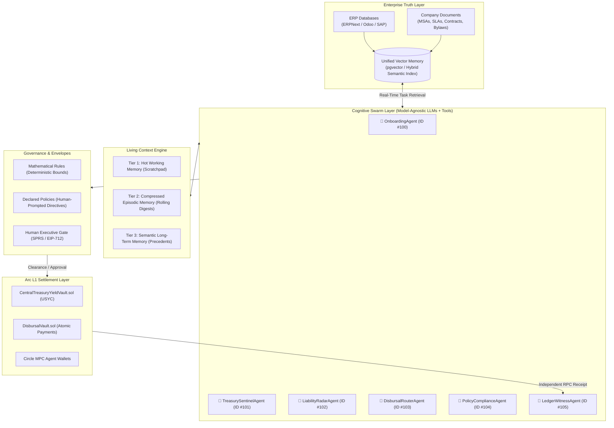
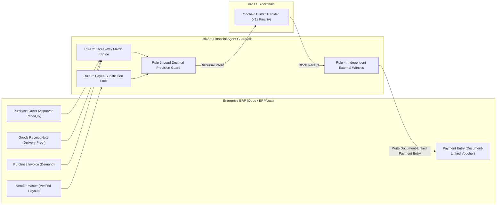
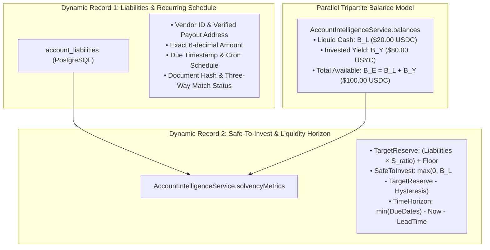

# BizArc: Autonomous Multi-Agent Treasury & Financial Operations Platform
## Comprehensive Architectural Alignment Plan

---

### Executive Summary

This **Alignment Plan** consolidates the complete architectural vision, technical specifications, and operational mechanics of the **BizArc Autonomous Multi-Agent Treasury & Financial Operations Platform**. 

BizArc is an enterprise-grade financial operating system designed for **Arc Layer-1 Blockchain** (native USDC gas, sub-second deterministic finality, and ERC-4626 USYC tokenized short-term US Treasury yield vault integration). The system eliminates idle capital across enterprise operational accounts without risking payment defaults or liquidity shortfalls.

Unlike naive deterministic scripts or brittle hardcoded bots, BizArc is engineered as a **genuine, model-agnostic Multi-Agent Swarm**. Each agent is an autonomous Large Language Model (LLM) equipped with structured function-calling tools, persistent working memory, and specialized institutional personas. All agents operate on a **Single Continuous Running Context** governed by a **Multi-Tiered Context Management System**, continuous background context compaction, a unified **Enterprise Vector Database** for corporate documents and ERP retrievals, and inviolable onchain smart contract safety envelopes.

---

## 1. Core Architectural Pillars



The system operates across six foundational pillars:
1. **Model-Agnostic Multi-Agent Cognitive Swarm**: Autonomous LLMs driving reasoning, perception, intent formulation, and structured tool invocation.
2. **Single Continuous Living Context Stream**: A shared blackboard where all agents read, deliberate, and publish in a unified operational timeline.
3. **Multi-Tiered Context Management & Rolling Compaction**: Hot working memory (Tier 1), compressed episodic narrative (Tier 2), and semantic long-term memory (Tier 3), preventing token window overflow while preserving the *Financial Fidelity Invariant*.
4. **Enterprise Vector Database Grounding**: Real-time semantic retrieval over company agreements, board resolutions, and ERP records for every task.
5. **The Two Dynamic Records & Tripartite Balance Model**: Continual tracking of all liabilities, liquidity horizons, and total effective solvency ($B_E = B_L + B_Y$).
6. **Dual-Tier Policy Governance & Reason-Bearing Intent**: Strict segregation between Operator and Enforcer, requiring explicit commercial rationale (`declaredReason`) evaluated against mathematical bounds and human-declared policies.

---

## 2. Model-Agnostic Multi-Agent Architecture

### 2.1 The Agentic Deliberation Paradigm (LLMs + Tools vs. Deterministic Scripts)
In standard corporate software, workflows are hardcoded: `if (balance > threshold) sweep()`. In real-world enterprise operations, rigid deterministic scripts fail because corporate finance is filled with messy, unstructured, and ambiguous edge cases:
- An invoice contains a stealth 18% price hike obscured inside an unannounced seat-tier restructuring.
- A vendor offers a 2/10 Net 30 early settlement discount that exceeds the annualized USYC yield.
- A client payment clears into the wrong cost-center wallet during a bank reconciliation window.
- An urgent cloud infrastructure bill is due in 12 hours while operating cash is temporarily deployed in yield shares.

BizArc replaces rigid hardcoded logic with **Cognitive Agent Swarms**. Each agent is an autonomous LLM running a continuous **ReAct (Reason + Act)** deliberation loop:
$$\text{Observation} \longrightarrow \text{Deliberation (Thought / declaredReason)} \longrightarrow \text{Action (Tool Call)} \longrightarrow \text{Environment Feedback} \longrightarrow \text{Resolution}$$

The underlying deterministic services (database repositories, smart contract encoders, Arc RPC clients, mathematical bound validators) are **tools** provided to the LLMs. The LLM acts as the conscious brain; the tools act as the inviolable hands.

### 2.2 Model-Agnostic Engine (`ILlmEngine`)
BizArc is completely model-agnostic and provider-neutral. It supports any standard Chat Completion and Function Calling endpoint:
- **Commercial APIs**: Google Gemini 2.5/Pro via Gemini API, OpenAI GPT-4o, Anthropic Claude 3.7 Sonnet.
- **Open-Weights & Local Runners**: DeepSeek-R1/V3, Llama 3.3 70B, Qwen 2.5 running locally via Ollama, vLLM, or LMDeploy.
- **Unified Interface**: Configured via environment variables (`LLM_BASE_URL`, `LLM_API_KEY`, `LLM_MODEL`, `LLM_EMBEDDING_MODEL`), allowing instant hot-swapping of models without changing any agent code.

```typescript
export interface ToolSchema {
  name: string;
  description: string;
  parameters: {
    type: "object";
    properties: Record<string, any>;
    required?: string[];
  };
}

export interface AgentChatMessage {
  role: "system" | "user" | "assistant" | "tool";
  content?: string;
  senderAgent?: string;
  tool_calls?: {
    id: string;
    name: string;
    arguments: Record<string, any>;
  }[];
  tool_call_id?: string;
  timestamp: string;
}

export interface ILlmEngine {
  chat(messages: AgentChatMessage[], tools: ToolSchema[]): Promise<{
    thought?: string;
    toolCalls?: { id: string; name: string; arguments: Record<string, any> }[];
    content?: string;
  }>;
  embedText(text: string): Promise<number[]>;
}
```

### 2.3 The Agent Persona Matrix & Segregation of Duties
To eliminate single-agent failure modes, authority is strictly segregated across specialized agent personas:

| Agent Persona | ERC-8004 ID | Primary Mandate | Private Key / Signing Privilege | Ledger Write Privilege | Core Tool Capabilities |
|---|:---:|---|:---:|:---:|---|
| **`OnboardingAgent`** | `#100` | Automated corporate intake, ERP discovery, policy synthesis, wallet provisioning | **Yes** (initial setup) | **No** (defers to witness) | `inspect_erp_database`, `parse_intake_documents`, `generate_policy_proposal`, `provision_arc_wallets`, `generate_otp_handoff` |
| **`TreasurySentinelAgent`** | `#101` | Capital optimization, safe-to-invest forecasting, USYC sweeps, predictive recall | **Yes** (sweep / recall) | **No** (defers to witness) | `get_account_intelligence`, `calculate_liquidity_horizon`, `submit_intent_to_compliance`, `execute_vault_sweep`, `execute_vault_recall` |
| **`LiabilityRadarAgent`** | `#102` | Forensic AP auditing, Three-Way Matching, zombie subscription hunting, 48h pre-flight SPRS | **No** | **No** (defers to witness) | `extract_invoice_data`, `query_vendor_master`, `verify_three_way_match`, `flag_payee_anomaly`, `draft_cancellation_memo` |
| **`DisbursalRouterAgent`** | `#103` | Cross-account liquidity routing, multi-account waterfall planning, atomic settlement | **Yes** (staged transfers) | **No** (defers to witness) | `evaluate_account_qualification`, `plan_waterfall_allocation`, `stage_disbursal_vault_funds`, `execute_atomic_payment` |
| **`PolicyComplianceAgent`** | `#104` | Chief Risk & Governance Gatekeeper, EIP-712 human liaison, reason evaluation | **No** | **No** (defers to witness) | `evaluate_mathematical_rules`, `evaluate_declared_policies`, `issue_clearance_token`, `emit_sprs_to_human`, `verify_eip712_signature` |
| **`LedgerWitnessAgent`** | `#105` | Zero-signing independent external auditor, double-entry voucher creator, hash chainer | **No** (strictly read-only) | **Yes** (exclusive ledger writer) | `watch_arc_rpc_receipts`, `verify_execution_receipt`, `record_double_entry_voucher`, `append_hash_chained_journal` |

---

## 3. The Continuous Running Context & Multi-Tiered Context System

### 3.1 The Single Living Blackboard Paradigm
Traditional multi-agent frameworks spawn isolated conversational threads for each sub-task, destroying context continuity. In BizArc, all agents operate against **One Continuous Running Context Stream**. 

The context stream is a shared operational bus. When any agent thinks, acts, calls a tool, or reports an environmental event, that interaction is published to the shared context. All other agents observe this evolving state in real time:
1. `LiabilityRadarAgent` observes an incoming invoice and records:
   `[LiabilityRadarAgent] INGESTED: AWS Invoice $2,500 due in 24h on acc_engineering. Delivery receipt GRN-991 confirmed. Status: SCHEDULED.`
2. `TreasurySentinelAgent` reads this update directly from the shared context, calculates that liquid cash is only $\$500$ while $\$10,000$ is in USYC, and immediately outputs:
   `[TreasurySentinelAgent] PROPOSAL: Sourcing liquidity for AWS payable. Intent: RECALL $2,000 from USYC. declaredReason: Pre-funding verified AWS liability due in 24h to avoid default.`
3. `PolicyComplianceAgent` reads Sentinel's intent and declared rationale, checks against declared human policies, and responds:
   `[PolicyComplianceAgent] EVALUATION: Action matches declared policy 'Liquidity Urgency Overrides'. Target reserve relaxed for scheduled payable. PERMIT issued (Clearance Code #CLEAR-8812).`
4. `TreasurySentinelAgent` receives clearance and calls `execute_vault_recall`.
5. `LedgerWitnessAgent` witnesses the transaction confirmation on Arc L1, verifies that $\$2,000$ USDC arrived in `acc_engineering`, and writes Voucher `#1092` to the hash-chained journal.

### 3.2 The Three Tiers of Context Memory

```
┌──────────────────────────────────────────────────────────────────────────────────────────────────┐
│ TIER 1: HOT WORKING MEMORY (Active Context Scratchpad)                                           │
│ • Rolling window of recent 20–50 conversational, deliberation, and event turns.                 │
│ • Active tool execution payloads (raw invoice extractions, temporary simulation states).         │
│ • Real-time notifications (Arc System Emitter Transfer events, ERP webhook triggers).            │
│ • Pending approval requests awaiting admin resolution.                                           │
└───────────────────────────────────────────────┬──────────────────────────────────────────────────┘
                                                │ Eviction Trigger (> 8,000 tokens or > 30 turns)
                                                ▼
┌──────────────────────────────────────────────────────────────────────────────────────────────────┐
│ TIER 2: COMPRESSED EPISODIC MEMORY (Rolling Operational Narrative)                               │
│ • Background compaction engine summarizes completed operational cycles into Episode Blocks.      │
│ • Condenses hundreds of verbose tool calls into structured, factual state deltas.                │
│ • DUAL-STREAM COMPACTION: Preserves narrative reasoning while strictly locking exact financial   │
│   numbers (6-decimal balances, tx hashes, voucher IDs) via deterministic anchors.               │
└───────────────────────────────────────────────┬──────────────────────────────────────────────────┘
                                                │ Knowledge Distillation & Precedent Extraction
                                                ▼
┌──────────────────────────────────────────────────────────────────────────────────────────────────┐
│ TIER 3: SEMANTIC LONG-TERM MEMORY (Persistent Enterprise Vector Store)                          │
│ • High-dimensional vector index backed by PostgreSQL (pgvector).                                 │
│ • Permanent repository for: Corporate Bylaws, Master Service Agreements (MSAs), Board Spending   │
│   Resolutions, Historical Vendor Trust Ratings, Past Human SPRS Approval Precedents.             │
│ • Dynamically queried on demand via hybrid vector cosine + metadata filter search.               │
└──────────────────────────────────────────────────────────────────────────────────────────────────┘
```

### 3.3 Continuous Context Compression & The Financial Fidelity Invariant

#### The Compaction Hazard
Standard LLM text summarization algorithms routinely corrupt financial data:
- `$12,491.50` gets rounded to *"about $12.5k"*.
- Payout addresses like `0x1234...5678` are truncated to `0x123...`.
- Reconciled debits and credits lose exact mathematical equality.

#### Dual-Stream Compaction Mechanism
To solve this, BizArc enforces **Dual-Stream Compaction**:
1. **The Semantic Narrative Stream**: The LLM synthesizes the human and operational rationale: why the decision was taken, what options were considered, and which agent cleared it.
2. **The Exact Financial Ledger Stream (Deterministic Anchor)**:
   - Financial balances, smart contract addresses, transaction hashes, and journal sequence IDs are **never generated by the LLM**.
   - They are queried directly from deterministic services (`AccountIntelligenceService`, `MasterJournalRepo`) and injected verbatim into the episode header:

```yaml
Episode_ID: EP-2026-10-01-0089
Timestamp_Range: "2026-10-01T15:00:00Z to 2026-10-01T15:20:00Z"
Cycle_Type: AUTONOMOUS_SURPLUS_SWEEP
Narrative_Summary: >
  Inflow of $15,000 customer payment into acc_engineering.
  Sentinel proposed $12,000 sweep to USYC to capture 5.1% yield.
  Compliance granted PERMIT. Sweep executed in Tx 0x8a9f...
  Witness verified receipt and posted Voucher #5012.
[DETERMINISTIC FINANCIAL ANCHOR]
Account: acc_engineering
Liquid_USDC: 3000.000000
Invested_USYC_Equivalent: 12000.000000
Total_Effective_USDC: 15000.000000
Committed_Liabilities_14d: 400.000000
Journal_Sequence_Id: 5012
Journal_Hash: 0x9812bcfe3321...
```

When older turns are compressed, the raw verbose messages are replaced by this dense, precise episode block. Token utilization drops by 80–90% while financial fidelity remains 100% intact.

---

## 4. Enterprise Vector Database & Real-Time Per-Task Retrieval

### 4.1 Vector Storage Architecture (`enterprise_vector_memory`)
Enterprise corporate knowledge resides across thousands of pages of contracts, service level agreements (SLAs), board resolutions, and historical ERP records. BizArc establishes an **Enterprise Vector Database** inside PostgreSQL using `pgvector`:

```sql
CREATE EXTENSION IF NOT EXISTS vector;

CREATE TABLE enterprise_vector_memory (
    memory_id UUID PRIMARY KEY DEFAULT gen_random_uuid(),
    source_type VARCHAR(32) NOT NULL, -- 'ERP_PO', 'ERP_GRN', 'CONTRACT_MSA', 'POLICY_MEMO', 'SPRS_PRECEDENT'
    source_ref VARCHAR(255) NOT NULL, -- 'odoo:po:PO-2026-104' or 'docs/contracts/datadog_msa_2026.pdf'
    document_title VARCHAR(255) NOT NULL,
    chunk_index INT NOT NULL,
    chunk_text TEXT NOT NULL,
    metadata JSONB NOT NULL,          -- {"vendor_id": "vnd_datadog", "cost_center": "acc_engineering", "date": "2026-05-12"}
    embedding vector(1536),           -- OpenAI / Gemini / nomic-embed standard
    created_at TIMESTAMPTZ DEFAULT NOW(),
    updated_at TIMESTAMPTZ DEFAULT NOW()
);

CREATE INDEX idx_vector_memory_hnsw ON enterprise_vector_memory 
USING hnsw (embedding vector_cosine_ops)
WITH (m = 16, ef_construction = 64);

CREATE INDEX idx_vector_memory_metadata ON enterprise_vector_memory USING gin (metadata);
CREATE INDEX idx_vector_memory_source ON enterprise_vector_memory (source_type, source_ref);
```

### 4.2 Ingestion & Semantic Chunking Pipeline
1. **Unstructured Documents**: Inbound PDF contracts, supplier quotes, and board memos are parsed, cleaned of formatting artifacts, and chunked using semantic boundary detection (splitting by clauses, legal sections, and milestone tables, typically 500–1000 tokens with 100-token overlap).
2. **ERP Database Records**: Structured records from ERPNext or Odoo (Purchase Orders, Delivery Notes, Vendor Master details) are converted into semantic markdown representations before embedding:
   ```markdown
   # ERP Purchase Order PO-2026-881
   - Vendor: Datadog Inc. (vnd_datadog)
   - Cost Center: Engineering Operations (acc_engineering)
   - Authorized Amount: $850.00 USDC
   - Line Items: 15 Host Licenses ($50/ea), APM Add-on ($100)
   - Approved By: Jane Doe (VP Engineering) on 2026-09-15
   - Payment Terms: Net 30, 2% discount if paid within 10 days
   ```
3. **Embeddings Generation**: Chunks are embedded via the model-agnostic `ILlmEngine.embedText()`.

### 4.3 Real-Time Per-Task Semantic Retrieval Hook
Before **any agent** executes a cognitive task, the system triggers a real-time semantic query:

$$\text{Task Query} + \text{Metadata Filters} \xrightarrow{\text{Hybrid HNSW Cosine Search}} \text{Top-}K \text{ Grounded Context Chunks}$$

```typescript
export interface VectorRetrievalQuery {
  queryText: string;
  sourceTypes?: string[];
  vendorId?: string;
  accountId?: string;
  topK?: number;
  similarityThreshold?: number;
}

export interface RetrievedMemoryChunk {
  documentTitle: string;
  sourceRef: string;
  chunkText: string;
  similarity: number;
  metadata: Record<string, any>;
}
```

#### Real-World Operational Examples:
- **Stealth Price Creep Detection**: When Datadog submits an invoice for $\$1,050$ (up from $\$850$), `LiabilityRadarAgent` queries the vector DB: `"Datadog subscription agreement price hike terms and renewal notices"`. It retrieves Section 7.2 of the MSA: *"Vendor must provide 30-day prior written notice for any annual price increase exceeding 5%"*. The agent immediately flags the invoice as an unauthorized breach of agreement and drafts a formal dispute.
- **Early Settlement Discount Capture**: When an invoice for $\$10,000$ arrives from AWS, `TreasurySentinelAgent` queries: `"AWS Enterprise discount terms early payment"`. It discovers an approved 2% discount for payments cleared within 10 days. The agent calculates that a 2% return over 20 days equals a **36.5% annualized return**—dramatically outpacing the 5.1% USYC yield. It formulates an intent to disburse early, citing the retrieved clause.
- **Board Policy Compliance**: When `PolicyComplianceAgent` evaluates an executive bonus draw, it queries: `"Board spending authority limits for executive compensation"`. It confirms whether the draw requires dual-custody board authorization or falls within standard officer limits.

---

## 5. Enterprise ERP Integration & The 6 Golden Rules of Financial Agents

BizArc integrates with open-source and enterprise ERP systems (**ERPNext**, **Odoo**, SAP) as its source of operational truth, applying the architectural principles from Canteen's *Agents and Ledgers in 2026* ([`agents-and-ledgers`](file:///C:/Users/hp/.gemini/config/skills/agents-and-ledgers/SKILL.md)).



### 5.1 The Six Golden Rules Detailed

#### Rule 1: Document-Linked Ledgers Only
- Every ledger voucher in BizArc points directly to an immutable source artifact (`account.move` ID in Odoo, `Purchase Invoice` voucher in ERPNext, Keccak-256 PDF hash).
- Running balances without underlying documents are strictly rejected.

#### Rule 2: Programmatic Three-Way Matching (PO vs. Receipt vs. Invoice)
- An invoice is **never** paid based on invoice arrival alone.
- `LiabilityRadarAgent` enforces alignment across three independent documents:
  1. **Purchase Order (PO)**: Validates authorized quantity and approved price.
  2. **Goods Receipt Note (GRN) / Milestone Proof**: Confirms physical receipt or cryptographic deliverable completion.
  3. **Vendor Invoice**: Validates line-item math.
- If delivery proof is missing, the invoice is tagged `UNMATCHED_PENDING_DELIVERY` and locked from payment.

#### Rule 3: Vendor Master Change Control (Prevent Payee Substitution)
- Attackers rarely manipulate line items; they change the crypto payout address or bank IBAN on invoice PDFs.
- BizArc cross-checks the invoice's claimed payout address against the ERP's immutable Vendor Master.
- If an invoice presents an address not pre-approved in the registry, the liability is **instantly frozen**, and a security incident is logged. Changing a payout address requires interactive admin OTP confirmation.

#### Rule 4: Put an Independent External Witness in Front of Writes
- `LedgerWitnessAgent` possesses **zero private keys** and cannot initiate transactions.
- It observes the Arc blockchain independently via separate RPC nodes and webhooks, reconciles transaction receipts, and updates the double-entry vouchers.

#### Rule 5: Make Repair Loud — Refuse Silent Rounding
- **The ERPNext Pitfall**: ERPNext automatically sweeps small differences (up to 0.5 units) into a general `Round Off` expense account. When an LLM feeds 6-decimal crypto settlement into a 2-decimal ledger, silent rounding accumulates phantom compensating errors.
- BizArc rejects silent rounding. If an invoice differs by even 1 micro-unit ($0.000001$ USDC), BizArc halts the entry and raises a visible exception.

#### Rule 6: Model Output as Suggestion, Never as Unilateral Release Condition
- LLMs classify, summarize, extract, and suggest.
- Deterministic smart contracts and cryptographic signature verifiers hold exclusive authority over physical money release.

---

## 6. The Two Dynamic Records & Parallel Tripartite Balance Model

To eliminate capital stagnation without risking default, the system maintains **two dynamic operational records** alongside a **parallel tripartite balance record**:



### 6.1 Dynamic Record 1: Account Liabilities & Recurring Schedules
- **Location**: PostgreSQL table [`account_liabilities`](file:///wsl.localhost/Ubuntu-24.04/home/gifted/BizArc/database/schema.sql#L19).
- **Maintained By**: `LiabilityRadarAgent`.
- **Tracks**: Every recurring subscription, debt service covenant, cloud bill, and contractor milestone, including its verified payout address, cron schedule, and Keccak-256 document hash.

### 6.2 Dynamic Record 2: Safe-to-Invest & Liquidity Horizon
- **Location**: Computed dynamically by `AccountIntelligenceService` on every balance change.
- **Mathematical Formulations**:
  $$\text{TargetReserve} = \left( \sum_{i \in \text{Liabilities}_{T}} \text{amount}_i \times S_{\text{ratio}} \right) + F_{\text{op}}$$
  $$\text{SafeToInvest} = \max\left(0, B_L - (\text{TargetReserve} + \Delta_{\text{invest}})\right)$$
  $$\text{TimeHorizonSeconds} = \min_{i}(\text{due\_date}_i) - \text{now} - \text{REDEMPTION\_LEAD\_TIME\_SECONDS}$$
- **Dynamic Recalculation**: Re-evaluated on **any** balance delta (revenue inflow, external funding, or vendor disbursement).

### 6.3 Parallel Tripartite Balance Model ($B_E = B_L + B_Y$)
- Evaluates corporate solvency using **Total Effective Buying Power** rather than liquid snapshots:
  $$B_E = B_L + B_Y$$
  Where $B_L$ is liquid native USDC and $B_Y$ is tokenized USYC shares converted to USDC equivalent via the vault exchange rate.
- **The Core Benefit**: If an account holds $\$20$ in liquid USDC and $\$80$ in USYC, the agent evaluates a $\$90$ server invoice against the **Available Balance of $\$100$**. It qualifies the invoice as fully fundable, avoids false insolvency alerts, and triggers an autonomous pre-funding recall of $\$70$ from USYC so liquid funds are waiting when the bill matures.

---

## 7. Dual-Tier Policy Governance & Reason-Bearing Intent

```mermaid
sequenceDiagram
    participant TSA as TreasurySentinelAgent (Operator)
    participant PCA as PolicyComplianceAgent (Enforcer)
    participant Human as Human CFO (SPRS Gate)
    participant Vault as CentralTreasuryYieldVault (Arc L1)
    participant LWA as LedgerWitnessAgent (Auditor)

    TSA->>PCA: Propose Intent (Action + Amount + declaredReason + ProjectedState)
    Note over PCA: Evaluates Math Rules & Human Declared Policies
    alt Inside Rules (Full Compliance)
        PCA-->>TSA: PERMIT (Clearance Code + Execution Token)
        TSA->>Vault: Dispatch onchain sweepFromAccount()
        Vault-->>LWA: Emit Arc System Event
        LWA->>LWA: Reconcile Receipt & Append Journal Hash
    alt Hard Invariant Violation (e.g. Payroll Drain)
        PCA-->>TSA: DENY (Instant Halt + Violation Diagnostic)
    alt Ambiguous Decision OR Outside Rules with Commercial Rationale
        PCA->>Human: ESCALATE_TO_SPRS (Proposal, declaredReason, Conflict, Options)
        alt Human Approves (EIP-712 Signature)
            Human-->>TSA: Execution Released
            TSA->>Vault: Dispatch onchain action
            Vault-->>LWA: Reconcile & Journal
        alt Human Cancels
            Human-->>TSA: Cancelled with Instructions
        end
    end
```

### 7.1 Tier A: Mathematical Rules (Hard Deterministic Bounds)
- Hard programmatic boundaries embedded in smart contracts and code:
  - Minimum operating floors ($F_{\text{op}}$).
  - Safety buffer multipliers ($S_{\text{ratio}}$, e.g. 1.20×).
  - Daily hard spending caps.
  - Hysteresis bands ($\Delta_{\text{invest}}, \Delta_{\text{recall}}$) to prevent micro-sweep churn.
  - Absolute payroll draw exclusion (`exclude_from_waterfall_draws: true`).

### 7.2 Tier B: Declared Policies (Human-Prompted Written Directives)
- Natural-language business rules established by executive leadership:
  - *"Never pay marketing software from engineering or payroll accounts."*
  - *"If any vendor renewal increases by more than 15%, do not auto-pay; escalate to the department lead."*
  - *"If an invoice is due within 48 hours, USYC recall takes precedence over maintaining target reserves."*
  - *"Retain 15% of gross incoming revenue in liquid cash for quarterly tax reserves."*
- **Strict Human Invariant**: Agents only *suggest* policies; human operators *explicitly define* and sign off on them.

### 7.3 Reason-Bearing Intent & Tri-State Escalation
Whenever `TreasurySentinelAgent` or `DisbursalRouterAgent` proposes a fund movement, it must submit its formal operational rationale:
```json
{
  "proposedAction": "AUTONOMOUS_SWEEP",
  "accountId": "acc_engineering",
  "amountUsdc": "12000.000000",
  "declaredReason": "Customer payment of $15,000 cleared into acc_engineering. Current 14-day liabilities are only $400. Holding $14,600 liquid generates $0 yield. Sweeping $12,000 captures 5.1% USYC yield while maintaining $3,000 ($2,500 above operating floor) for unplanned costs.",
  "projectedState": {
    "postLiquid": "3000.000000",
    "postInvested": "12000.000000",
    "committed30d": "400.000000"
  }
}
```

#### Tri-State Decision Engine (`PolicyComplianceAgent`):
1. **`PERMIT`**: Action satisfies all mathematical bounds and declared policies. A clearance token is issued, and execution proceeds autonomously.
2. **`DENY`**: Action breaches hard safety invariants (e.g. attempting to draw from payroll or paying an unverified address). Immediate halt.
3. **`ESCALATE_TO_SPRS`**: 
   - **Trigger A (Ambiguity)**: Two declared policies conflict.
   - **Trigger B (Outside Rules with Sound Rationale)**: The proposed sweep exceeds the standard autonomous limit (e.g. $\$12,000$ vs $\$5,000$ cap), but the agent's declared commercial reason is sound (capturing yield on unexpected revenue).
   - Formulates a rich **Standardized Permission Request (SPRS)** with the proposal, the agent's reasoning, live tripartite context, and binary choices: `APPROVE` or `CANCEL_WITH_INSTRUCTIONS`.

---

## 8. Automated Onboarding Agent Workflow (`OnboardingAgent`)

The platform eliminates manual onboarding through an autonomous **Onboarding Coordinator Agent** (`OnboardingAgent`, ERC-8004 ID `#100`):

```
┌──────────────────────────────────────────────────────────────────────────────────────────────────┐
│                             7-PHASE AUTOMATED ONBOARDING MATRIX                                  │
├─────────┬──────────────────────┬──────────────────┬──────────────────────────────────────────────┤
│ Phase   │ Milestone            │ Execution Mode   │ Description                                  │
├─────────┼──────────────────────┼──────────────────┼──────────────────────────────────────────────┤
│ Phase 1 │ Entity Discovery     │ 🤖 Fully Auto    │ Ingests company contracts, PDFs, and ERP     │
│         │                      │                  │ records. Discovers cost centers and vendors. │
├─────────┼──────────────────────┼──────────────────┼──────────────────────────────────────────────┤
│ Phase 2 │ Policy Synthesis     │ 🤖 Fully Auto    │ Synthesizes suggested business_policy.yaml.  │
│         │                      │                  │ Status: SUGGESTION_PENDING_HUMAN_COMMIT.     │
├─────────┼──────────────────────┼──────────────────┼──────────────────────────────────────────────┤
│ Phase 3 │ Circle MPC Wallets   │ 🤖 Fully Auto    │ Provisions segregated Arc L1 MPC Agent       │
│         │                      │                  │ Wallets for each approved cost center.       │
├─────────┼──────────────────────┼──────────────────┼──────────────────────────────────────────────┤
│ Phase 4 │ DB & Ledger Genesis  │ 🤖 Fully Auto    │ Seeds PostgreSQL tables, registers vendors,  │
│         │                      │                  │ and creates Genesis Block in Master Journal. │
├─────────┼──────────────────────┼──────────────────┼──────────────────────────────────────────────┤
│ Phase 5 │ Smart Contract Reg.  │ 🤖 Fully Auto    │ Registers accounts in Yield Vault and sets   │
│         │                      │                  │ Arc USDC allowances on predeploy contract.   │
├─────────┼──────────────────────┼──────────────────┼──────────────────────────────────────────────┤
│ Phase 6 │ Spending Guardrails  │ 👤 Human Hand-off│ Outputs verbatim terminal CLI command for OTP│
│         │                      │                  │ confirmation (protecting admin root key).    │
├─────────┼──────────────────────┼──────────────────┼──────────────────────────────────────────────┤
│ Phase 7 │ Deposit & Activation │ 👤 Single Deposit│ Admin deposits operating capital. System     │
│         │                      │                  │ detects inflow and engages autonomous engine.│
└─────────┴──────────────────────┴──────────────────┴──────────────────────────────────────────────┘
```

#### Monotonic Spending Limits Command (Phase 6):
Adhering strictly to [`agent-wallet-policy`](file:///C:/Users/hp/.gemini/config/skills/agent-wallet-policy/SKILL.md), limits must be monotonic: $\text{per-tx} \le \text{daily} \le \text{weekly} \le \text{monthly}$. The agent outputs the exact command for the user's terminal:
```bash
circle wallet limit set --address 0xAcmeEng... --chain ARC --policy-type stablecoin --per-tx 500 --daily 2500 --weekly 7500 --monthly 25000
```
*Security Invariant: The agent never touches or stores the email OTP; the user confirms it directly.*

---

## 9. Technical Implementation Roadmap & DAG Alignment

```
┌──────────────────────────────────────────────────────────────────────────────────────────────────┐
│                                   REVISED IMPLEMENTATION DAG                                     │
├──────────────────────────────────────────────────────────────────────────────────────────────────┤
│                                                                                                  │
│  [M1] Model-Agnostic LLM Foundation & Client                                                     │
│       ├── ILlmEngine adapter (OpenAI / Gemini / Anthropic / Local Ollama)                        │
│       └── Text embedding client                                                                  │
│                                                                                                  │
│  [M2] Enterprise Vector Database (pgvector / Semantic Memory)                                   │
│       ├── enterprise_vector_memory schema & HNSW index                                           │
│       ├── Document & ERP semantic chunker                                                        │
│       └── Per-task real-time retrieval hook                                                      │
│                                                                                                  │
│  [M3] Continuous Multi-Tiered Context Engine                                                     │
│       ├── Shared Living Context Bus                                                              │
│       ├── Tier 1: Hot Working Memory Scratchpad                                                  │
│       ├── Tier 2: Continuous Background Compactor (Dual-Stream narrative + financial anchor)     │
│       └── Tier 3: Semantic Long-Term Precedent Store                                             │
│                                                                                                  │
│  [M4] Autonomous Cognitive Agent Refactor (LLMs + Tools)                                         │
│       ├── BaseAgent ReAct Deliberation Loop                                                      │
│       ├── OnboardingAgent (Intake reasoning + Policy suggestion)                                 │
│       ├── LiabilityRadarAgent (3-Way Matching + Forensic Anomaly Detection)                      │
│       ├── TreasurySentinelAgent (Reason-Bearing Yield Intent Formulation)                        │
│       ├── PolicyComplianceAgent (Dual-Tier Policy Evaluator + SPRS Generator)                    │
│       ├── DisbursalRouterAgent (Waterfall Liquidity Strategist)                                  │
│       └── LedgerWitnessAgent (Independent Cryptographic Double-Entry Auditor)                    │
│                                                                                                  │
│  [M5] Enterprise ERP Connectors                                                                  │
│       ├── Odoo JSON-RPC / XML-RPC Connector                                                      │
│       ├── ERPNext Frappe REST Connector                                                          │
│       └── Bidirectional Document-Linked Payment Entry Syncer                                     │
│                                                                                                  │
│  [M6] Arc Testnet End-to-End Multi-Agent Scenarios                                               │
│       ├── Scenario 1: Autonomous Inflow Sweep with Reason-Bearing Intent                         │
│       ├── Scenario 2: 48h Pre-Flight Liability Radar Alert & Human SPRS Resolution               │
│       ├── Scenario 3: Multi-Account Waterfall Disbursal via DisbursalVault                       │
│       └── Scenario 4: Continuous Context Compaction under Heavy Event Load                       │
│                                                                                                  │
└──────────────────────────────────────────────────────────────────────────────────────────────────┘
```

---

## 10. Verification & Audit Protocol

1. **Zero Shallow Mocks**: All audits must run against live PostgreSQL instances (`bizarc`) and Arc L1 testnet client nodes.
2. **Double-Entry Reconciliation Verification**: Every financial event must verify that debits equal credits in `master_system_journal` with unbroken SHA-256 hash chains.
3. **Financial Fidelity in Compaction Test**: Stress-test the background compactor with 100 consecutive simulated operations, asserting that post-compaction liquid, invested, and effective balances match the database ledger down to the 6th decimal unit ($0.000001$ USDC).
4. **Payee Substitution Attack Simulation**: Feed an invoice PDF with an altered recipient address; verify that `LiabilityRadarAgent` freezes the payout immediately and logs a security violation.
5. **Git Commit Discipline**: Every completed DAG milestone must immediately trigger an independent test run and a clean Git commit.

---

### Conclusion

This **Alignment Plan** establishes the complete architecture for BizArc: a genuine, model-agnostic, multi-agent treasury platform operating inside a continuous, multi-tiered context with enterprise vector memory, real-world ERP integration, and smart contract guardrails. 

We are aligned and ready to execute.
