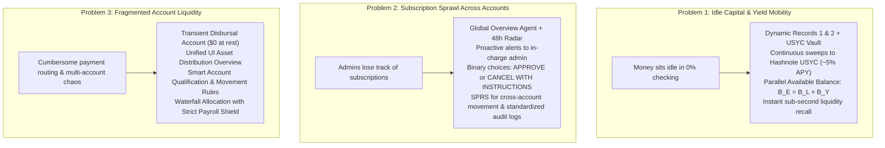
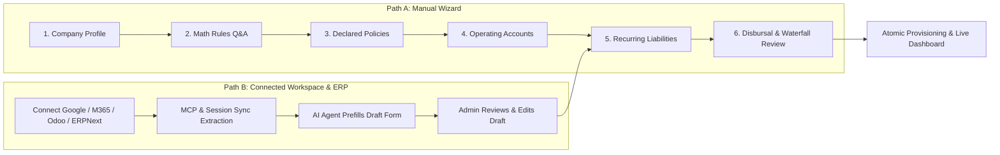

# BizArc: Autonomous Multi-Agent Corporate Treasury System

Welcome to the official technical documentation for the **BizArc Autonomous Corporate Treasury Platform**, purpose-built for **Arc L1** (Circle's Layer-1 blockchain where USDC is the native gas token) and global commercial banking networks.

---

## 1. Executive Summary & Core Motivation

Modern corporate finance is hindered by fragmented banking portals, idle capital drag, and subscription chaos. High-growth enterprises maintain balances across disparate corporate entities, departmental budgets, credit cards, and crypto wallets. Finance teams struggle with three structural challenges:

1. **Idle Capital Drag**: Working capital sits idle in zero-yield checking accounts or operational hot wallets. If locked in traditional yield vehicles, it cannot be mobilized quickly enough when obligations come due.
2. **Subscription Sprawl**: Proliferation of recurring SaaS, cloud infrastructure, AI models, and vendor retainers across teams leads to forgotten subscriptions, unexpected price hikes, and cash overdrafts.
3. **Fragmented Liquidity & Routing Gridlock**: Dispersed departmental accounts create friction when deciding where to pay from, how to stage funds, and how to protect critical reserves like payroll.

**BizArc** solves these problems with a cognitive multi-agent treasury swarm operating inside cryptographically enforced smart contract guardrails on Arc L1.

---

## 2. The Three Core Problems & BizArc Solutions

### Problem 1: Idle Capital & Yield Mobility
- **Problem**: Corporate money sits idle earning zero yield. It needs to be continuously invested in yield-generating assets, but must remain immediately accessible whenever payments or liabilities come due.
- **BizArc Solution**:
  - **Central USYC Investment Account**: Deployed on Arc L1 via [CentralTreasuryYieldVault](file://wsl.localhost/Ubuntu-24.04/home/gifted/BizArc/src/contracts/centralTreasuryYieldVaultService.ts), interfacing with Hashnote USYC (ERC-4626 tokenized US Treasury bills yielding ~5% APY).
  - **Dynamic Record 1 (Account Liabilities & Dates)**: Dynamic registry of every active liability and recurring schedule per account.
  - **Dynamic Record 2 (Safe-to-Invest Margin)**: Continuously calculates safe-to-invest margin based on liquid balance, operating reserve floor, and upcoming liabilities over a forward-looking horizon.
  - **Continuous Recalculation & Immediate Sweeps**: Recalculated anytime the balance changes from funding or disbursements; surplus funds are immediately swept to USYC on Arc L1. A separate agent ([LedgerWitnessService](file://wsl.localhost/Ubuntu-24.04/home/gifted/BizArc/src/services/ledgerWitnessService.ts)) independently posts double-entry vouchers to the master journal.
  - **Parallel Record of Effective Available Balance**: If an account holds $20 liquid and $80 in USYC, the UI and decision engines maintain a parallel record showing **Available Balance = $100.000000 USDC** ($B_E = B_L + B_Y$). Treasury decisions evaluate this full purchasing power.
  - **Dynamic Liquidity Recall**: Whenever a payment is initiated or an obligation enters the pre-flight window, the agent automatically withdraws the exact required amount from USYC to the operating account.

### Problem 2: Subscription Sprawl Across Accounts
- **Problem**: Enterprise subscriptions can proliferate so rapidly that administrators lose track of which account pays what, resulting in unexpected debits, zombie subscriptions, or service cutoffs.
- **BizArc Solution**:
  - **Global Overview Agent**: The [LiabilityRadarService](file://wsl.localhost/Ubuntu-24.04/home/gifted/BizArc/src/services/liabilityRadarService.ts) maintains a global view across all accounts and recurring commitments (subscriptions, debts, retainers).
  - **Proactive Pre-Flight Notifications**: Scans 48 hours in advance and alerts the in-charge administrator with complete context: what is being paid, counterparty identity, amount, and the exact account scheduled to fund it.
  - **Binary Admin Framework**: Presents the admin with strictly two clear options:
    1. **`APPROVE`**: Signs off on the transaction (with EIP-712 cryptographic permit if exceeding limits).
    2. **`CANCEL_WITH_INSTRUCTIONS`**: Freezes the obligation and records the admin's mandatory instructional memo.
  - **Cross-Account Movement via SPRS**: If paying requires transferring funds between accounts, the agent constructs a Standardized Permission Request (SPRS).
  - **Standardized Agent Log**: Every notification, decision, and movement is immutably logged according to the Standardized Agent Log Specification in `account_agent_audit_log`.

### Problem 3: Fragmented Accounts & Payment Routing
- **Problem**: Fragmented departmental accounts make it difficult to determine which account should pay, calculate cross-account transfers, and stage funds without draining critical operational reserves.
- **BizArc Solution**:
  - **Transient Disbursal Account ($0 at Rest)**: Deploys [DisbursalVault](file://wsl.localhost/Ubuntu-24.04/home/gifted/BizArc/src/contracts/disbursalVaultService.ts) on Arc L1. The vault holds $0 at rest. Funds are staged into the vault temporarily only at the moment of payment and dispersed immediately to the vendor.
  - **Unified Asset Distribution UI**: The [UnifiedAssetAggregatorService](file://wsl.localhost/Ubuntu-24.04/home/gifted/BizArc/src/services/unifiedAssetAggregatorService.ts) aggregates and displays total enterprise assets and distribution across all accounts, roles, and yield pools.
  - **Smart Account Qualification & Movement Rules**: The [DisbursalRouterService](file://wsl.localhost/Ubuntu-24.04/home/gifted/BizArc/src/services/disbursalRouterService.ts) evaluates category compatibility and unencumbered free capital to qualify candidate accounts.
  - **Multi-Account Waterfall Allocation**: If a single account cannot cover the bill, the agent evaluates a waterfall draw across compatible accounts, strictly respecting liability reserves and enforcing the **Inviolable Payroll Shield**. Cross-account draws require human approval via SPRS before funds are staged.

---

## 3. Audit & Control Philosophy: Inside vs. Outside the Rules

BizArc's operational architecture is built on a constitutional invariant: **No agent can perform any financial action without explicit authorization.**

| Dimension | "Inside the Rules" (Autonomous Fast-Path) | "Outside the Rules" (Mandatory Human Escalation) |
| :--- | :--- | :--- |
| **Scope** | Routine actions within pre-authorized mathematical bounds and verified schedules. | High-risk actions, inter-account transfers, crypto-to-fiat conversions, or out-of-policy limits. |
| **Typical Actions** | 1. Sweeping idle cash surplus to Central USYC Vault. 2. Recalling USYC funds for pre-approved liabilities. 3. Routine scheduled payments below auto-pay threshold to verified vendors. | 1. Moving funds between corporate accounts. 2. Converting crypto to fiat banking rails. 3. Multi-account waterfall allocations. 4. Payments exceeding single-transaction caps. 5. Unregistered vendors or changed payout addresses. |
| **Authorization Layer** | **Layer 1: Enforcer Agent ([PolicyComplianceLlmAgent](file://wsl.localhost/Ubuntu-24.04/home/gifted/BizArc/src/agents/policyComplianceLlmAgent.ts))** issues single-use clearance codes. | **Layer 2: Human Officer (CFO / Admin)** signs an EIP-712 Standardized Permission Request (SPRS). |
| **Agent Autonomy** | Agent acts autonomously and logs the transaction immediately. | Agent CANNOT execute; pauses and awaits human sign-off. |
| **Audit Trails** | Chronological entry in Account Agent Log and Master Journal. | Complete SPRS payload, human signature, and rationale immutably recorded. |

---

## 4. The Four Primary Agent Capabilities

1. **Comprehensive Account Knowledge**: Deep visibility into live balances (Liquid $B_L$, Invested $B_Y$, Effective Available $B_E$), account locations (Arc L1, banking networks), active liabilities (Dynamic Record 1), safe-to-invest margins (Dynamic Record 2), and full historical audit logs.
2. **Move Money Account-to-Account**: Autonomous surplus sweeps to USYC, liquidity recalls to operating wallets, and cross-account waterfall allocations staged through the transient DisbursalVault ($0 at rest) under strict SPRS governance.
3. **Authorize Transactions**: Layer 1 cryptographic clearance codes for autonomous actions and EIP-712 signature verification for human-authorized operations, enforcing 3-way matching and loud rounding math.
4. **Convert Crypto to Fiat**: Seamless execution across **5 Universal Settlement Rails** and **5 Traditional Banking Sub-Methods** (Fedwire, ACH, Push-to-Card, SEPA, SWIFT) via Circle Mint, with onchain proof-of-burn tracking on Arc L1.

---

## 5. Enterprise Onboarding Architecture

BizArc offers two comprehensive pathways for onboarding organizations:

- **Path A: Manual Interactive Wizard**: Guided 6-step flow where admins answer business Q&A to derive mathematical rules, configure per-account policies, attach liabilities to accounts, select payment gateways, and provision onchain accounts.
- **Path B: Connected Workspace & ERP Assisted**: Connects to Google Workspace MCP, Microsoft 365 MCP, Odoo, or ERPNext. The autonomous AI intake agent parses invoices, purchase orders, and cost centers to pre-populate an editable draft. Admins review the draft and manually confirm recurring liabilities.
- **Post-Onboarding Lifecycle**: All accounts, policies, rules, and liabilities remain 100% editable post-onboarding via the administrative dashboard.

---

## 6. Complete Documentation Directory

| Document | Primary Focus |
| :--- | :--- |
| **1. [Problem, Solution & Governance Philosophy](file://wsl.localhost/Ubuntu-24.04/home/gifted/BizArc/docs/problem_and_solution_philosophy.md)** | **Core Manifesto**: Detailed breakdown of the 3 Core Problems, Algorithmic Solutions, Parallel Balances, Inside vs. Outside the Rules, and Agent Capabilities. |
| **2. [Enterprise Onboarding & Lifecycle Guide](file://wsl.localhost/Ubuntu-24.04/home/gifted/BizArc/docs/enterprise_onboarding_guide.md)** | **Onboarding Manual**: Step-by-step walkthrough of Manual 6-step QA setup, Connected Workspace/ERP MCP draft prefill, liability attachment, and post-onboarding CRUD. |
| **3. [Architecture Overview](file://wsl.localhost/Ubuntu-24.04/home/gifted/BizArc/docs/architecture_overview.md)** | **System Blueprint**: Arc L1 protocol foundation, Tripartite Balance Invariant ($B_E = B_L + B_Y$), 6 Golden Rules of Enterprise Ledgers, and daemon runtime. |
| **4. [Dual-Layer Autonomous Architecture](file://wsl.localhost/Ubuntu-24.04/home/gifted/BizArc/docs/dual_layer_architecture.md)** | **Safety Cage**: Cognitive Agent Swarm (The Brain) vs. Smart Contract Guardrail Envelope (The Safety Cage) and Segregation of Duties. |
| **5. [Agent Responsibilities & Swarm Topology](file://wsl.localhost/Ubuntu-24.04/home/gifted/BizArc/docs/agent_responsibilities.md)** | **Cognitive Swarm**: Technical specification of the 6 specialized LLM agents (IDs #100–#105), Swarm Coordinator, shared blackboard, and intent lifecycle. |
| **6. [Universal Payment Rails & Routing Guide](file://wsl.localhost/Ubuntu-24.04/home/gifted/BizArc/docs/payment_rails_and_routing.md)** | **Settlement Rails**: Comprehensive specification of the 5 Universal Payment Rails (DisbursalVault, Session Keys, ERC-3009, x402, and Fiat Banking Rails). |
| **7. [Reactive State Machines & Orchestration](file://wsl.localhost/Ubuntu-24.04/home/gifted/BizArc/docs/state_machines_and_orchestration.md)** | **Runtime Engine**: Technical specification of the 5 reactive state machines, closed-loop triggers, master orchestrator, and background daemon. |
| **8. [Security, Governance & Compliance Architecture](file://wsl.localhost/Ubuntu-24.04/home/gifted/BizArc/docs/security_and_compliance.md)** | **Compliance Engine**: Two-Layer Authorization Gate, EIP-712 SPRS protocol, Anti-Payee Substitution Defense, and Loud Rounding enforcement. |
| **9. [Database Schema, Ledger & Vector Memory](file://wsl.localhost/Ubuntu-24.04/home/gifted/BizArc/docs/database_and_double_entry_ledger.md)** | **Data Architecture**: PostgreSQL relational schema (22 tables), Master System Journal with sequential SHA-256 hash chaining, and vector memory. |
| **10. [API, Webhooks & Agent Tool Reference](file://wsl.localhost/Ubuntu-24.04/home/gifted/BizArc/docs/api_and_tool_reference.md)** | **Integration & Tools**: Physical REST Ingress endpoints, Circle Mint webhooks, and 30+ deterministic tools provided by the Tool Registry. |

---

## 7. Core System Invariants at a Glance

1. **Native USDC Gas**: Arc L1 uses USDC as native gas token with a deterministic 20 Gwei gas floor and sub-second finality.
2. **Tripartite Balance Invariant**: $B_E = B_L + B_Y$ maintains strict equality between total purchasing power, operating cash, and USYC yield shares.
3. **Transient Disbursal Vault**: Disbursal account holds $0 balance at rest, only staging funds temporarily at the moment of payment.
4. **Payee Substitution Protection**: Payment destinations are verified strictly against immutable master records; addresses on invoice headers are never trusted.
5. **Loud Rounding Arithmetic**: Financial calculations enforce exact 6-decimal USDC integer math; fractional cent truncations throw loud errors.
6. **Deterministic Idempotency**: All payment intents generate 32-byte Keccak-256 keys preventing duplicate executions across smart contracts and APIs.
7. **Sequential Hash-Linked Audit**: Master System Journal entries form an unbroken cryptographic SHA-256 chain verified programmatically.
