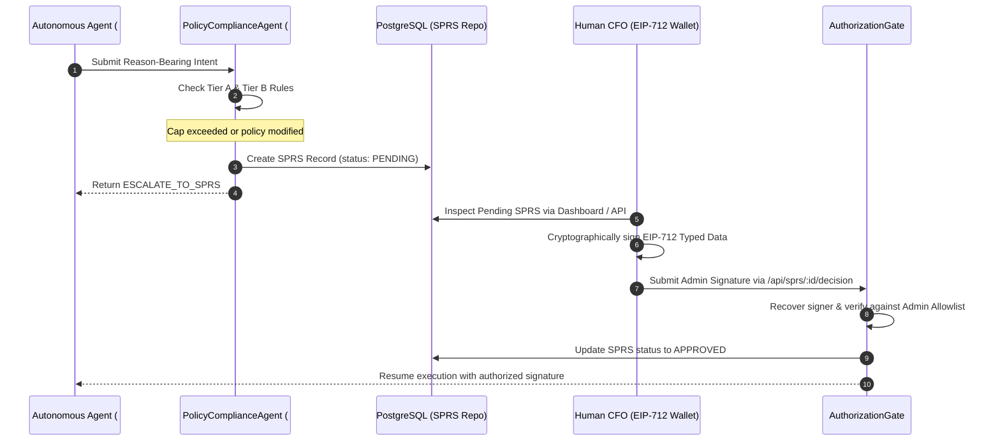

# BizArc Cognitive Agent Swarm: Roles, Responsibilities & Deliberation Architecture

## 1. Executive Overview

The **BizArc Autonomous Treasury System** replaces manual, fragmented corporate treasury workflows with a coordinated swarm of specialized, model-agnostic Autonomous LLM Agents. Built according to the **Canteen Agents & Ledgers (2026)** architectural standard, the swarm coordinates multi-account liquidity on **Arc L1** (Circle's purpose-built Layer-1 blockchain where USDC is the native gas token) while simultaneously executing traditional banking operations (Fedwire, ACH, Push-to-Card, SEPA, SWIFT).

For a high-level conceptual breakdown of the business problems, algorithmic solutions, and governance philosophy, refer to:
- **[Problem, Solution & Governance Philosophy](file://wsl.localhost/Ubuntu-24.04/home/gifted/BizArc/docs/problem_and_solution_philosophy.md)**
- **[Enterprise Onboarding & Lifecycle Guide](file://wsl.localhost/Ubuntu-24.04/home/gifted/BizArc/docs/enterprise_onboarding_guide.md)**

Each agent operates as an autonomous cognitive loop inheriting from [BaseLlmAgent](file://wsl.localhost/Ubuntu-24.04/home/gifted/BizArc/src/agents/core/BaseLlmAgent.ts), which manages:
- **Shared Multi-Tier Context**: Real-time event streaming via PostgreSQL [agent_continuous_context](file://wsl.localhost/Ubuntu-24.04/home/gifted/BizArc/src/database/schema.sql#L134-L152) and dual-stream rolling compaction.
- **Enterprise Vector Memory**: Semantic RAG over bylaws, MSAs, SLAs, board resolutions, and historical rulings using pgvector HNSW indexing.
- **Dynamic Tripartite Records**: Real-time access to Dynamic Record 1 (Liabilities), Dynamic Record 2 (Safe-to-Invest), and Parallel Tripartite Balances ($B_E = B_L + B_Y$).
- **Tool-Augmented Reasoning**: Deterministic execution through [ToolRegistry](file://wsl.localhost/Ubuntu-24.04/home/gifted/BizArc/src/tools/toolRegistry.ts) with strict permission scopes.

---

## 2. Core Capabilities & Operating Philosophy

### 2.1 The Four Primary Agent Capabilities
Across the entire agent swarm, agents possess four fundamental financial capabilities:
1. **Comprehensive Account Knowledge**: Live visibility into liquid cash ($B_L$), invested yield shares ($B_Y$), effective available balance ($B_E = B_L + B_Y$), account location (Arc L1 vs commercial banks), active liabilities (Dynamic Record 1), safe-to-invest margins (Dynamic Record 2), and full historical audit logs.
2. **Move Money Account-to-Account**: Autonomous surplus sweeps to Central USYC Vault, liquidity recalls to operating wallets, and cross-account waterfall allocations staged through the transient DisbursalVault ($0 at rest) under strict SPRS governance.
3. **Authorize Transactions**: Issuing Layer 1 cryptographic clearance codes for autonomous actions and formulating/verifying EIP-712 human approvals for out-of-policy actions.
4. **Convert Crypto to Fiat**: Seamless execution across **5 Universal Settlement Rails** and **5 Traditional Banking Sub-Methods** (Fedwire, ACH, Push-to-Card, SEPA, SWIFT) via Circle Mint, with onchain proof-of-burn tracking on Arc L1.

### 2.2 The Operating Philosophy: "Inside the Rules" vs. "Outside the Rules"
BizArc enforces a strict boundary governing agent initiative:

```mermaid
flowchart TD
    Action[Agent Proposed Financial Action] --> Check{Is Action Inside Pre-Authorized Rules?}

    Check -->|INSIDE THE RULES| FastPath[Autonomous Fast-Path Execution]
    FastPath --> ClearCode[Enforcer Agent Issues Clearance Code]
    ClearCode --> ExecArc[Execute Action Immediately on Arc L1]
    ExecArc --> LogAuto[Append to Account Agent Log & Master Journal]

    Check -->|OUTSIDE THE RULES| HumanGate[Mandatory Human Escalation]
    HumanGate --> GenSPRS[Formulate Standardized Permission Request (SPRS)]
    GenSPRS --> AdminModal[Present Modal to Admin: APPROVE or CANCEL WITH INSTRUCTIONS]
    AdminModal -->|Admin Approves| CFOVerify[Verify CFO EIP-712 Cryptographic Signature]
    CFOVerify --> ExecGate[Execute via DisbursalVault Clearinghouse]
    AdminModal -->|Admin Cancels| Freeze[Halt Action & Record Admin Instructions]
```

- **Inside the Rules (Autonomous Fast-Path)**:
  - Sweeps of idle surplus cash to Central USYC Vault.
  - Pulling funds back from USYC to fund an already-approved payment or scheduled liability.
  - Routine scheduled payments below the auto-pay threshold to verified Vendor Master counterparties.
  - *The agent acts on its own autonomously and logs every action immediately.*
- **Outside the Rules (Mandatory Human Escalation)**:
  - Moving funds between operational cost centers.
  - Multi-account waterfall allocations.
  - Converting crypto to traditional fiat banking rails.
  - Payments exceeding single-transaction caps.
  - Payments to unregistered vendors or changed payout addresses.
  - *The agent CANNOT act alone; it must generate a Standardized Permission Request (SPRS) and await human sign-off.*

---

## 3. Swarm Agent Directory & Topology


| Agent ID | Class Name | Primary Persona | Mandate & Core Golden Rule |
| :--- | :--- | :--- | :--- |
| **#100** | [OnboardingLlmAgent](file://wsl.localhost/Ubuntu-24.04/home/gifted/BizArc/src/agents/onboardingLlmAgent.ts) | Enterprise Initialization | 6-Step Wizard & Connected ERP/MCP Discovery, Ground-Truth Genesis |
| **#101** | [TreasurySentinelLlmAgent](file://wsl.localhost/Ubuntu-24.04/home/gifted/BizArc/src/agents/treasurySentinelLlmAgent.ts) | Capital Efficiency Sentinel | Parallel Tripartite Invariant ($B_E = B_L + B_Y$), Dynamic USYC Yield Sweeps & Recalls |
| **#102** | [LiabilityRadarLlmAgent](file://wsl.localhost/Ubuntu-24.04/home/gifted/BizArc/src/agents/liabilityRadarLlmAgent.ts) | Forensic Ingestion Radar | 48-Hour Pre-Flight Radar Alerts, Three-Way Match & Payee Substitution Defense |
| **#103** | [DisbursalRouterLlmAgent](file://wsl.localhost/Ubuntu-24.04/home/gifted/BizArc/src/agents/disbursalRouterLlmAgent.ts) | Liquidity Waterfall Router | Multi-Account Waterfall Routing, Transient Disbursal Account, Payroll Shield |
| **#104** | [PolicyComplianceLlmAgent](file://wsl.localhost/Ubuntu-24.04/home/gifted/BizArc/src/agents/policyComplianceLlmAgent.ts) | Gatekeeper / Enforcer | Tier A Invariants, Tier B Declared Policies, Tri-State Clearance Decisions |
| **#105** | [LedgerWitnessLlmAgent](file://wsl.localhost/Ubuntu-24.04/home/gifted/BizArc/src/agents/ledgerWitnessLlmAgent.ts) | Independent GL Witness | Segregation of Duties: Independent Blockchain Witness, SHA-256 Chained Master Journal |

---

## 4. Detailed Agent Specifications

### 4.1 Agent #100: OnboardingAgent
- **Implementation**: [OnboardingLlmAgent.ts](file://wsl.localhost/Ubuntu-24.04/home/gifted/BizArc/src/agents/onboardingLlmAgent.ts)
- **ERC-8004 Agent ID**: `100`
- **Core Purpose**: Orchestrates autonomous organizational onboarding across the two enterprise pathways (Manual Wizard vs Connected Workspace / ERP).
- **Key Responsibilities**:
  1. **Workspace & ERP Discovery**: Connects via Google Workspace MCP, Microsoft 365 MCP, Odoo, or ERPNext session sync to discover suppliers, purchase orders, invoices, and candidate cost centers.
  2. **Mathematical Rules Q&A Integration**: Administers structured Q&A questionnaire via [MathRulesQAEngine](file://wsl.localhost/Ubuntu-24.04/home/gifted/BizArc/src/services/mathRulesQAEngine.ts) to derive runway, operating floors, and buffer formulas.
  3. **Draft Pre-population**: Pre-fills the Onboarding Wizard draft in `wizard_onboarding_sessions` for admin inspection and editing.
  4. **Multi-Rail Account Provisioning**: Initializes Arc L1 operating accounts (`TREASURY_RESERVE`, `PAYROLL`, `OPEX_DEV`, `OPEX_GROWTH`, `TAX_ESCROW`) and links corporate bank details in [VendorBankRepo](file://wsl.localhost/Ubuntu-24.04/home/gifted/BizArc/src/database/repos/vendorBankRepo.ts).
  5. **Ledger Genesis**: Writes Sequence ID 1 (Genesis block) to [master_system_journal](file://wsl.localhost/Ubuntu-24.04/home/gifted/BizArc/src/database/repos/masterJournalRepo.ts) with `previous_hash = '0000000000000000000000000000000000000000000000000000000000000000'`.
- **Allowed Tool Scopes**:
  - `query_vector_memory`, `read_dynamic_records`, `check_vendor_master`, `recalculate_safe_to_invest`, `synthesize_policy_proposal`, `provision_arc_wallets`, `generate_spending_guardrails_handoff`, `verify_initial_funding`, `ingest_enterprise_documents`.

---

### 4.2 Agent #101: TreasurySentinelAgent
- **Implementation**: [TreasurySentinelLlmAgent.ts](file://wsl.localhost/Ubuntu-24.04/home/gifted/BizArc/src/agents/treasurySentinelLlmAgent.ts)
- **ERC-8004 Agent ID**: `101`
- **Core Purpose**: Continuous liquidity guardian enforcing capital efficiency, Dynamic Record 2 recalculation, and the Parallel Tripartite Balance invariant.
- **Mathematical Invariant Enforced**:
  $$\text{Effective Available Balance } (B_E) = \text{Liquid Cash } (B_L) + \text{Invested Yield in USYC } (B_Y)$$
- **Key Responsibilities**:
  1. **Tripartite Balance Vigilance**: Monitors real-time balance mutations on Arc L1 and internal triggers via [TreasurySentinelService](file://wsl.localhost/Ubuntu-24.04/home/gifted/BizArc/src/services/treasurySentinelService.ts).
  2. **Safe-to-Invest Recalculation (Dynamic Record 2)**: Recomputes investable surplus anytime balance changes:
     $$\text{Safe-to-Invest} = \max\left(0,\, B_L - \left(\sum_{i \in \text{Horizon}} \text{Liability}_i \times \text{Buffer Ratio}\right) - \text{Floor}\right)$$
  3. **Autonomous Surplus Sweeping (Inside the Rules)**: When $\text{Safe-to-Invest} > 0$, requests a Layer 1 clearance code and immediately triggers `sweep_excess_liquidity` into Hashnote USYC via [CentralTreasuryYieldVault](file://wsl.localhost/Ubuntu-24.04/home/gifted/BizArc/contracts/CentralTreasuryYieldVault.sol).
  4. **Dynamic Liquidity Recall**: When upcoming liabilities or outbound payments require liquid cash, autonomously redeems USYC shares back to the target operating account before payment executes.
  5. **Auto-Swap Inflow Normalization**: Swaps inbound non-USDC assets to native Arc USDC via [TokenSwapService](file://wsl.localhost/Ubuntu-24.04/home/gifted/BizArc/src/services/tokenSwapService.ts).
- **Allowed Tool Scopes**:
  - `read_dynamic_records`, `recalculate_safe_to_invest`, `evaluate_reason_bearing_intent`, `sweep_excess_liquidity`, `recall_invested_liquidity`, `scan_predictive_liabilities`, `execute_predictive_recall`, `query_vector_memory`, `get_unified_operational_state`, `get_yield_performance_metrics`, `transfer_account_liquidity`, `get_account_intelligence`, `estimate_token_swap`, `execute_token_swap`, `create_fiat_onramp_session`, `get_fiat_wire_deposit_instructions`, `record_fiat_deposit`.

---

### 4.3 Agent #102: LiabilityRadarAgent
- **Implementation**: [LiabilityRadarLlmAgent.ts](file://wsl.localhost/Ubuntu-24.04/home/gifted/BizArc/src/agents/liabilityRadarLlmAgent.ts)
- **ERC-8004 Agent ID**: `102`
- **Core Purpose**: Continuous obligation radar and early-warning detection sentinel. Maintains Dynamic Record 1 and enforces Payee Substitution Protection.
- **Key Responsibilities**:
  1. **Dynamic Record 1 Maintenance**: Maintains up-to-the-second registry of every active recurring subscription, debt, and vendor contract in `account_liabilities`.
  2. **48-Hour Pre-Flight Radar Alerts**: Scans upcoming obligations and proactively alerts the in-charge administrator with complete context: what is being paid, counterparty identity, amount, and source account details.
  3. **Binary Admin Framework**: Provides administrators with strictly two binary options:
     - `APPROVE`: Authorizes payment to proceed.
     - `CANCEL_WITH_INSTRUCTIONS`: Halts payment and prompts for mandatory admin instructions.
  4. **Forensic Three-Way Matching (Golden Rule 2)**: Verifies Purchase Order terms, delivery receipts, and invoice demands before releasing payment.
  5. **Payee Substitution Defense (Golden Rule 3)**: Validates destination wallet addresses and bank coordinates against [VendorMasterRepo](file://wsl.localhost/Ubuntu-24.04/home/gifted/BizArc/src/database/repos/vendorMasterRepo.ts). Rejects addresses printed on unverified invoice headers.
- **Allowed Tool Scopes**:
  - `read_dynamic_records`, `verify_three_way_match`, `check_vendor_master`, `query_vector_memory`, `request_human_approval`, `get_unified_operational_state`, `evaluate_reason_bearing_intent`, `create_preflight_liability_alert`, `ingest_liability_document`.

---

### 4.4 Agent #103: DisbursalRouterAgent
- **Implementation**: [DisbursalRouterLlmAgent.ts](file://wsl.localhost/Ubuntu-24.04/home/gifted/BizArc/src/agents/disbursalRouterLlmAgent.ts)
- **ERC-8004 Agent ID**: `103`
- **Core Purpose**: Multi-account routing coordinator, transient disbursal operator, and cross-rail execution engine.
- **Key Responsibilities**:
  1. **Transient Disbursal Account Management**: Directs payments through [DisbursalVault](file://wsl.localhost/Ubuntu-24.04/home/gifted/BizArc/src/contracts/disbursalVaultService.ts), ensuring the vault holds **$0 at rest** and only receives funds temporarily at execution.
  2. **Candidate Account Qualification**: Evaluates payment categories against account roles and unencumbered free capital ($B_E - \text{Committed Liabilities} - \text{Floor}$).
  3. **Multi-Account Waterfall Allocation**: When an expense exceeds a single account's unencumbered balance, computes a waterfall allocation across compatible accounts while strictly enforcing the **Payroll Shield**. Emits an SPRS for human confirmation before moving funds.
  4. **Universal 5-Rail Settlement Execution**: Routes payments across DisbursalVault, Modular Session Keys, ERC-3009 Gasless Authorization, Gateway x402, and Circle Mint Fiat Banking (Fedwire, ACH, Push-to-Card, SEPA, SWIFT).
- **Allowed Tool Scopes**:
  - `read_dynamic_records`, `get_unified_asset_distribution`, `qualify_disbursal_route`, `execute_disbursal_route`, `plan_waterfall_allocation`, `evaluate_reason_bearing_intent`, `execute_disbursal`, `request_human_approval`, `check_vendor_master`, `query_vector_memory`, `get_unified_operational_state`, `convert_crypto_to_fiat_payout`, `route_universal_payment`, `estimate_token_swap`, `execute_token_swap`, `scan_predictive_liabilities`, `execute_predictive_recall`, `recall_invested_liquidity`, `post_document_linked_gl`.

---

### 4.5 Agent #104: PolicyComplianceAgent
- **Implementation**: [PolicyComplianceLlmAgent.ts](file://wsl.localhost/Ubuntu-24.04/home/gifted/BizArc/src/agents/policyComplianceLlmAgent.ts)
- **ERC-8004 Agent ID**: `104`
- **Core Purpose**: Swarm Gatekeeper enforcing the Two-Layer Authorization Architecture.
- **Two-Tier Rule Architecture**:
  - **Tier A (Mathematical Invariants)**: Zero negative balances; exact 6-decimal USDC arithmetic; operating reserve floors ($B_L \ge \text{Floor}$); Payroll account isolation; Vendor Master address locks; unbroken SHA-256 hash chaining.
  - **Tier B (Human Declared Policies)**: Cost center segregation; price hike thresholds (<15%); single-tx, daily, weekly, and monthly spending caps.
- **Tri-State Decision Protocol**:
  1. `PERMIT`: Inside the rules. Issues a single-use clearance code (`#CLEAR-...`) in [ClearanceCodeRepo](file://wsl.localhost/Ubuntu-24.04/home/gifted/BizArc/src/database/repos/clearanceCodeRepo.ts).
  2. `DENY`: Hard invariant violated. Immediate transaction rejection.
  3. `ESCALATE_TO_SPRS`: Outside the rules. Generates an EIP-712 Standardized Permission Request (SPRS) requiring human CFO cryptographic sign-off.
- **Allowed Tool Scopes**:
  - `evaluate_reason_bearing_intent`, `query_vector_memory`, `read_dynamic_records`, `check_vendor_master`, `request_human_approval`, `get_unified_operational_state`, `authorize_transaction_intent`, `audit_production_readiness`, `trigger_emergency_circuit_breaker`.

---

### 4.6 Agent #105: LedgerWitnessAgent
- **Implementation**: [LedgerWitnessLlmAgent.ts](file://wsl.localhost/Ubuntu-24.04/home/gifted/BizArc/src/agents/ledgerWitnessLlmAgent.ts)
- **ERC-8004 Agent ID**: `105`
- **Core Purpose**: Independent external auditor and accounting witness enforcing Segregation of Duties.
- **Key Responsibilities**:
  1. **Pre- and Post-Mutation Witnessing**: Inspects balances and transaction parameters before and after execution to guarantee consistency. Possesses **zero private keys or signing capabilities**.
  2. **Onchain Receipt Verification**: Confirms transaction receipts against Arc L1 RPC nodes, verifying block confirmations, emitted events, and gas consumptions.
  3. **Master System Journal Hashing**: Appends every action to [master_system_journal](file://wsl.localhost/Ubuntu-24.04/home/gifted/BizArc/src/database/repos/masterJournalRepo.ts) using sequential SHA-256 hash chaining:
     $$\text{Hash}_n = \text{SHA256}(\text{Hash}_{n-1} \parallel \text{SeqId} \parallel \text{Timestamp} \parallel \text{AccountId} \parallel \text{Debit} \parallel \text{Credit} \parallel \text{Amount} \parallel \text{DocRef})$$
  4. **Document-Linked ERP Sync**: Formulates double-entry accounting vouchers linked to underlying POs, Invoices, and Proof of Delivery hashes, then stages them to connected ERPs (Odoo / ERPNext).
- **Allowed Tool Scopes**:
  - `post_document_linked_gl`, `witness_and_reconcile`, `get_unified_operational_state`, `query_vector_memory`, `read_dynamic_records`.

---

## 5. Multi-Agent Shared Context & Memory

### 5.1 Blackboard Event Stream
All agents communicate and coordinate over a shared, append-only PostgreSQL event stream:
- **Table**: `agent_continuous_context`
- **Session Scoping**: Partitioned by `session_id`.
- **Event Types**: `TASK_INITIATED`, `LLM_DELIBERATION`, `TOOL_CALLED`, `TOOL_RESULT`, `INVARIANT_CHECK`, `STATE_MUTATION`, `SYSTEM_INTERRUPT`.

### 5.2 Dual-Stream Rolling Compaction
When context depth reaches the configured threshold (default: 8 events), [ContinuousContextManager](file://wsl.localhost/Ubuntu-24.04/home/gifted/BizArc/src/context/continuousContextManager.ts) compresses the conversation into two parallel streams:
1. **Narrative Summary Stream**: High-level strategic digest of agent deliberations, decisions, and goals.
2. **Deterministic Anchor Stream**: Strict JSON document containing exact 6-decimal numeric account balances, active liability UUIDs, document hashes, and clearance codes. This prevents numeric hallucination across compaction cycles.

Episodes are stored in `agent_context_compaction_episodes` with 1536-dimensional vector embeddings for episodic semantic recall.

---

## 6. Reason-Bearing Intent & SPRS Lifecycle

Every autonomous action that mutates treasury state requires a formal **Reason-Bearing Intent**:

```typescript
export interface ReasonBearingIntentPayload {
  proposedAction: string;           // e.g. "DISBURSE_PAYMENT", "AUTONOMOUS_SWEEP"
  accountId: string;                // Source operating cost-center
  amountUsdc: string;               // Exact 6-decimal USDC string
  declaredReason: string;           // Verifiable business rationale
  recipientAddress?: string;        // Verified counterparty address or bank ID
  currentLiquid?: string;           // Pre-flight liquid balance
  targetReserve?: string;           // Preserved operating reserve floor
  safeToInvest?: string;            // Record 2 metric
  vendorId?: string;                // Verified vendor ID
  invoiceId?: string;               // Document identifier
  purchaseOrderId?: string;         // Verified PO linkage
  idempotencyKey?: string;          // Keccak-256 idempotency key
}
```

If the Enforcer Agent issues an `ESCALATE_TO_SPRS` decision, the intent is converted into an EIP-712 Standardized Permission Request:



---

## 7. Verification and Reference Files

- Agent Base Class: [BaseLlmAgent.ts](file://wsl.localhost/Ubuntu-24.04/home/gifted/BizArc/src/agents/core/BaseLlmAgent.ts)
- Swarm Coordinator: [swarmCoordinator.ts](file://wsl.localhost/Ubuntu-24.04/home/gifted/BizArc/src/agents/swarmCoordinator.ts)
- Two-Layer Gate: [authorizationGate.ts](file://wsl.localhost/Ubuntu-24.04/home/gifted/BizArc/src/security/authorizationGate.ts)
- Tool Registry: [toolRegistry.ts](file://wsl.localhost/Ubuntu-24.04/home/gifted/BizArc/src/tools/toolRegistry.ts)
- Continuous Context Manager: [continuousContextManager.ts](file://wsl.localhost/Ubuntu-24.04/home/gifted/BizArc/src/context/continuousContextManager.ts)
- Problem & Governance Manifesto: [problem_and_solution_philosophy.md](file://wsl.localhost/Ubuntu-24.04/home/gifted/BizArc/docs/problem_and_solution_philosophy.md)
- Enterprise Onboarding Guide: [enterprise_onboarding_guide.md](file://wsl.localhost/Ubuntu-24.04/home/gifted/BizArc/docs/enterprise_onboarding_guide.md)
