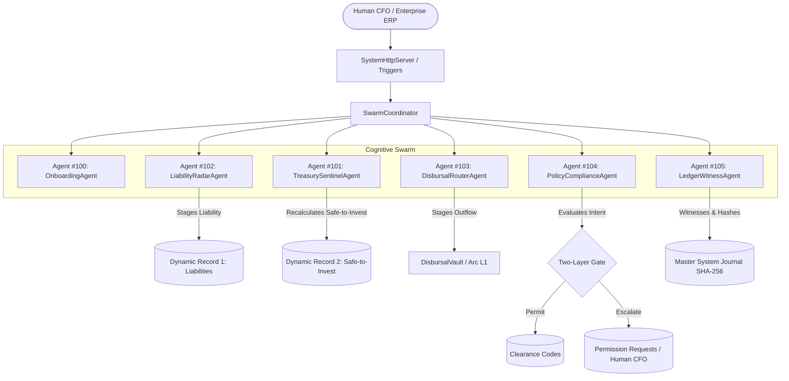
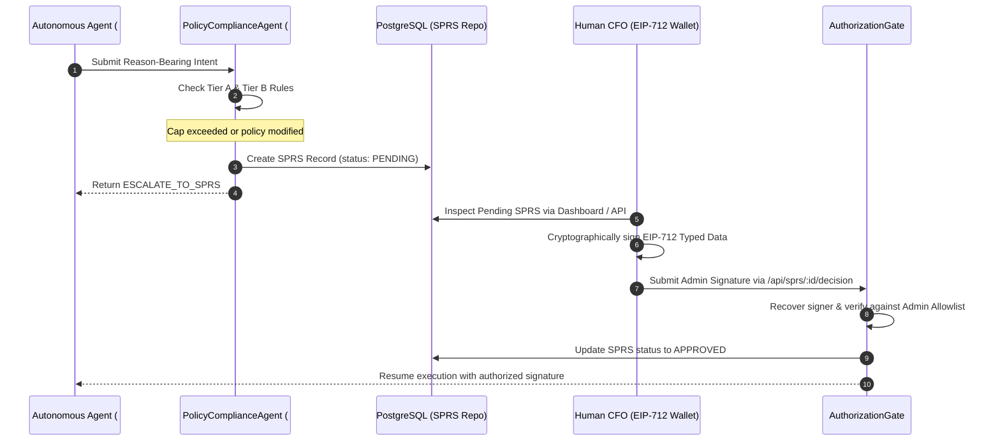

# BizArc Cognitive Agent Swarm: Roles, Responsibilities & Deliberation Architecture

## 1. Executive Overview

The **BizArc Autonomous Treasury System** replaces manual corporate treasury workflows with a coordinated swarm of specialized, model-agnostic Autonomous LLM Agents. Built according to the **Canteen Agents & Ledgers (2026)** architectural standard, the swarm coordinates multi-account liquidity on **Arc L1** (Circle's purpose-built Layer-1 blockchain where USDC is the native gas token) while simultaneously executing traditional banking operations (Fedwire, ACH, Push-to-Card, SEPA, SWIFT).

Each agent operates as an autonomous cognitive loop inheriting from [BaseLlmAgent](file://wsl.localhost/Ubuntu-24.04/home/gifted/BizArc/src/agents/core/BaseLlmAgent.ts), which manages:
- **Shared Multi-Tier Context**: Real-time event streaming via PostgreSQL [agent_continuous_context](file://wsl.localhost/Ubuntu-24.04/home/gifted/BizArc/src/database/schema.sql#L134-L152) and dual-stream rolling compaction.
- **Enterprise Vector Memory**: Semantic RAG over bylaws, MSAs, SLAs, board resolutions, and historical rulings using pgvector HNSW indexing.
- **Dynamic Tripartite Records**: Real-time access to Dynamic Record 1 (Liabilities), Dynamic Record 2 (Safe-to-Invest), and Dynamic Record 3 (Audit Ledger).
- **Tool-Augmented Reasoning**: Deterministic execution through [ToolRegistry](file://wsl.localhost/Ubuntu-24.04/home/gifted/BizArc/src/tools/toolRegistry.ts) with strict permission scopes.

---

## 2. Swarm Agent Directory & Topology



| Agent ID | Class Name | Primary Persona | Mandate & Core Golden Rule |
| :--- | :--- | :--- | :--- |
| **#100** | [OnboardingLlmAgent](file://wsl.localhost/Ubuntu-24.04/home/gifted/BizArc/src/agents/onboardingLlmAgent.ts) | Enterprise Initialization | 7-Phase Onboarding Matrix, Entity & ERP Discovery, Ground-Truth Genesis |
| **#101** | [TreasurySentinelLlmAgent](file://wsl.localhost/Ubuntu-24.04/home/gifted/BizArc/src/agents/treasurySentinelLlmAgent.ts) | Capital Efficiency Sentinel | Tripartite Balance Invariant ($B_E = B_L + B_Y$), USYC Yield Sweeps & Recalls |
| **#102** | [LiabilityRadarLlmAgent](file://wsl.localhost/Ubuntu-24.04/home/gifted/BizArc/src/agents/liabilityRadarLlmAgent.ts) | Forensic Ingestion Radar | Golden Rule 2 (Three-Way Match) & Golden Rule 3 (Payee Substitution Defense) |
| **#103** | [DisbursalRouterLlmAgent](file://wsl.localhost/Ubuntu-24.04/home/gifted/BizArc/src/agents/disbursalRouterLlmAgent.ts) | Liquidity Waterfall Router | Multi-Account Routing, Payroll Wall Isolation, Transient Settlement |
| **#104** | [PolicyComplianceLlmAgent](file://wsl.localhost/Ubuntu-24.04/home/gifted/BizArc/src/agents/policyComplianceLlmAgent.ts) | Gatekeeper / Enforcer | Tier A Mathematical Invariants, Tier B Declared Policies, Tri-State Decisions |
| **#105** | [LedgerWitnessLlmAgent](file://wsl.localhost/Ubuntu-24.04/home/gifted/BizArc/src/agents/ledgerWitnessLlmAgent.ts) | Independent GL Witness | Golden Rule 1 (External Witness) & Golden Rule 4 (Idempotent SHA-256 Journaling) |

---

## 3. Detailed Agent Specifications

### 3.1 Agent #100: OnboardingAgent
- **Implementation**: [OnboardingLlmAgent.ts](file://wsl.localhost/Ubuntu-24.04/home/gifted/BizArc/src/agents/onboardingLlmAgent.ts)
- **ERC-8004 Agent ID**: `100`
- **Core Purpose**: Orchestrates the autonomous bootstrapping of a corporate entity into BizArc across the 7-Phase Onboarding Matrix.
- **Key Responsibilities**:
  1. **Document & Entity Parsing**: Ingests legal entity documents (Bylaws, MSAs, SLA schedules, bank mandates) into `enterprise_vector_memory`.
  2. **ERP Metadata Discovery**: Connects to Odoo or ERPNext APIs via [EnterpriseOnboardingService](file://wsl.localhost/Ubuntu-24.04/home/gifted/BizArc/src/services/enterpriseOnboardingService.ts) to extract cost centers, suppliers, open invoices, and payment preferences.
  3. **Policy Proposal Synthesis**: Synthesizes suggested mathematical rules (operating floors, safety buffer ratios, spending limits) without unilaterally committing them; proposals require human confirmation.
  4. **Multi-Rail Account Provisioning**: Initializes Arc L1 operating wallets (`OPEX_DEV`, `OPEX_GROWTH`, `PAYROLL`, `TREASURY_RESERVE`) and links corporate bank accounts in [VendorBankRepo](file://wsl.localhost/Ubuntu-24.04/home/gifted/BizArc/src/database/repos/vendorBankRepo.ts).
  5. **Ledger Genesis**: Writes Sequence ID 1 (the Genesis block) to [master_system_journal](file://wsl.localhost/Ubuntu-24.04/home/gifted/BizArc/src/database/repos/masterJournalRepo.ts) with `previous_hash = '0x0000000000000000000000000000000000000000000000000000000000000000'`.
  6. **Spending Guardrails Handoff**: Generates monotonic Circle CLI commands for terminal OTP execution by the corporate officer.
- **Allowed Tool Scopes**:
  - `query_vector_memory`, `read_dynamic_records`, `check_vendor_master`, `recalculate_safe_to_invest`, `synthesize_policy_proposal`, `provision_arc_wallets`, `generate_spending_guardrails_handoff`, `verify_initial_funding`, `ingest_enterprise_documents`.

---

### 3.2 Agent #101: TreasurySentinelAgent
- **Implementation**: [TreasurySentinelLlmAgent.ts](file://wsl.localhost/Ubuntu-24.04/home/gifted/BizArc/src/agents/treasurySentinelLlmAgent.ts)
- **ERC-8004 Agent ID**: `101`
- **Core Purpose**: Continuous liquidity guardian enforcing capital efficiency and the parallel tripartite balance invariant.
- **Mathematical Invariant Enforced**:
  $$\text{Effective Treasury Balance } (B_E) = \text{Liquid Cash } (B_L) + \text{Invested Yield in USYC } (B_Y)$$
- **Key Responsibilities**:
  1. **Tripartite Balance Vigilance**: Monitors real-time balance mutation events from Arc L1 RPC nodes and internal triggers via [TreasurySentinelService](file://wsl.localhost/Ubuntu-24.04/home/gifted/BizArc/src/services/treasurySentinelService.ts).
  2. **Safe-to-Invest Recalculation**: Computes Dynamic Record 2 by comparing liquid balances against scheduled liabilities inside the configured time horizon (e.g., 7 days) and operating reserve floors:
     $$\text{Safe-to-Invest} = B_L - (\text{Committed Liabilities}_{t} \times \text{Safety Buffer}) - \text{Operating Floor}$$
  3. **Autonomous Surplus Yield Sweeping**: When $\text{Safe-to-Invest} > 0$, formulates a Reason-Bearing Intent, obtains a Layer 1 `PERMIT` clearance code from [PolicyComplianceLlmAgent](file://wsl.localhost/Ubuntu-24.04/home/gifted/BizArc/src/agents/policyComplianceLlmAgent.ts), and triggers `sweep_excess_liquidity` into Hashnote USYC via [CentralTreasuryYieldVault](file://wsl.localhost/Ubuntu-24.04/home/gifted/BizArc/contracts/CentralTreasuryYieldVault.sol).
  4. **Predictive Liquidity Recalls**: When upcoming obligations exceed $B_L$, formulates an intent to recall invested USYC shares before payment execution occurs.
  5. **Auto-Swap Inflow Normalization**: Inspects inbound token transfers; if non-USDC tokens arrive, executes automated swaps to native Arc USDC via [TokenSwapService](file://wsl.localhost/Ubuntu-24.04/home/gifted/BizArc/src/services/tokenSwapService.ts).
- **Allowed Tool Scopes**:
  - `read_dynamic_records`, `recalculate_safe_to_invest`, `evaluate_reason_bearing_intent`, `sweep_excess_liquidity`, `recall_invested_liquidity`, `scan_predictive_liabilities`, `execute_predictive_recall`, `query_vector_memory`, `get_unified_operational_state`, `get_yield_performance_metrics`, `transfer_account_liquidity`, `get_account_intelligence`, `estimate_token_swap`, `execute_token_swap`, `create_fiat_onramp_session`, `get_fiat_wire_deposit_instructions`, `record_fiat_deposit`.

---

### 3.3 Agent #102: LiabilityRadarAgent
- **Implementation**: [LiabilityRadarLlmAgent.ts](file://wsl.localhost/Ubuntu-24.04/home/gifted/BizArc/src/agents/liabilityRadarLlmAgent.ts)
- **ERC-8004 Agent ID**: `102`
- **Core Purpose**: Forensic invoice parser and early-warning detection sentinel. Enforces Golden Rule 2 (Three-Way Match) and Golden Rule 3 (Payee Substitution Protection).
- **Key Responsibilities**:
  1. **Multi-Source Inbound Discovery**: Ingests invoices, credit card demands, ERP purchase orders, and OCR documents across connected systems.
  2. **Forensic Three-Way Matching (Golden Rule 2)**:
     - Retrieves authorized Purchase Order (PO) terms and limits from Vector Memory.
     - Validates Goods Receipt Notes (GRN), delivery proof hashes, or API telemetry milestones.
     - Verifies incoming vendor invoices against both documents. Discrepancies immediately freeze the invoice.
  3. **Payee Substitution Defense (Golden Rule 3)**:
     - Cross-references claimed payout addresses or banking coordinates against [VendorMasterRepo](file://wsl.localhost/Ubuntu-24.04/home/gifted/BizArc/src/database/repos/vendorMasterRepo.ts) and [VendorBankRepo](file://wsl.localhost/Ubuntu-24.04/home/gifted/BizArc/src/database/repos/vendorBankRepo.ts).
     - **Critical Rule**: Never trusts the payout address printed on the invoice document. Mismatches trigger `PAYEE_SUBSTITUTION_ALERT` and set status to `FROZEN`.
  4. **Stealth Price-Creep & Zombie SaaS Detection**: Compares recurring SaaS subscriptions against historical 3-month trailing averages. Hikes exceeding policy limits (e.g., >15%) trigger SPRS escalation.
  5. **Dynamic Record 1 Staging**: Commits verified obligations into [account_liabilities](file://wsl.localhost/Ubuntu-24.04/home/gifted/BizArc/src/database/repos/liabilityRepo.ts) with exact metadata (`preferred_payment_rail`, `payment_sub_method`, `payment_rail_config`).
- **Allowed Tool Scopes**:
  - `query_vector_memory`, `verify_three_way_match`, `check_vendor_master`, `read_dynamic_records`, `ingest_enterprise_documents`, `add_account_liability`, `edit_account_liability`, `remove_account_liability`, `scan_predictive_liabilities`, `evaluate_reason_bearing_intent`.

---

### 3.4 Agent #103: DisbursalRouterAgent
- **Implementation**: [DisbursalRouterLlmAgent.ts](file://wsl.localhost/Ubuntu-24.04/home/gifted/BizArc/src/agents/disbursalRouterLlmAgent.ts)
- **ERC-8004 Agent ID**: `103`
- **Core Purpose**: Liquidity routing and settlement executor across both crypto and traditional banking rails.
- **Key Responsibilities**:
  1. **Route Qualification**: Evaluates single-account balances vs. multi-account waterfall draws per [MovementPolicyRepo](file://wsl.localhost/Ubuntu-24.04/home/gifted/BizArc/src/database/repos/movementPolicyRepo.ts).
  2. **Payroll Wall Isolation (Hard Invariant)**: Strictly prevents non-payroll draws from accounts tagged with role `PAYROLL`.
  3. **Cryptographic Idempotency (Golden Rule 4)**: Generates deterministic 32-byte Keccak-256 idempotency keys:
     $$\text{Key} = \text{keccak256}(\text{vendorId} \parallel \text{invoiceId} \parallel \text{amountRaw})$$
     Prevents double-spend at both the smart contract level and the REST routing layer.
  4. **Multi-Rail Dispatch**:
     - **Rail 1 (DisbursalVault)**: Transient smart contract clearinghouse on Arc L1 ($0 balance at rest).
     - **Rail 2 (Modular Session Keys)**: Scoped ERC-4337 UserOps on Arc USDC predeploy.
     - **Rail 3 (ERC-3009)**: Gasless delegated transfers using `receiveWithAuthorization`.
     - **Rail 4 (Gateway x402)**: Low-latency AI agent micropayments via HTTP 402 challenge.
     - **Rail 5 (Fiat Payout Rail)**: Traditional banking settlement (Fedwire, ACH, Push-to-Card, SEPA, SWIFT) via Circle Mint with deterministic onchain Arc burn tracking.
- **Allowed Tool Scopes**:
  - `read_dynamic_records`, `get_unified_asset_distribution`, `qualify_disbursal_route`, `execute_disbursal_route`, `plan_waterfall_allocation`, `evaluate_reason_bearing_intent`, `execute_disbursal`, `request_human_approval`, `check_vendor_master`, `query_vector_memory`, `get_unified_operational_state`, `convert_crypto_to_fiat_payout`, `route_universal_payment`, `estimate_token_swap`, `execute_token_swap`, `scan_predictive_liabilities`, `execute_predictive_recall`, `recall_invested_liquidity`, `post_document_linked_gl`.

---

### 3.5 Agent #104: PolicyComplianceAgent
- **Implementation**: [PolicyComplianceLlmAgent.ts](file://wsl.localhost/Ubuntu-24.04/home/gifted/BizArc/src/agents/policyComplianceLlmAgent.ts)
- **ERC-8004 Agent ID**: `104`
- **Core Purpose**: Swarm Gatekeeper enforcing the Two-Layer Authorization Architecture.
- **Two-Tier Rule Architecture**:
  - **Tier A (Mathematical Invariants)**:
    - Zero negative balances; exact 6-decimal USDC arithmetic.
    - Operating reserve floors ($B_L \ge \text{Floor}$).
    - Absolute Payroll account wall isolation.
    - Vendor Master address verification (Golden Rule 3).
    - Unbroken SHA-256 hash chaining on all journal entries.
  - **Tier B (Human Declared Policies)**:
    - Cost-center segregation (e.g., Marketing cannot pay Engineering SaaS).
    - Price creep thresholds (<15%).
    - Single-transaction, daily, weekly, and monthly spending caps.
- **Tri-State Decision Protocol**:
  1. `PERMIT`: Reason-bearing intent satisfies all Tier A and Tier B rules. Issues single-use, time-bound clearance code (`#CLEAR-...`) in [ClearanceCodeRepo](file://wsl.localhost/Ubuntu-24.04/home/gifted/BizArc/src/database/repos/clearanceCodeRepo.ts).
  2. `DENY`: Hard invariant violated (e.g., attempt to draw payroll, non-whitelisted payee, silent rounding). Instant halt.
  3. `ESCALATE_TO_SPRS`: Operation exceeds spending caps or modifies corporate policies. Generates an EIP-712 Standardized Permission Request (SPRS) requiring human CFO cryptographic sign-off.
- **Allowed Tool Scopes**:
  - `evaluate_reason_bearing_intent`, `query_vector_memory`, `read_dynamic_records`, `check_vendor_master`, `request_human_approval`, `get_unified_operational_state`, `authorize_transaction_intent`, `audit_production_readiness`, `trigger_emergency_circuit_breaker`.

---

### 3.6 Agent #105: LedgerWitnessAgent
- **Implementation**: [LedgerWitnessLlmAgent.ts](file://wsl.localhost/Ubuntu-24.04/home/gifted/BizArc/src/agents/ledgerWitnessLlmAgent.ts)
- **ERC-8004 Agent ID**: `105`
- **Core Purpose**: Independent external auditor and accounting witness. Enforces Golden Rule 1 (External Witness) and Golden Rule 4 (Audit Idempotency).
- **Key Responsibilities**:
  1. **Pre- and Post-Mutation Witnessing**: Inspects balances and transaction parameters before and after execution to guarantee consistency.
  2. **Onchain Receipt Verification**: Confirms transaction receipts against Arc L1 RPC nodes, verifying block confirmations, emitted events, and gas consumptions.
  3. **Master System Journal Hashing**: Appends every action to [master_system_journal](file://wsl.localhost/Ubuntu-24.04/home/gifted/BizArc/src/database/repos/masterJournalRepo.ts) using sequential SHA-256 hash chaining:
     $$\text{Hash}_n = \text{SHA256}(\text{Hash}_{n-1} \parallel \text{SeqId} \parallel \text{Timestamp} \parallel \text{AccountId} \parallel \text{Debit} \parallel \text{Credit} \parallel \text{Amount} \parallel \text{DocRef})$$
  4. **Document-Linked ERP Sync**: Formulates double-entry accounting vouchers linked to underlying POs, Invoices, and Proof of Delivery hashes, then stages them to connected ERPs (Odoo / ERPNext) via [ErpSyncRepo](file://wsl.localhost/Ubuntu-24.04/home/gifted/BizArc/src/database/repos/erpSyncRepo.ts).
- **Allowed Tool Scopes**:
  - `post_document_linked_gl`, `witness_and_reconcile`, `get_unified_operational_state`, `query_vector_memory`, `read_dynamic_records`.

---

## 4. Multi-Agent Shared Context & Memory

### 4.1 Blackboard Event Stream
All agents communicate and coordinate over a shared, append-only PostgreSQL event stream:
- **Table**: `agent_continuous_context`
- **Session Scoping**: Partitioned by `session_id`.
- **Event Types**: `TASK_INITIATED`, `LLM_DELIBERATION`, `TOOL_CALLED`, `TOOL_RESULT`, `INVARIANT_CHECK`, `STATE_MUTATION`, `SYSTEM_INTERRUPT`.

### 4.2 Dual-Stream Rolling Compaction
When context depth reaches the configured threshold (default: 8 events), [ContinuousContextManager](file://wsl.localhost/Ubuntu-24.04/home/gifted/BizArc/src/context/continuousContextManager.ts) compresses the conversation into two parallel streams:
1. **Narrative Summary Stream**: High-level strategic digest of agent deliberations, decisions, and goals.
2. **Deterministic Anchor Stream**: Strict JSON document containing exact 6-decimal numeric account balances, active liability UUIDs, document hashes, and clearance codes. This prevents numeric hallucination across compaction cycles.

Episodes are stored in `agent_context_compaction_episodes` with 1536-dimensional vector embeddings for episodic semantic recall.

---

## 5. Reason-Bearing Intent & SPRS Lifecycle

Every autonomous action that mutates treasury state requires a formal **Reason-Bearing Intent**:

```typescript
export interface ReasonBearingIntentPayload {
  proposedAction: string;           // e.g. "DISBURSE_PAYMENT", "AUTONOMOUS_SWEEP"
  accountId: string;                // Source operating cost-center
  amountUsdc: string;               // Exact 6-decimal USDC string
  declaredReason: string;           // Verifiable business rationale
  recipientAddress?: string;        // Verified counterparty address or bank ID
  currentLiquid?: string;           // Pre-flight liquid balance
  targetReserve?: string;           // Preserved operating reserve floor
  safeToInvest?: string;            // Record 2 metric
  vendorId?: string;                // Verified vendor ID
  invoiceId?: string;               // Document identifier
  purchaseOrderId?: string;         // Verified PO linkage
  idempotencyKey?: string;          // Keccak-256 idempotency key
}
```

If the Enforcer Agent issues an `ESCALATE_TO_SPRS` decision, the intent is converted into an EIP-712 Standardized Permission Request:



---

## 6. Verification and Reference Files

- Agent Base Class: [BaseLlmAgent.ts](file://wsl.localhost/Ubuntu-24.04/home/gifted/BizArc/src/agents/core/BaseLlmAgent.ts)
- Swarm Coordinator: [swarmCoordinator.ts](file://wsl.localhost/Ubuntu-24.04/home/gifted/BizArc/src/agents/swarmCoordinator.ts)
- Two-Layer Gate: [authorizationGate.ts](file://wsl.localhost/Ubuntu-24.04/home/gifted/BizArc/src/security/authorizationGate.ts)
- Tool Registry: [toolRegistry.ts](file://wsl.localhost/Ubuntu-24.04/home/gifted/BizArc/src/tools/toolRegistry.ts)
- Continuous Context Manager: [continuousContextManager.ts](file://wsl.localhost/Ubuntu-24.04/home/gifted/BizArc/src/context/continuousContextManager.ts)
