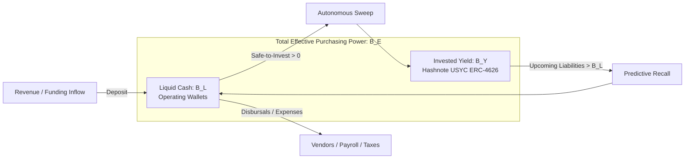
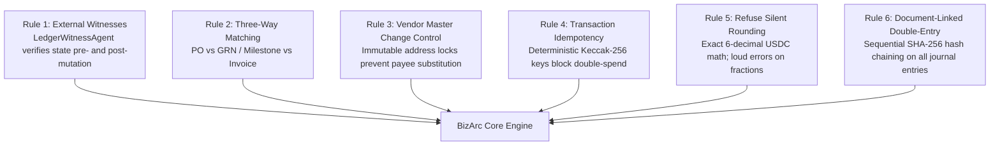
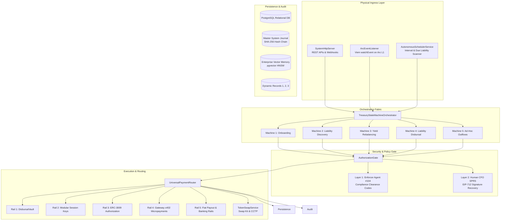

# BizArc Autonomous Treasury: Architecture & System Overview

## 1. Executive Summary

**BizArc** is an Autonomous Multi-Agent Corporate Treasury & Financial Operations Platform purpose-built for **Arc L1** (Circle's Layer-1 blockchain where USDC is the native gas token) and global banking networks.

Traditional corporate treasury relies on error-prone manual reviews, fragmented banking portals, and disconnected crypto wallets. BizArc automates enterprise financial operations by combining:
1. **The 6 Golden Rules of Enterprise Ledgers** (based on *Canteen: Agents & Ledgers in 2026*).
2. **The Tripartite Invariant** ($B_E = B_L + B_Y$) maintaining absolute balance integrity between liquid cash and yield-bearing reserves.
3. **True Enterprise Duality**: Seamless, automatic routing across both crypto rails (Arc L1, CCTP, Session Keys, x402) and non-crypto commercial banking rails (Fedwire, ACH, Push-to-Card, SEPA, SWIFT via Circle Mint).
4. **The Cognitive Swarm Architecture**: Six specialized LLM agents coordinating under an unbroken master state machine orchestrator and an immutable double-entry ledger.

---

## 2. Blockchain Foundation: Arc L1

BizArc is natively architected for **Arc L1** (Chain ID: `5042` Mainnet, `5042002` Testnet):

| Protocol Attribute | Specification | Architectural Advantage for Treasury |
| :--- | :--- | :--- |
| **Native Gas Token** | **USDC** (18-decimal native gas / 6-decimal ERC-20 interface) | Eliminates volatile gas tokens (ETH/SOL/MATIC). All operational expenses and gas fees are denominated in stable USD. |
| **Gas Floor** | **20 Gwei** minimum base fee floor | Eliminates fee volatility; guarantees deterministic transaction cost estimation for automated sweeps and disbursals. |
| **Finality** | Sub-second deterministic finality | Eliminates multi-block re-org risks; invoices settle instantaneously without settlement latency. |
| **USDC Predeploy** | `0x3600000000000000000000000000000000000000` | Canonical system contract allowing direct ERC-20 transfers and approvals without third-party contract risk. |
| **System Emitter** | `0x4800000000000000000000000000000000000000` | Protocol-level event emitter emitting Transfer logs for native token movements, captured by BizArc's [ArcEventListener](file://wsl.localhost/Ubuntu-24.04/home/gifted/BizArc/src/foundation/events/arcEventListener.ts). |

---

## 3. Core Mathematical Invariants

### 3.1 The Tripartite Balance Invariant
To prevent idle cash drag while ensuring 100% solvency for due liabilities, BizArc divides corporate capital into three parallel dimensions:

$$B_E = B_L + B_Y$$

Where:
- **$B_E$ (Effective Treasury Balance)**: Total corporate purchasing power.
- **$B_L$ (Liquid Cash)**: Immediately spendable USDC held in operating accounts for immediate disbursements.
- **$B_Y$ (Invested Yield)**: Idle capital earning institutional yield in tokenized US Treasury bills (Hashnote USYC via ERC-4626).

### 3.2 Dynamic Safe-to-Invest Metric (Dynamic Record 2)
The [TreasurySentinelService](file://wsl.localhost/Ubuntu-24.04/home/gifted/BizArc/src/services/treasurySentinelService.ts) continuously recomputes the investable margin:

$$\text{Safe-to-Invest} = B_L - \left( \sum_{i \in \text{Horizon}} \text{Liability}_i \times \text{Buffer Ratio} \right) - \text{Floor}$$

- **Horizon**: Predictive evaluation window (default: 7 days / $604,800$ seconds).
- **Buffer Ratio**: Safety factor applied to due liabilities (default: $1.20$).
- **Floor**: Minimum untouched cash threshold per cost center (e.g., $\$500.00$ USDC).
- **Hysteresis Bands**: Prevents unnecessary micro-sweeps by requiring surplus to exceed minimum sweep thresholds (e.g., $\$100.00$ USDC).

---

## 4. The 6 Golden Rules of Enterprise Ledgers

Based on the *Canteen 2026* standard, BizArc enforces six non-negotiable operational rules to eliminate agent hallucination, fraud, and ledger corruption:

1. **Rule 1: External Witnesses**: No agent unilaterally writes to accounting records. Mutations must be verified by [LedgerWitnessLlmAgent](file://wsl.localhost/Ubuntu-24.04/home/gifted/BizArc/src/agents/ledgerWitnessLlmAgent.ts) comparing RPC execution receipts against database states.
2. **Rule 2: Three-Way Matching**: Before any disbursal, [LiabilityRadarLlmAgent](file://wsl.localhost/Ubuntu-24.04/home/gifted/BizArc/src/agents/liabilityRadarLlmAgent.ts) enforces matching across Purchase Order terms, delivery verification, and invoice demands.
3. **Rule 3: Vendor Master Change Control (Anti-Payee Substitution)**: Counterparty addresses and bank coordinates must exist in [vendor_master_registry](file://wsl.localhost/Ubuntu-24.04/home/gifted/BizArc/src/database/repos/vendorMasterRepo.ts) with `change_lock: true`. Addresses printed on inbound invoice PDFs are never trusted.
4. **Rule 4: Transaction Idempotency**: All payment intents generate a 32-byte Keccak-256 idempotency key: $\text{keccak256}(\text{vendor} \parallel \text{invoice} \parallel \text{amount})$. Retries are strictly idempotent.
5. **Rule 5: Refuse Silent Rounding**: Financial math uses exact 6-decimal integers. Floating-point remainders throw a `LOUD_ROUNDING_ERROR`.
6. **Rule 6: Document-Linked Double-Entry Ledger**: Every journal entry records debit, credit, document reference, and a sequential SHA-256 hash chained to the previous block.

---

## 5. System Architecture & Component Hierarchy

---

## 6. The 5 Universal Payment Rails

BizArc eliminates the binary divide between cryptocurrency and traditional corporate banking:

### Rail 1: DisbursalVault (Smart Contract Waterfall)
- **Contract**: [DisbursalVault.sol](file://wsl.localhost/Ubuntu-24.04/home/gifted/BizArc/contracts/DisbursalVault.sol)
- **Nature**: Transient clearinghouse holding **$0 balance at rest**.
- **Capabilities**: Draws funds from operating accounts via an inter-account liquidity waterfall, enforces onchain vendor allowlists, checks Keccak-256 idempotency, and disburses USDC on Arc L1.

### Rail 2: Modular Session Keys (ERC-4337 / ERC-6900)
- **Implementation**: [modularSessionKeyRail.ts](file://wsl.localhost/Ubuntu-24.04/home/gifted/BizArc/src/payments/rails/modularSessionKeyRail.ts)
- **Nature**: Scoped programmatic permissions.
- **Capabilities**: Enables AI agents to pay recurring vendor subscriptions within predefined balance cycles, time horizons, and maximum spend envelopes without requiring human approvals for each cycle.

### Rail 3: ERC-3009 Delegated Authorizations
- **Implementation**: [erc3009AuthorizationRail.ts](file://wsl.localhost/Ubuntu-24.04/home/gifted/BizArc/src/payments/rails/erc3009AuthorizationRail.ts)
- **Nature**: Gasless delegated transfers (`transferWithAuthorization` / `receiveWithAuthorization`).
- **Capabilities**: Backed by EIP-712 off-chain signatures; relayed onchain with cryptographic nonce tracking to prevent replay attacks.

### Rail 4: Circle Gateway x402 Micropayments
- **Implementation**: [gatewayX402Rail.ts](file://wsl.localhost/Ubuntu-24.04/home/gifted/BizArc/src/payments/rails/gatewayX402Rail.ts)
- **Nature**: Sub-cent HTTP 402 pay-per-call protocol.
- **Capabilities**: Enables autonomous agents to purchase real-time external services (market data, AI inference, cloud APIs) via instant signature-verified micropayments.

### Rail 5: Universal Fiat Payouts (Traditional Banking)
- **Implementation**: [fiatPayoutRail.ts](file://wsl.localhost/Ubuntu-24.04/home/gifted/BizArc/src/payments/rails/fiatPayoutRail.ts)
- **Nature**: Global traditional banking settlement via Circle Mint.
- **Supported Sub-Methods**:
  1. **FEDWIRE**: Domestic high-value wire transfers (BNY Mellon, same-day settlement).
  2. **ACH**: Standard and Same-Day automated clearing house for routine vendor billing.
  3. **PUSH_TO_CARD**: Real-time (<5 minute) payouts directly to 16-digit debit cards (Visa Direct / Mastercard Send).
  4. **SEPA / SEPA INSTANT**: Eurozone EUR/EURC instant payouts.
  5. **SWIFT**: International cross-border commercial wire transfers.
- **Onchain Audit Tie**: Executes an onchain tracking burn transaction on Arc L1 (`transfer(0x0, amount)`) to tie traditional bank wire releases to the tamper-evident cryptographic ledger.

---

## 7. Runtime Architecture: Daemon & Ingress

The entire system executes as an autonomous background daemon managed by [TreasuryDaemon](file://wsl.localhost/Ubuntu-24.04/home/gifted/BizArc/src/daemon/treasuryDaemon.ts):

1. **Physical Ingress Server**: [SystemHttpServer](file://wsl.localhost/Ubuntu-24.04/home/gifted/BizArc/src/ingress/systemHttpServer.ts) serves REST APIs for frontend dashboards, ERP webhooks (Circle Mint, Odoo, ERPNext), and human SPRS decision gateways.
2. **Physical Blockchain Listener**: [ArcEventListener](file://wsl.localhost/Ubuntu-24.04/home/gifted/BizArc/src/foundation/events/arcEventListener.ts) connects directly to Arc L1 RPC nodes using Viem `watchEvent` on `ARC_CONSTANTS.USDC_PREDEPLOY` and `ARC_CONSTANTS.SYSTEM_EMITTER`. Inbound transfers trigger automatic deposit reconciliation in [AccountFundingService](file://wsl.localhost/Ubuntu-24.04/home/gifted/BizArc/src/services/accountFundingService.ts) and dynamic balance sweeps.
3. **Physical Background Scheduler**: [AutonomousSchedulerService](file://wsl.localhost/Ubuntu-24.04/home/gifted/BizArc/src/services/autonomousSchedulerService.ts) runs continuous interval scans for upcoming liabilities reaching their pre-flight window (e.g., 48 hours before due date), initiating predictive recall and settlement.
4. **Master State Machine Orchestrator**: [TreasuryStateMachineOrchestrator](file://wsl.localhost/Ubuntu-24.04/home/gifted/BizArc/src/orchestration/treasuryStateMachineOrchestrator.ts) coordinates transitions across all 5 reactive state machines.

---

## 8. Directory & Source Reference Map

- **Contracts**: [contracts/](file://wsl.localhost/Ubuntu-24.04/home/gifted/BizArc/contracts) ([CentralTreasuryYieldVault.sol](file://wsl.localhost/Ubuntu-24.04/home/gifted/BizArc/contracts/CentralTreasuryYieldVault.sol), [DisbursalVault.sol](file://wsl.localhost/Ubuntu-24.04/home/gifted/BizArc/contracts/DisbursalVault.sol))
- **Cognitive Agents**: [src/agents/](file://wsl.localhost/Ubuntu-24.04/home/gifted/BizArc/src/agents) ([Onboarding](file://wsl.localhost/Ubuntu-24.04/home/gifted/BizArc/src/agents/onboardingLlmAgent.ts), [Sentinel](file://wsl.localhost/Ubuntu-24.04/home/gifted/BizArc/src/agents/treasurySentinelLlmAgent.ts), [Radar](file://wsl.localhost/Ubuntu-24.04/home/gifted/BizArc/src/agents/liabilityRadarLlmAgent.ts), [Router](file://wsl.localhost/Ubuntu-24.04/home/gifted/BizArc/src/agents/disbursalRouterLlmAgent.ts), [Compliance](file://wsl.localhost/Ubuntu-24.04/home/gifted/BizArc/src/agents/policyComplianceLlmAgent.ts), [Witness](file://wsl.localhost/Ubuntu-24.04/home/gifted/BizArc/src/agents/ledgerWitnessLlmAgent.ts))
- **State Machines**: [src/orchestration/stateMachines/](file://wsl.localhost/Ubuntu-24.04/home/gifted/BizArc/src/orchestration/stateMachines)
- **Universal Payment Rails**: [src/payments/rails/](file://wsl.localhost/Ubuntu-24.04/home/gifted/BizArc/src/payments/rails)
- **Security & Authorization**: [src/security/authorizationGate.ts](file://wsl.localhost/Ubuntu-24.04/home/gifted/BizArc/src/security/authorizationGate.ts)
- **Database Repositories**: [src/database/repos/](file://wsl.localhost/Ubuntu-24.04/home/gifted/BizArc/src/database/repos)
- **Runtime Daemon**: [src/daemon/treasuryDaemon.ts](file://wsl.localhost/Ubuntu-24.04/home/gifted/BizArc/src/daemon/treasuryDaemon.ts)
- **Ingress HTTP Server**: [src/ingress/systemHttpServer.ts](file://wsl.localhost/Ubuntu-24.04/home/gifted/BizArc/src/ingress/systemHttpServer.ts)
