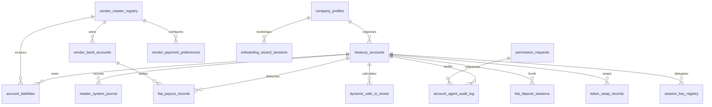
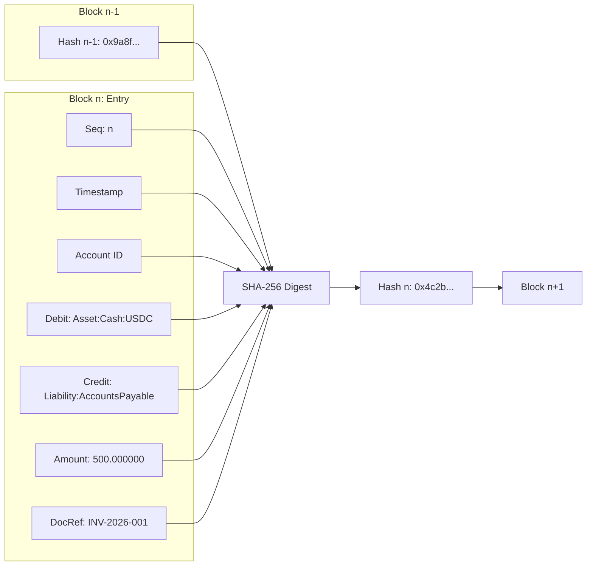

# BizArc Database Schema, Double-Entry Ledger & Vector Memory Architecture

## 1. Executive Summary

BizArc combines a robust relational data store, a tamper-evident cryptographic hash-chained general ledger, and a high-performance semantic vector database into a unified persistence engine.

Engineered according to the **Canteen Agents & Ledgers (2026)** specification, the data architecture guarantees:
1. **Unbroken Audit Chains**: Every internal and onchain mutation is recorded in a sequential SHA-256 hash-linked journal.
2. **Three Dynamic Records**: Continuous synchronization of active liabilities, safe-to-invest liquidity, and actor-agent audit trails.
3. **Enterprise Vector Memory**: Semantic RAG over company contracts, bylaws, and ERP documents using `pgvector` with HNSW cosine indexing.
4. **ERP Synchronization**: Dual-directional staging and checkpoint tracking for ERPNext and Odoo.

---

## 2. Relational Schema Architecture (PostgreSQL)

The database schema is defined in [database/schema.sql](file://wsl.localhost/Ubuntu-24.04/home/gifted/BizArc/database/schema.sql) and implemented via 22 dedicated repositories in [src/database/repos/](file://wsl.localhost/Ubuntu-24.04/home/gifted/BizArc/src/database/repos):



### 2.1 Core Relational Tables Directory

| Table Name | Primary Repository | Purpose | Key Indices |
| :--- | :--- | :--- | :--- |
| `treasury_accounts` | [TreasuryAccountsRepo](file://wsl.localhost/Ubuntu-24.04/home/gifted/BizArc/src/database/repos/treasuryAccountsRepo.ts) | Operating wallets, cost-center roles, reserve floors, spending caps | `account_id`, `wallet_address`, `company_id` |
| `account_liabilities` | [LiabilityRepo](file://wsl.localhost/Ubuntu-24.04/home/gifted/BizArc/src/database/repos/liabilityRepo.ts) | Dynamic Record 1: Scheduled vendor liabilities, multi-modal payment configs | `liability_id`, `due_date`, `status`, `account_id` |
| `vendor_master_registry` | [VendorMasterRepo](file://wsl.localhost/Ubuntu-24.04/home/gifted/BizArc/src/database/repos/vendorMasterRepo.ts) | Verified payee registry with immutable `change_lock` (Rule 3) | `vendor_id`, `verified_payout_address` |
| `vendor_bank_accounts` | [VendorBankRepo](file://wsl.localhost/Ubuntu-24.04/home/gifted/BizArc/src/database/repos/vendorBankRepo.ts) | Traditional banking coordinates (IBANs, routing numbers, card tokens) | `bank_account_id`, `vendor_id`, `payment_sub_method` |
| `vendor_payment_preferences` | [VendorPaymentPreferenceRepo](file://wsl.localhost/Ubuntu-24.04/home/gifted/BizArc/src/database/repos/vendorPaymentPreferenceRepo.ts) | Multi-modal payment rail preferences (Rails 1–5) and routing metadata | `preference_id`, `vendor_id`, `preferred_rail` |
| `permission_requests` | [PermissionRequestRepo](file://wsl.localhost/Ubuntu-24.04/home/gifted/BizArc/src/database/repos/permissionRequestRepo.ts) | EIP-712 Standardized Permission Requests (SPRS) awaiting human CFO sign-off | `request_id`, `status` |
| `master_system_journal` | [MasterJournalRepo](file://wsl.localhost/Ubuntu-24.04/home/gifted/BizArc/src/database/repos/masterJournalRepo.ts) | Double-entry journal with sequential SHA-256 hash chaining (Rule 1 & 6) | `sequence_id`, `account_id`, `document_ref` |
| `account_agent_audit_log` | [AuditLogRepo](file://wsl.localhost/Ubuntu-24.04/home/gifted/BizArc/src/database/repos/auditLogRepo.ts) | Dynamic Record 3: Pre- and post-state snapshots per actor agent | `log_id`, `account_id`, `timestamp`, `action_type` |
| `dynamic_safe_to_invest` | [DynamicRecordsService](file://wsl.localhost/Ubuntu-24.04/home/gifted/BizArc/src/records/dynamicRecordsService.ts) | Dynamic Record 2: Safe-to-invest metrics, tripartite balance records | `record_id`, `account_id`, `created_at` |
| `compliance_clearance_codes`| [ClearanceCodeRepo](file://wsl.localhost/Ubuntu-24.04/home/gifted/BizArc/src/database/repos/clearanceCodeRepo.ts) | Single-use time-bound authorization tokens issued by Enforcer Agent #104 | `code`, `account_id`, `is_consumed`, `expires_at` |
| `movement_policies` | [MovementPolicyRepo](file://wsl.localhost/Ubuntu-24.04/home/gifted/BizArc/src/database/repos/movementPolicyRepo.ts) | Inter-account waterfall priority, borrowing ratios, protected accounts | `policy_id`, `company_id` |
| `fiat_payout_records` | [FiatPayoutRepo](file://wsl.localhost/Ubuntu-24.04/home/gifted/BizArc/src/database/repos/fiatPayoutRepo.ts) | Traditional banking payout tracking (Fedwire, ACH, Push-to-Card, SEPA, SWIFT) | `payout_id`, `account_id`, `vendor_id`, `status` |
| `fiat_deposit_sessions` | [FiatDepositSessionRepo](file://wsl.localhost/Ubuntu-24.04/home/gifted/BizArc/src/database/repos/fiatDepositSessionRepo.ts) | Onramp and institutional wire funding sessions with tracking memos | `session_id`, `account_id`, `tracking_memo` |
| `token_swap_records` | [TokenSwapRepo](file://wsl.localhost/Ubuntu-24.04/home/gifted/BizArc/src/database/repos/tokenSwapRepo.ts) | Multi-chain token swap records (LiFi / Swap Kit / Arc settlement) | `swap_id`, `account_id` |
| `session_key_registry` | [SessionKeyRepo](file://wsl.localhost/Ubuntu-24.04/home/gifted/BizArc/src/database/repos/sessionKeyRepo.ts) | Scoped ERC-4337 / ERC-6900 session keys with spending cycles | `session_key_id`, `account_id`, `allowed_recipient` |
| `erc3009_authorizations` | [Erc3009Repo](file://wsl.localhost/Ubuntu-24.04/home/gifted/BizArc/src/database/repos/erc3009Repo.ts) | Signed EIP-3009 authorizations and nonces preventing replay attacks | `nonce`, `from_address`, `to_address` |
| `erp_sync_state` | [ErpSyncRepo](file://wsl.localhost/Ubuntu-24.04/home/gifted/BizArc/src/database/repos/erpSyncRepo.ts) | Document checkpoints and synchronization status for Odoo & ERPNext | `sync_id`, `system_type`, `entity_type` |
| `enterprise_vector_memory` | [VectorMemoryService](file://wsl.localhost/Ubuntu-24.04/home/gifted/BizArc/src/memory/vectorMemoryService.ts) | 1536-dimensional pgvector store for semantic retrieval of contracts and bylaws | `id`, `collection`, `document_id`, HNSW index |

---

## 3. Master System Journal & SHA-256 Hash Chaining

The [MasterJournalRepo](file://wsl.localhost/Ubuntu-24.04/home/gifted/BizArc/src/database/repos/masterJournalRepo.ts) implements **Golden Rule 1 & Rule 6**: an immutable, double-entry general ledger protected by a cryptographic hash chain.

### 3.1 Hash Chaining Mathematical Formulation

For each sequence entry $n$, the cryptographic digest is computed as:

$$\text{Hash}_n = \text{SHA256}(\text{Hash}_{n-1} \parallel \text{SeqId}_n \parallel \text{Timestamp}_n \parallel \text{AccountId}_n \parallel \text{Debit}_n \parallel \text{Credit}_n \parallel \text{Amount}_n \parallel \text{DocRef}_n)$$



### 3.2 Double-Entry Chart of Accounts Mapping

Every financial mutation requires balancing debit and credit entries:

| Operational Action | Debit Account | Credit Account | Purpose |
| :--- | :--- | :--- | :--- |
| **Incoming Fiat Deposit** | `Asset:Cash:USDC:<account>` | `Equity:FiatCapitalContribution:<account>` | Account funding via Fedwire / Card on-ramp |
| **Incoming Arc Crypto Inflow** | `Asset:Cash:USDC:<account>` | `Equity:CryptoTreasuryContribution:<account>` | Direct Arc native USDC transfer |
| **Yield Surplus Sweep** | `Asset:Yield:USYC:<account>` | `Asset:Cash:USDC:<account>` | Capital moved into Hashnote USYC |
| **Deficit Yield Recall** | `Asset:Cash:USDC:<account>` | `Asset:Yield:USYC:<account>` | Capital pulled from USYC into liquid pool |
| **Vendor Disbursal (Rails 1–4)** | `Expense:VendorPayable:<vendor>` | `Asset:Cash:USDC:<account>` | Crypto settlement to verified payee |
| **Vendor Fiat Disbursal (Rail 5)**| `Expense:VendorPayable:<vendor>` | `Asset:Cash:USDC:<account>` | Traditional bank wire / card push via Circle Mint |
| **Inter-Account Transfer** | `Asset:Cash:USDC:<target>` | `Asset:Cash:USDC:<source>` | Cost-center rebalancing |

### 3.3 Automated Integrity Verification
The ledger integrity is verified programmatically via `MasterJournalRepo.verifyChainIntegrity(accountId)`:
- Recursively recalculates every hash from Sequence ID 1 to the present.
- Detects database tampering, row deletions, or out-of-order edits with $O(n)$ precision.

---

## 4. The Three Dynamic Records

The system maintains three parallel real-time dynamic records in [DynamicRecordsService](file://wsl.localhost/Ubuntu-24.04/home/gifted/BizArc/src/records/dynamicRecordsService.ts):

### Dynamic Record 1: Active Liabilities Table
- **Scope**: All upcoming vendor obligations, subscription renewals, payroll cycles, and debt service demands.
- **Attributes Persisted**: Exact 6-decimal `amount_usdc`, `due_date`, `vendor_id`, `payout_address`, `preferred_payment_rail`, `payment_sub_method`, and `payment_rail_config`.
- **Status Lifecycle**: `SCHEDULED` $\rightarrow$ `AWAITING_APPROVAL` $\rightarrow$ `DISBURSED` (or `FROZEN` / `CANCELLED`).

### Dynamic Record 2: Dynamic Safe-to-Invest Record
- **Scope**: Real-time solvency and investment capacity per operating account.
- **Attributes Persisted**: `liquid_cash_usdc`, `invested_yield_usdc`, `available_balance_usdc`, `target_reserve_usdc`, `safe_to_invest_usdc`, `time_horizon_seconds`.
- **Recomputation**: Recomputed automatically following any balance mutation, liability addition, or disbursal.

### Dynamic Record 3: Immutable Agent Audit Trail
- **Scope**: Cryptographically verifiable record of all agent deliberations, tool calls, and state transitions.
- **Attributes Persisted**: `pre_state_snapshot`, `post_state_snapshot`, `actor_agent`, `reason`, `tx_hash`, `permission_request_id`.

---

## 5. Enterprise Vector Memory (pgvector HNSW)

For semantic RAG over complex corporate documents, the system uses PostgreSQL's native `vector` extension with Hierarchical Navigable Small World (HNSW) indexing:

```sql
CREATE TABLE enterprise_vector_memory (
    id UUID PRIMARY KEY DEFAULT gen_random_uuid(),
    collection VARCHAR(64) NOT NULL,
    document_id VARCHAR(128) NOT NULL,
    title VARCHAR(255) NOT NULL,
    chunk_index INT NOT NULL DEFAULT 0,
    content TEXT NOT NULL,
    metadata JSONB NOT NULL DEFAULT '{}'::jsonb,
    embedding vector(1536),
    created_at TIMESTAMPTZ DEFAULT NOW()
);

CREATE INDEX idx_vector_memory_hnsw ON enterprise_vector_memory 
USING hnsw (embedding vector_cosine_ops) WITH (m = 16, ef_construction = 64);
```

### Vector Memory Collections
- `company_documents`: Bylaws, signing authority delegations, corporate resolutions.
- `msas`: Master Service Agreements containing negotiated terms and SLAs.
- `vendor_masters`: Supplier profile history, delivery track records, risk notes.
- `erp_pos`: Ingested Purchase Orders with approved quantity and rate schedules.
- `erp_invoices`: Historic vendor invoices for anomaly comparison and price-creep detection.
- `historical_rulings`: Prior decisions made by Human Corporate Officers on SPRS requests.

---

## 6. Verification and Reference Files

- Database Schema: [database/schema.sql](file://wsl.localhost/Ubuntu-24.04/home/gifted/BizArc/database/schema.sql)
- Database Migration Script: [src/database/migrate.ts](file://wsl.localhost/Ubuntu-24.04/home/gifted/BizArc/src/database/migrate.ts)
- Master Journal Repo: [masterJournalRepo.ts](file://wsl.localhost/Ubuntu-24.04/home/gifted/BizArc/src/database/repos/masterJournalRepo.ts)
- Dynamic Records Service: [dynamicRecordsService.ts](file://wsl.localhost/Ubuntu-24.04/home/gifted/BizArc/src/records/dynamicRecordsService.ts)
- Vector Memory Service: [vectorMemoryService.ts](file://wsl.localhost/Ubuntu-24.04/home/gifted/BizArc/src/memory/vectorMemoryService.ts)
- Database Repositories: [src/database/repos/](file://wsl.localhost/Ubuntu-24.04/home/gifted/BizArc/src/database/repos)
