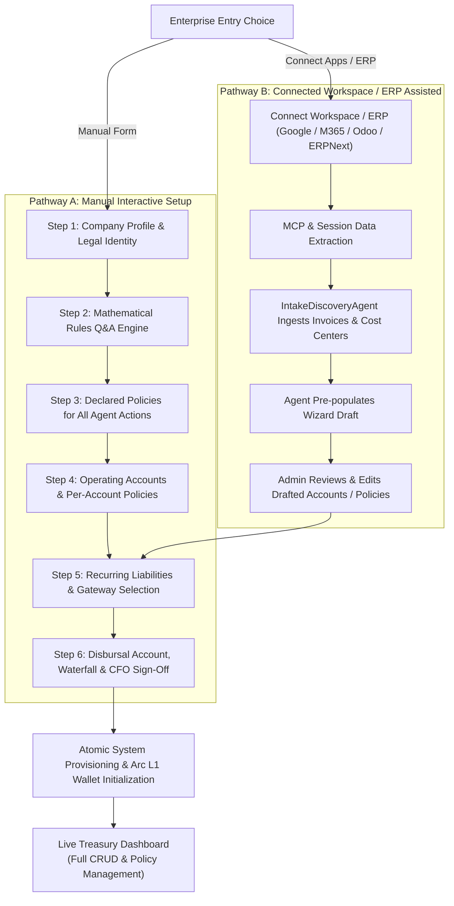
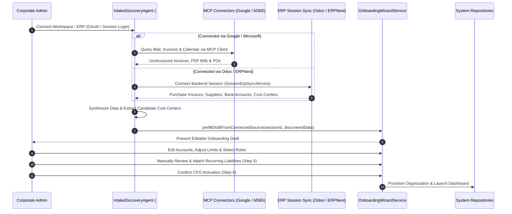

# BizArc: Enterprise Onboarding & Lifecycle Guide

## 1. Executive Overview

Corporate onboarding into an autonomous treasury system cannot be a one-size-fits-all form. Hyper-growth companies have bespoke financial policies, varying risk tolerances, distinct departmental budgets, and existing software ecosystems.

BizArc delivers a flexible, robust **Two-Pathway Enterprise Onboarding Architecture**:
1. **Pathway A: The Interactive Manual Onboarding Wizard**: A structured 6-step guided workflow where administrators answer intuitive business questions, define operating accounts, establish mathematical financial rules, configure recurring liabilities with specific payment gateways, and provision onchain accounts.
2. **Pathway B: Connected Workspace & ERP-Assisted Onboarding**: Seamless integration via Google Workspace MCP, Microsoft 365 MCP, or native session synchronization with Odoo and ERPNext. The autonomous AI intake agent extracts existing vendor contracts, bills, and cost centers to pre-populate an editable draft for administrative review.

Regardless of the initial pathway selected:
- **Strict Invariant**: Every recurring liability must be attached to an account established during account configuration.
- **Mathematical Policies**: Defined through an intuitive Q&A engine rather than code or scripts.
- **100% Post-Onboarding Editability**: Every account, policy rule, spending limit, vendor preference, and liability remains fully editable by authorized administrators at any time.

---

## 2. Onboarding Architecture & System Flow



---

## 3. Pathway A: The 6-Step Manual Interactive Wizard

Managed by the [OnboardingWizardService](file://wsl.localhost/Ubuntu-24.04/home/gifted/BizArc/src/services/onboardingWizardService.ts) and backed by the `wizard_onboarding_sessions` table in PostgreSQL.

### Step 1: Company Profile & Legal Identity
Captures organizational fundamentals:
- **`companyName`**: Legal corporate entity name (e.g., `Acme Innovations Inc.`).
- **`taxId`**: Federal Employer Identification Number (EIN) or corporate registration tax identifier.
- **`jurisdiction`**: Regulatory domicile (e.g., `US-DE`, `UK`, `SG`).
- **`reportingCurrency`**: Base treasury denomination (default: `USD` / `USDC`).
- **`businessDescription`**: Natural-language operational charter guiding cognitive agent context.

### Step 2: Mathematical Rules Defined via Q&A Engine
Corporate finance officers should not write mathematical algorithms or YAML configurations. BizArc utilizes the [MathRulesQAEngine](file://wsl.localhost/Ubuntu-24.04/home/gifted/BizArc/src/services/mathRulesQAEngine.ts) to administer a structured questionnaire across four categories:

| Category | Example Question | Derived Mathematical Parameter | Purpose in System |
| :--- | :--- | :--- | :--- |
| **`GENERAL_MATH`** | *"How many months of liquid cash runway must your treasury maintain at all times?"* | `minRunwayMonths` (e.g., 3 months) | Establishes the macro-liquidity safety envelope. |
| **`GENERAL_MATH`** | *"What is your estimated 30-day net operating cash burn in USDC?"* | `monthlyBurnUsdc` (e.g., $150,000) | Computes baseline corporate reserve floors. |
| **`ACCOUNT_MATH`** | *"What is the minimum operating floor in USDC below which this account should never fall?"* | `minOperatingFloorUsdc` (e.g., $50.00 to $1,000.00) | Hard safety floor for each departmental wallet. |
| **`ACCOUNT_MATH`** | *"What safety multiplier buffer should be held over upcoming liabilities?"* | `safetyBufferRatio` (e.g., 1.20x Opex, 1.25x Payroll) | Protects against price volatility and unexpected fees. |
| **`LIABILITY_MATH`** | *"How many hours prior to an invoice due date should the agent stage funds or alert you?"* | `preFlightLeadTimeHours` (e.g., 48 hours) | Governs the radar scan window and pre-funding timing. |
| **`LIABILITY_MATH`** | *"What is the maximum price increase percentage before an alert is triggered?"* | `maxPriceHikePercentage` (e.g., 15.0%) | Flag unexpected vendor subscription hikes. |
| **`INVESTMENT_MATH`** | *"What percentage of idle surplus cash should be swept into Hashnote USYC?"* | `targetAllocationRatio` (e.g., 80.0%) | Governs yield vault allocation. |
| **`INVESTMENT_MATH`** | *"What minimum dollar surplus justifies an onchain sweep transaction?"* | `minSweepThresholdUsdc` (e.g., $50.00) | Prevents micro-transaction churn and unnecessary gas. |

The QA engine evaluates responses and persists derived mathematical coefficients into `math_rule_qa_responses`.

### Step 3: Declared Policies for All Agent Actions
Establishes the boundary between autonomous fast-path execution and mandatory human escalation:
- **Cost Center Rules**: Spending restrictions by department.
- **Anomaly Tolerances**: Three-way match verification requirements and vendor price hike flags.
- **Spending Caps**: Single-transaction human gate threshold (e.g., $500.00 USDC), daily spending caps, weekly limits, and monthly velocity ceilings.

### Step 4: Operating Accounts & Per-Account Policies
The administrator configures specific operating wallets corresponding to organizational departments:
- **Standard Account Roles**:
  - `TREASURY_RESERVE`: Master corporate pool; primary interface for USYC yield sweeps.
  - `PAYROLL`: Strictly shielded personnel compensation account.
  - `OPEX_DEV`: Cloud infrastructure (AWS, GCP, Datadog) and developer tooling.
  - `OPEX_GROWTH`: Marketing, ad spend, and customer acquisition.
  - `OPEX_LEGAL`: Legal counsel retainers and corporate compliance.
  - `TAX_ESCROW`: Estimated tax liabilities and regulatory fees.
- **Per-Account Policy Attributes**:
  - `minOperatingFloorUsdc`: Liquid cash reserve.
  - `safetyBufferRatio`: Liability protection multiplier.
  - `perTxCapUsdc`: Max single payment permitted without human sign-off.
  - `dailyCapUsdc` / `weeklyCapUsdc` / `monthlyCapUsdc`: Velocity limits.
  - `maxAutonomousSweepUsdc`: Maximum surplus allowed to sweep to USYC automatically (set to `0.00` for `PAYROLL` to prevent any fund sweeps).
  - `excludeFromWaterfall`: Inviolable shield preventing non-payroll expenditures from pulling from this account.

### Step 5: Recurring Liabilities Setup & Attachment
Administrators input recurring obligations and attach them directly to finalized accounts:
1. **Strict Account Attachment Invariant**:
   - The user must select an account established in Step 4.
   - If a liability references an undeclared account ID, validation rejects the payload immediately.
2. **Obligation Definition**:
   - `title`: Obligation name (e.g., `AWS Cloud Infrastructure`, `OpenAI API Tier 5`, `G-Suite Enterprise`).
   - `vendorId`: Unique counterparty code mapped to [VendorMasterRepo](file://wsl.localhost/Ubuntu-24.04/home/gifted/BizArc/src/database/repos/vendorMasterRepo.ts).
   - `amountUsdc`: Exact recurring amount (enforcing 6-decimal USDC precision).
   - `dueDate`: Scheduled payment date.
   - `frequencyCron`: Recurrence schedule (e.g., `0 0 1 * *` for monthly 1st).
3. **Payment Method / Gateway Selection**:
   The admin selects the preferred settlement rail from BizArc's **Universal 5-Rail Gateway**:
   - **Rail 1: DisbursalVault**: Transient onchain clearinghouse on Arc L1 with cryptographic idempotency.
   - **Rail 2: Modular Session Keys**: Gasless, policy-bounded recurring micropayments via ERC-4337 smart accounts.
   - **Rail 3: ERC-3009 Gasless Authorization**: Offchain signed transfers (`receiveWithAuthorization`) without native gas tokens.
   - **Rail 4: Circle Gateway x402**: Instant HTTP 402 pay-per-call nanopayments for autonomous AI agents.
   - **Rail 5: Circle Mint Traditional Fiat Payout**: Commercial banking wires for non-crypto vendors with five supported sub-methods:
     - `FEDWIRE`: Domestic high-value wire transfers (BNY Mellon / Fedwire).
     - `ACH`: Standard or Same-Day automated clearing house.
     - `PUSH_TO_CARD`: Instant (<5 min) payouts to 16-digit debit cards (Visa Direct / Mastercard Send).
     - `SEPA` / `SEPA INSTANT`: Eurozone EUR/EURC instant bank transfers.
     - `SWIFT`: International cross-border commercial bank wires.
4. **Disbursal & Pre-Flight Rules**:
   - `autoPayThresholdUsdc`: Auto-execution limit if inside rules.
   - `preFlightLeadTimeHours`: Advance notice window for admin radar alerts (e.g., 48 hours).
   - `requireThreeWayMatch`: Enforces PO and goods receipt verification.

### Step 6: Review, Disbursal Rules, Waterfall & Final CFO Activation
1. **Disbursal Account Settings**: Confirms transient DisbursalVault configuration ($0 balance at rest).
2. **Waterfall Policy Confirmation**: Confirms cross-account movement priorities and verifies that the **Payroll Shield** is active.
3. **CFO Sign-Off & Activation**:
   - Calls `activateOrganization(sessionId)`.
   - Provisions database records in `company_profiles`, `treasury_accounts`, `account_liabilities`, `vendor_master`, and `vendor_bank_details`.
   - Deploys or binds Arc L1 smart contracts.
   - Loads the active Treasury Dashboard.

---

## 4. Pathway B: Connected Workspace & ERP-Assisted Onboarding

For enterprises managing hundreds of vendors across existing systems, manual entry can be replaced by autonomous discovery via Model Context Protocol (MCP) and ERP session sync.



### 4.1 Integration Connectors
1. **Google Workspace MCP Client** ([GoogleWorkspaceMcpClient](file://wsl.localhost/Ubuntu-24.04/home/gifted/BizArc/src/connectors/googleWorkspaceMcpClient.ts)):
   - Connects to Google Drive, Gmail, and Google Cloud Billing via MCP.
   - Extracts inbound supplier invoices, billing notices, and contract PDFs.
2. **Microsoft 365 MCP Client** ([Microsoft365McpClient](file://wsl.localhost/Ubuntu-24.04/home/gifted/BizArc/src/connectors/microsoft365McpClient.ts)):
   - Interfaces with Microsoft Graph API and Azure Billing.
   - Gathers enterprise vendor correspondence, receipts, and subscription renewals.
3. **Odoo & ERPNext Direct Session Sync** ([SessionErpSyncService](file://wsl.localhost/Ubuntu-24.04/home/gifted/BizArc/src/connectors/sessionErpSyncService.ts)):
   - Authenticates using active enterprise user sessions.
   - Ingests structured purchase invoices (`account.move` in Odoo, `Purchase Invoice` in ERPNext), active supplier records (`res.partner`), and general ledger chart of accounts.

### 4.2 Autonomous Extraction to Editable Draft
- The [IntakeDiscoveryAgent](file://wsl.localhost/Ubuntu-24.04/home/gifted/BizArc/src/services/intakeDiscoveryAgent.ts) parses discovered financial documents.
- Normalizes supplier details, bank credentials (IBAN, routing, swift), crypto payout addresses, and recurring frequencies.
- Calls `OnboardingWizardService.prefillDraftFromConnectedSource()`:
  - Generates candidate Step 4 operating accounts based on identified cost centers.
  - Populates suggested reserve floors and spending caps based on historical billing volumes.
  - Drafts discovered vendor profiles and payment preferences.

### 4.3 Administrative Review & Mandatory Manual Liability Attachment
To prevent hallucinated spending obligations:
1. **Admin Reviews Draft**: The administrator inspects the pre-populated accounts, modifying titles, floors, and roles.
2. **Mandatory Manual Attachment**: The administrator **always manually confirms and attaches** recurring liabilities to the finalized accounts. This ensures that every scheduled withdrawal has explicit human sign-off prior to activation.

---

## 5. Post-Onboarding Lifecycle & Continuous Management

Onboarding is not a static one-time setup. Business needs evolve continuously. BizArc provides comprehensive runtime management APIs and interfaces:

```
┌─────────────────────────────────────────────────────────────────────────────┐
│                   POST-ONBOARDING LIFECYCLE MANAGEMENT                      │
├─────────────────────────────────────────────────────────────────────────────┤
│                                                                             │
│  1. ACCOUNT MANAGEMENT ([AccountManagementService])                         │
│     - Provision new departmental accounts dynamically                       │
│     - Update operating floors, buffer ratios, and spending limits           │
│     - Deactivate deprecated accounts or toggle waterfall participation      │
│                                                                             │
│  2. LIABILITY SETTINGS ([LiabilitySettingsService])                         │
│     - Add new recurring liabilities, subscriptions, or debt obligations     │
│     - Edit due dates, amounts, frequencies, and payout addresses            │
│     - Modify preferred payment rail (Switch from Crypto to Fiat Payout)     │
│     - Update beneficiary banking details (Fedwire, ACH, Push-to-Card)       │
│                                                                             │
│  3. VENDOR MASTER REGISTRY ([VendorMasterService])                          │
│     - Manage immutable verified vendor registry                             │
│     - Perform KYC/AML verification and add banking credentials             │
│     - Guard against Payee Substitution Attacks via address locking          │
│                                                                             │
│  4. MATHEMATICAL RULES & POLICY TUNING                                      │
│     - Re-run Math Rules Q&A at any time to adjust runway or buffer formulas │
│     - Modify single-tx human gate thresholds and daily velocity limits      │
│                                                                             │
└─────────────────────────────────────────────────────────────────────────────┘
```

### Complete Code Example: Updating a Recurring Liability Post-Onboarding

```typescript
import { LiabilitySettingsService } from "../services/liabilitySettingsService.js";

const settingsService = new LiabilitySettingsService();

// Update AWS subscription: Switch to Fedwire Traditional Bank Payout and adjust auto-pay ceiling
await settingsService.updateLiabilitySettings({
  liabilityId: "liab_aws_infra_001",
  accountId: "OPEX_DEV",
  amountUsdc: 14500.00,
  preferredPaymentRail: "FIAT_PAYOUT",
  preferredSubMethod: "FEDWIRE",
  fiatDetails: {
    accountHolderName: "Amazon Web Services Inc.",
    ibanOrAccountNumber: "9876543210",
    routingOrSwift: "021000021",
    bankName: "JPMorgan Chase Bank, N.A.",
    bankCountry: "US",
  },
  disbursalRules: {
    autoPayThresholdUsdc: 20000.00,
    preFlightLeadTimeHours: 72,
    requireThreeWayMatch: true,
  },
});
```

---

## 6. Summary: Key Architectural Guarantees

1. **Deterministic Separation of Duties**: The agent that computes safe-to-invest margins never writes directly to the master journal; an independent witness agent observes and records onchain settlements.
2. **Zero Custody Risk at Rest**: The clearinghouse Disbursal Vault holds $0 at rest, only receiving capital milliseconds before instant disbursement to verified vendors.
3. **No Silent Changes**: Any modification to vendor payout addresses or accounts requires human EIP-712 cryptographic approval.
4. **Resilient Duality**: Complete support for cutting-edge Arc L1 crypto rails and institutional commercial banking rails (Fedwire, ACH, Push-to-Card, SEPA, SWIFT).
