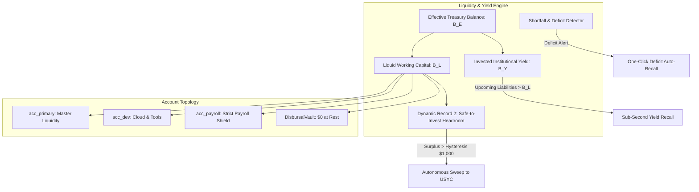
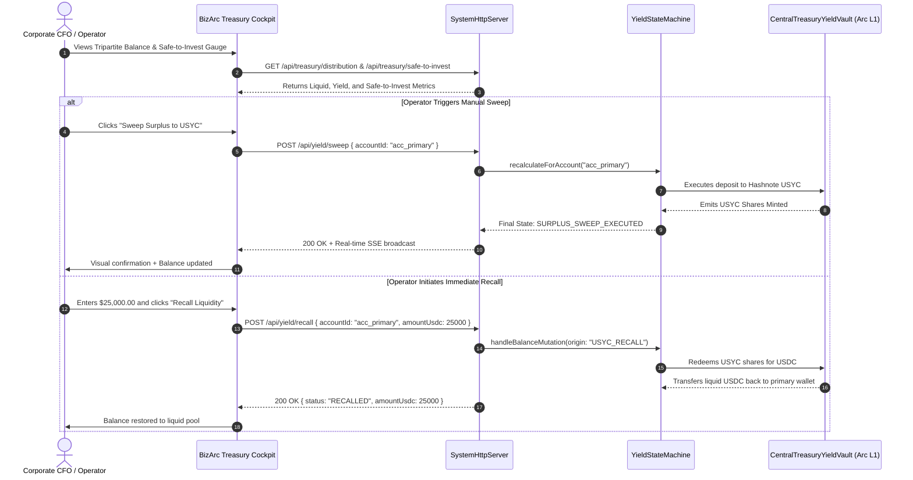
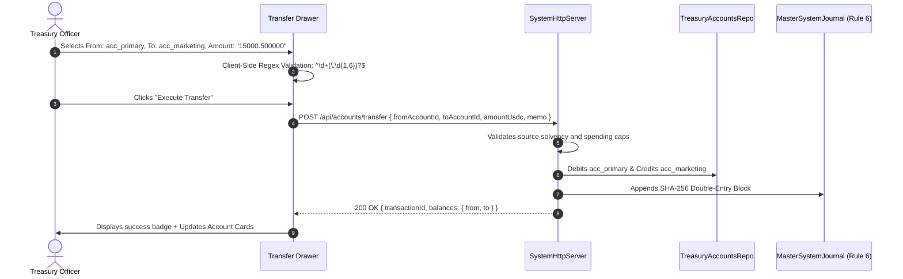
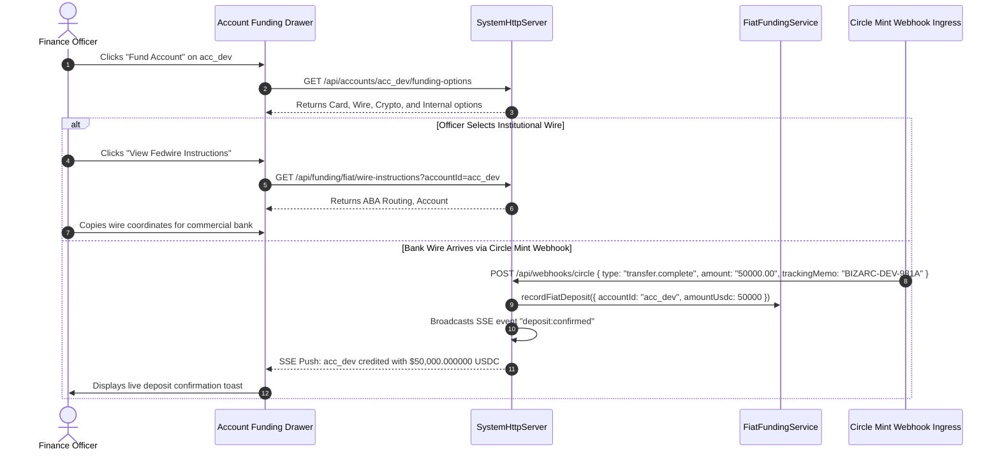

# BizArc Frontend Specification: Document 1
# Corporate Treasury Operations & Real-Time Liquidity Engine

## 1. Domain & Architectural Overview

The **Corporate Treasury Operations & Real-Time Liquidity Engine** represents the core financial cockpit of the BizArc platform. It delivers real-time visibility, mathematical solvency guarantees, and autonomous control over an enterprise's working capital, departmental cost centers, yield optimization, and multi-rail capital inflows.

The UI exposes the platform's core mathematical invariants:
1. **The Tripartite Balance Invariant**: Total effective purchasing power is always the exact sum of spendable liquid cash and tokenized institutional yield:
   $$B_E = B_L + B_Y$$
   Where $B_E$ is Effective Purchasing Power, $B_L$ is Liquid Cash across operating accounts on Arc L1, and $B_Y$ is Invested Yield Reserve in Hashnote USYC (ERC-4626).
2. **Dynamic Record 2 (Safe-to-Invest)**: The algorithmically determined surplus cash eligible for autonomous yield generation after reserving mandatory safety buffers and funding all committed liabilities over a rolling 7-day horizon:
   $$B_{STI} = B_L - (L_{7d} \times \text{Buffer}) - \sum \text{Floor}_{accounts}$$
3. **The Protected Payroll Shield**: Strict segregation of personnel compensation accounts (`max_autonomous_sweep_limit = 0.00`, `exclude_from_waterfall = true`).
4. **Transient Clearinghouse ($0.00 at Rest)**: Disbursal accounts only stage funds momentarily during execution cycles.

---

## 2. Target User Personas & Access Permissions

| Persona | Permitted Capabilities & Views | Restricted Actions |
| :--- | :--- | :--- |
| **Owner / CFO** | Full administrative and financial control; create and edit operating accounts; modify account floors and safety multipliers; execute manual yield sweeps and recalls; initiate intra-company transfers; approve fiat funding sessions; run shortfall rebalances. | None. |
| **Treasury Officer** | View all balances and safe-to-invest metrics; initiate intra-account transfers within per-tx spending limits; generate wire instructions; initiate account funding sessions; execute token swaps. | Cannot modify payroll shield status, delete operating accounts, or alter global investment policy without CFO approval. |
| **Auditor / Viewer** | Read-only inspection of tripartite balances, yield performance charts, account waterfalls, historical audit moves, and wire records. | All mutation endpoints (`POST`, `PUT`, `DELETE`) return `403 FORBIDDEN`. All action buttons are rendered in disabled state. |

---

## 3. Screen Blueprint & Interface Components

### 3.1 Tripartite Balance Cockpit (Executive Summary)
* **Effective Balance Metric Card ($B_E$)**:
  * Displays total consolidated corporate purchasing power denominated in exact 6-decimal USDC (`formatUsdc()`), updated via live Server-Sent Events (SSE).
  * Includes 24-hour liquidity delta indicator (percentage and USDC volume).
* **Liquid Capital Split Card ($B_L$)**:
  * Shows aggregate spendable cash across all operational accounts on Arc L1.
  * Direct action link: "Transfer Between Accounts" and "Fund Treasury".
* **Invested Yield Reserve Card ($B_Y$)**:
  * Total capital actively earning ~5.15% APY in tokenized US Treasury bills (**Hashnote USYC ERC-4626**).
  * Shows real-time earned yield tickers (Daily, MTD, All-Time) and compounding frequency indicator (`DAILY_REINVESTED`).
  * Action buttons: **"Sweep Surplus"** (deposits eligible cash into USYC) and **"Recall Liquidity"** (redeems USYC shares back to liquid cash).
* **Safe-to-Invest Gauge (Dynamic Record 2)**:
  * Visual circular progress gauge showing current unencumbered surplus vs. required solvency reserve.
  * Time-horizon countdown timer (`7d 00h 00m` horizon) tracking upcoming payment obligations.
  * Hysteresis safety margin indicator (e.g., `$1,000.00 USDC` buffer preventing micro-sweep churn).
  * Recommendation badge: `SWEEP_RECOMMENDED` (green), `BALANCED` (blue), or `RECALL_REQUIRED` (amber/red).
* **Treasury Shortfall Alert Banner**:
  * Conditionally renders at the top of the cockpit when `/api/treasury/shortfalls` detects any operating account below its required liquidity threshold.
  * Displays deficit amount ($B_{deficit}$), affected account name, and prominent action button: **"Resolve Deficit / Auto-Recall"**.

### 3.2 Operating Accounts Grid & Liquidity Waterfall
* **Cost Center Accounts Table & Cards**:
  * Displays all corporate accounts (e.g., `acc_primary`, `acc_engineering`, `acc_marketing`, `acc_ai_infra`).
  * For each account: Assigned EVM address (`0x...`), Assigned Role (`TREASURY_RESERVE`, `OPEX_DEV`, etc.), Active Balance, Minimum Operating Floor, Safety Buffer Ratio (e.g. `1.20x`), Per-Tx Cap, Daily Cap, and Status.
  * Quick Actions per account: "Fund Account", "Transfer Out", "Edit Policy", "View Audit Moves".
* **Account Creation Button**:
  * Prominent **"+ Add Operating Account"** button opening the Account Creation Drawer.
* **Protected Payroll Wall Card (`acc_payroll`)**:
  * Highlighted protected account card with an amber/gold border and permanent Shield icon.
  * Displays: `Strict Corporate Shield — max_autonomous_sweep_limit = 0.00 USDC`.
  * Explicit badge: `Protected from Automated Sweeps and Waterfall Drains`.
* **Transient Disbursal Account View (`DisbursalVault.sol`)**:
  * Displays clearinghouse status with indicator: `$0.00 USDC at Rest`.
  * Visual pulse animation triggers only during active batch payment execution.

### 3.3 Account Creation & Configuration Drawer / Modal
* **Drawer Trigger**: Opened via **"+ Add Operating Account"** or "Edit Policy" on any account card.
* **Form Inputs**:
  * **Account Identifier**: e.g., `acc_ai_infra` (alphanumeric snake_case, unique per tenant).
  * **Display Name**: Human-readable name (e.g., `AI Cloud Infrastructure`).
  * **Standard Account Role Dropdown**:
    * `TREASURY_RESERVE` (Master pool; primary yield interface)
    * `PAYROLL` (Strictly shielded personnel account)
    * `OPEX_DEV` (Cloud, engineering, and developer tooling)
    * `OPEX_GROWTH` (Marketing, advertising, and acquisition)
    * `OPEX_LEGAL` (Legal retainers and regulatory compliance)
    * `TAX_ESCROW` (Estimated tax reserves)
  * **Minimum Operating Floor (USDC)**: Liquid threshold below which funds cannot drop (e.g., `$5,000.000000`).
  * **Safety Buffer Ratio**: Multiplier over upcoming liabilities (e.g., `1.20x`).
  * **Spending Velocity Caps**:
    * Per-Transaction Cap (e.g., `$2,500.000000`)
    * Daily Cap (e.g., `$10,000.000000`)
    * Monthly Cap (e.g., `$100,000.000000`)
  * **Max Autonomous Sweep Limit**: Maximum USDC allowed to sweep to USYC automatically. (Setting to `0.00` locks the account as protected).
  * **Exclude From Waterfall Toggle**: Inviolable shield preventing other cost centers from draining this account.
* **Validation**: Enforces `perTxCap <= dailyCap <= monthlyCap` and Rule 5 6-decimal string precision. Calls `POST /api/accounts` or `PUT /api/accounts/:id`.

### 3.4 Dedicated Account Funding Modal & Drawer
* **Drawer Trigger**: Accessible from any account card via the **"Fund Account"** button or the top navigation "Fund Treasury".
* **Fetches Dynamic Options**: Queries `GET /api/accounts/:id/funding-options`.
* **Multi-Method Funding Tabs**:
  1. **Tab 1: Credit / Debit Card & ACH On-Ramp (Circle)**:
     * Preset buttons (`$1,000`, `$5,000`, `$25,000`, `$100,000`) or custom amount.
     * Inputs: Officer Email, Target Operating Account.
     * Actions: Generates hosted Circle checkout URL (`POST /api/funding/fiat/onramp` or `/api/accounts/:id/fund`) and verbatim `circle wallet fund` CLI fallback snippet.
  2. **Tab 2: Direct Crypto & Cross-Chain Deposit**:
     * Displays target Arc L1 deposit address (`0x...`) with high-contrast QR Code.
     * Cross-chain bridge helper: Generates deposit instructions for USDC on Ethereum, Arbitrum, Base, Polygon, or Solana via Circle CCTP Gateway.
  3. **Tab 3: Institutional Fedwire / Commercial Bank Wire**:
     * Beneficiary Details: BNY Mellon / Circle Mint.
     * ABA Routing Number, Account Number, SWIFT/BIC.
     * **Mandatory Corporate Tracking Memo**: e.g., `BIZARC-ORG-45F2A` (with one-click copy button; warns that wires without memo cannot auto-reconcile).
  4. **Tab 4: Internal Treasury Allocation (Instant Sweep)**:
     * Fast-transfer funds from `acc_primary` to the target account with zero onchain fees.
* **Submission**: Calls `POST /api/accounts/:id/fund` with `{ method, amountUsdc, userEmail, sourceChain, sourceToken }`.

### 3.5 Inter-Account Internal Transfer Drawer
* **Drawer Trigger**: Top cockpit button **"Transfer Between Accounts"**.
* **Form Inputs**:
  * **Source Account**: Dropdown of active operating accounts with live liquid balances.
  * **Target Account**: Dropdown excluding the selected source account.
  * **Transfer Amount (USDC)**: Strict 6-decimal input with "Max Liquid" and "Max Safe (Above Floor)" helper chips.
  * **Business Purpose / Memo**: Declarative description (e.g., *"Allocating Q4 compute budget to AI Infra"*).
* **Live Solvency Check**:
  * Real-time calculation showing post-transfer balance of source account and warning if transfer breaches the account's configured safety floor.
* **Execution**: Calls `POST /api/accounts/transfer` with `{ fromAccountId, toAccountId, amountUsdc, memo }`.
* **Instant Confirmation**: Triggers instant balance update via SSE and displays double-entry sequence reference.

### 3.6 Yield Rebalancing & Shield History Monitor
* **Interactive Yield Performance Chart**:
  * Visualizes cumulative yield accrued (USDC) over 30d, 90d, and 1-year timeframes against an idle zero-yield baseline.
  * Queries `GET /api/yield/performance` (returns `totalInvestedUsyc`, `annualYieldRate: "5.15%"`, `compoundingFrequency: "DAILY_REINVESTED"`).
* **Autonomous Yield Moves & Shield Audit Log**:
  * Chronological ledger of all yield rebalancing events (`GET /api/treasury/yield/moves`).
  * Columns: Timestamp, Account ID, Action Type (`AUTONOMOUS_SWEEP`, `AUTONOMOUS_RECALL`, `SWEEP_SUPPRESSED`, `RECALL_SUPPRESSED`, `PROTECTED_ACCOUNT`), Amount USDC, Actor (Agent vs Human), Arc L1 Tx Hash link, and Declarative Reason.
  * Declarative Reason Examples:
    * *"Surplus $350.000000 is below hysteresis band $1,000.00 USDC. Micro-sweep suppressed."*
    * *"Account acc_payroll is protected by Corporate Payroll Shield (max sweep = 0). Sweep suppressed."*
    * *"Safe-to-Invest headroom $45,000.000000 swept to Hashnote USYC at 5.15% APY."*
* **Shield Status Bar**:
  * Active indicators for `Payroll Shield: ACTIVE`, `Hysteresis Band: $1,000.00 USDC`, `Minimum Sweep Batch: $500.00 USDC`.

### 3.7 Shortfall Resolution & Deficit Auto-Recall Console
* **Screen Trigger**: Accessible via the Shortfall Alert Banner or Treasury menu.
* **Data Source**: `GET /api/treasury/shortfalls`.
* **Deficit Card Grid**:
  * Lists every account where $B_L < \text{Floor} + \text{Upcoming Due Liabilities}$.
  * Displays: Current Balance, Required Solvency Target, Exact Deficit ($B_{deficit}$), and Associated Liabilities due within 7 days.
* **One-Click Rebalance Action**:
  * Primary Action: **"Execute Deficit Auto-Recall"** (`POST /api/treasury/shortfalls/run`).
  * Backend autonomously redeems the exact required amount from Hashnote USYC and restores the affected accounts to full solvency without human calculation.

### 3.8 Institutional Fedwire Instructions & Deposit Reconciliation Drawer
* **Wire Instructions Panel**:
  * Fetches `GET /api/funding/fiat/wire-instructions?accountId=acc_primary&currency=USD`.
  * Displays full bank coordinates: Bank Name, Address, ABA Routing, Beneficiary Account, and Tracking Reference.
  * Export PDF button for sending instructions directly to corporate banking partners.
* **Wire Reconciliation Action Form**:
  * Accessible via **"Reconcile Bank Wire"** button.
  * Inputs: Target Account, Amount USDC, Bank Wire Reference / IMAD OMAD number, Source Commercial Bank name.
  * Calls `POST /api/funding/fiat/deposit-reconcile`.
  * Instantly credits the operating ledger and triggers yield rebalancing calculation.

### 3.9 Cross-Chain Token Swap Preview Modal
* **Modal Trigger**: "Swap Tokens" button on Treasury Cockpit.
* **Live Quote Preview**:
  * Inputs: Source Chain (Ethereum, Arbitrum, Base, Polygon, Arc), Source Token (USDT, ETH, WBTC, DAI), Amount. Target is fixed to Arc L1 USDC.
  * Calls `POST /api/swaps/estimate` or `GET /api/swaps/quotes`.
  * Displays: Expected Arc USDC Output, Realized Rate, Slippage Tolerance (bps, default 50 bps), Price Impact, and Route Aggregator (LiFi / Circle Swap Kit).
* **Execution**:
  * "Execute Swap & Deposit" button calls `POST /api/swaps/execute`.
  * Provides live step-by-step progress: Source approval $\rightarrow$ Bridge/Swap execution $\rightarrow$ Arc L1 ledger credit.

---

## 4. User Interaction Flows & Mermaid Sequence Diagrams

### 4.1 Autonomous Yield Sweep & Manual Recall Flow

### 4.2 Inter-Account Transfer Flow (Rule 5 6-Decimal Precision)

### 4.3 Account Funding & Wire Reconciliation Flow

---

## 5. Backend REST & WebSocket API Wireup

| UI Component | HTTP | Endpoint | Request Payload / Params | Response Highlights |
| :--- | :--- | :--- | :--- | :--- |
| **Tripartite Balances** | `GET` | `/api/treasury/distribution` | *None* (Tenant from token) | `{ success: true, distribution: { totalEffectiveUsdc, totalLiquidUsdc, totalInvestedYieldUsdc, accounts: [...] } }` |
| **Safe-to-Invest Gauge** | `GET` | `/api/treasury/safe-to-invest` | `?accountId=acc_primary` | `{ success: true, accountId, safeToInvestUsdc, targetReserveUsdc, timeHorizonSeconds, isSweepRecommended }` |
| **Shortfalls Alert** | `GET` | `/api/treasury/shortfalls` | *None* | `{ success: true, hasShortfalls: boolean, count: number, shortfalls: [...] }` |
| **Run Shortfall Rebalance** | `POST` | `/api/treasury/shortfalls/run` | `{ companyId?: string }` | `{ success: true, count: number, results: [...] }` |
| **Operating Accounts** | `GET` | `/api/accounts` | *None* | `{ success: true, accounts: [{ account_id, name, role, min_operating_floor_usdc, balance_usdc, ... }] }` |
| **Create Account** | `POST` | `/api/accounts` | `{ accountId, name, role, minOperatingFloorUsdc, safetyBufferRatio, perTxCapUsdc, dailyCapUsdc, maxAutonomousSweepLimit, excludeFromWaterfall }` | `{ success: true, account: { ... } }` |
| **Update Account Policy** | `PUT` | `/api/accounts/:id` | `{ minOperatingFloorUsdc, safetyBufferRatio, perTxCapUsdc, dailyCapUsdc, maxAutonomousSweepLimit, excludeFromWaterfall }` | `{ success: true, account: { ... } }` |
| **Intra-Account Transfer** | `POST` | `/api/accounts/transfer` | `{ fromAccountId: string, toAccountId: string, amountUsdc: string, memo?: string }` | `{ success: true, transactionId, fromAccountId, toAccountId, amountUsdc, balances: { from, to } }` |
| **Account Funding Options** | `GET` | `/api/accounts/:id/funding-options` | Path param `:id` | `{ success: true, data: { accountId, supportedMethods: ["CARD", "ACH", "FEDWIRE", "CRYPTO", "SWAP"], addresses: { arcL1: "0x..." } } }` |
| **Initiate Funding** | `POST` | `/api/accounts/:id/fund` | `{ method: "CARD"|"ACH"|"CRYPTO", amountUsdc: number, userEmail?: string, sourceChain?: string, sourceToken?: string }` | `{ success: true, data: { sessionId, checkoutUrl, instructions, depositAddress } }` |
| **Manual Sweep Action** | `POST` | `/api/yield/sweep` | `{ accountId: string }` | `{ success: true, accountId, result: { action: "SWEEP", amountUsdc, finalState } }` |
| **Manual Recall Action** | `POST` | `/api/yield/recall` | `{ accountId: string, amountUsdc: number }` | `{ success: true, accountId, amountUsdc, status: "RECALLED" }` |
| **Yield Performance** | `GET` | `/api/yield/performance` | *None* | `{ success: true, data: { totalInvestedUsyc, annualYieldRate: "5.15%", compoundingFrequency: "DAILY_REINVESTED", positions: [...] } }` |
| **Yield Moves & Shields** | `GET` | `/api/treasury/yield/moves` | `?accountId=acc_primary&limit=50` | `{ success: true, count, moves: [...], shields: { payrollShieldActive, hysteresisShieldActive, minSweepAmountUsdc } }` |
| **Fiat Wire Instructions** | `GET` | `/api/funding/fiat/wire-instructions` | `?accountId=acc_primary&currency=USD` | `{ success: true, data: { bankName: "BNY Mellon", routingNumber, accountNumber, trackingMemo } }` |
| **Fiat On-Ramp Session** | `POST` | `/api/funding/fiat/onramp` | `{ accountId: string, amountUsd: number }` | `{ success: true, data: { checkoutUrl, expiresAt, cliCommand } }` |
| **Wire Reconciliation** | `POST` | `/api/funding/fiat/deposit-reconcile` | `{ targetAccountId, amountUsdc, wireReference, sourceBank }` | `{ success: true, data: { reconciled: true, creditedAccountId, newBalance } }` |
| **Swap Quote & Exec** | `POST` | `/api/swaps/estimate` `/api/swaps/execute` | `{ fromChain, fromToken, toChain: "Arc", toToken: "USDC", amount }` | Quote returns estimated output and realized rate; execute returns `swapId`, `txHash`, and settled amount. |
| **Live Push Stream** | `SSE` | `/api/events` | Header: `Accept: text/event-stream` | Push events: `balance:mutated`, `yield:swept`, `yield:recalled`, `deposit:confirmed`. |

---

## 6. Real-Time Push Events & Client-Side Cache Invalidation

The frontend maintains a persistent SSE connection to `/api/events`:
1. **`balance:mutated`**: Inbound deposits, transfers, or disbursals trigger query invalidation for `/api/treasury/distribution` and `/api/accounts`, updating counters with smooth count-up animations.
2. **`yield:swept` & `yield:recalled`**: Invalidates `/api/yield/performance` and `/api/treasury/yield/moves`, prepending the new move to the ledger with a glowing highlight.
3. **`deposit:confirmed`**: Displays a toast notification with the bank IMAD/OMAD reference and credits the target account card.

---

## 7. Crucial User Safety Guardrails & Validation

1. **Rule 5: Zero Floating-Point Tolerance**: All transfer, sweep, and recall input fields strictly reject scientific notation or numbers with more than 6 decimal places. Input is masked with regex `^\d+(\.\d{1,6})?$`.
2. **Payroll Wall Protection**: The UI visually blocks any sweep actions on accounts with `role === "PAYROLL"` or `max_autonomous_sweep_limit = 0.00`. Outbound transfers from `acc_payroll` require elevated Owner/CFO authorization.
3. **Transient Disbursal Clearance**: The `DisbursalVault` clearinghouse account is locked against manual funding and displays a persistent `$0.00 at rest` badge.
