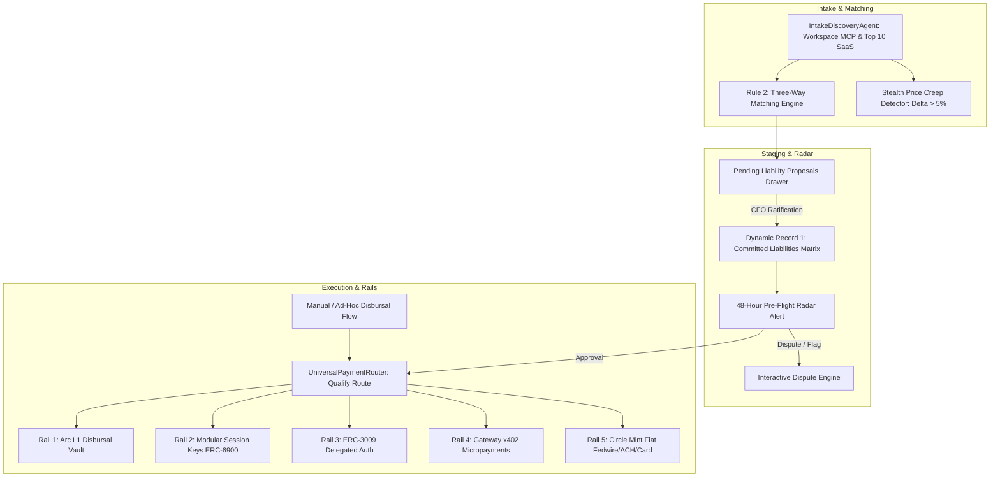
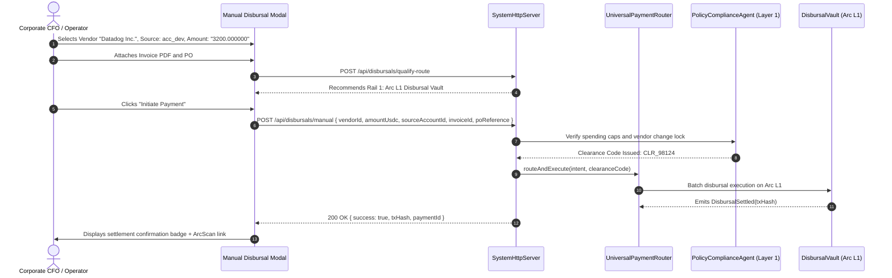
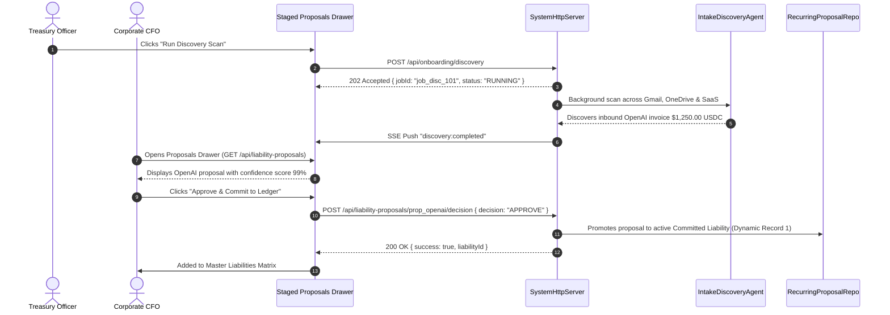

# BizArc Frontend Specification: Document 2
# Invoices, Subscriptions & Universal 5-Rail Settlement

## 1. Domain & Architectural Overview

The **Invoices, Subscriptions & Universal 5-Rail Settlement** engine is BizArc's autonomous Accounts Payable (AP) command center. It coordinates the lifecycle of recurring subscriptions, contractor invoices, ad-hoc corporate payments, and traditional fiat wires, guaranteeing that no dollar leaves an enterprise without:
1. **Rule 2: Three-Way Matching** (Purchase Order $\leftrightarrow$ Delivery Confirmation $\leftrightarrow$ Invoice Terms).
2. **Rule 3: Anti-Payee Substitution Defense** (Strict validation against the verified Vendor Master Registry with immutable onchain address locks).
3. **The 48-Hour Pre-Flight Radar** (Advance alerts empowering finance officers with binary control: `APPROVE` or `CANCEL_WITH_INSTRUCTIONS`).
4. **Stealth Price Creep Protection** (Real-time detection of billing increases $>5\%$ over historical contracts).
5. **Universal 5-Rail Routing Duality** (Seamless execution across Arc L1 smart contracts, session keys, gasless authorizations, x402 micropayments, and commercial bank wires/ACH via Circle Mint).



---

## 2. Target User Personas & Access Permissions

| Persona | Permitted Capabilities & Views | Restricted Actions |
| :--- | :--- | :--- |
| **Owner / CFO** | Ratify or reject AI intake proposals; decide on 48h pre-flight alerts (`APPROVE` or `CANCEL_WITH_INSTRUCTIONS`); initiate ad-hoc vendor disbursals; execute manual due liabilities; file or resolve invoice disputes; configure vendor payout methods and banking profiles; override address locks (`forceOverride: true`); trigger ERP checkpoints. | None. |
| **Treasury Officer** | Schedule recurring liabilities; initiate manual disbursals within authorized per-transaction spending limits; attach POs and delivery receipts; qualify payment routes; initiate discovery scans; flag invoices for dispute. | Cannot ratify proposals exceeding $2,500 USDC or modify vendor payout addresses without administrative unlock. |
| **Auditor / Viewer** | View liability calendar, inspect Three-Way Match audit trail, review vendor bank details, inspect unified payment ledger, and check ERP sync status. | Read-only mode. All decision, payment, and cancellation buttons are disabled. |

---

## 3. Screen Blueprint & Interface Components

### 3.1 Liabilities & Subscriptions Matrix (Dynamic Record 1)
* **Master Liabilities Calendar & Table View**:
  * **Tabbed Filters**: `Upcoming (Next 30 Days)`, `Recurring Subscriptions`, `Past Due / Action Required`, `Settled History`, `Disputed`.
  * **Columns**: Due Date, Vendor / Service Name, Cost Center Account (`acc_dev`, `acc_marketing`), Amount (6-decimal USDC), Payment Rail Badge (Rails 1–5), Three-Way Match Status (`VERIFIED`, `PENDING_PO`, `UNMATCHED`), and State Badge (`SCHEDULED`, `AWAITING_APPROVAL`, `PROCESSING`, `SETTLED`, `CANCELLED`, `DISPUTED`).
  * **Row Quick Actions**:
    * **"Pay Now"**: Triggers immediate execution (`POST /api/disbursal/trigger-due`).
    * **"Dispute Invoice"**: Opens Dispute Filing Modal (`POST /api/liabilities/:id/dispute`).
    * **"Configure Rail"**: Opens Payment Method Modal (`POST /api/liabilities/:id/payment-method`).
    * **"Edit Schedule"**: Modifies amount, cron frequency, or account binding (`PUT /api/liabilities/:id`).
    * **"Cancel Subscription"**: Opens Cancellation Modal requiring mandatory administrative instruction memo (`DELETE /api/liabilities/:id`).
* **Summary KPI Cards**:
  * **Monthly Committed Burn**: Real-time aggregated monthly run-rate commitment across all active subscriptions.
  * **Due Next 7 Days**: Total capital required in the next 7 days (directly feeding the Safe-to-Invest calculation).
  * **Active SaaS Count**: Total distinct corporate software subscriptions tracked.

### 3.2 The 48-Hour Pre-Flight Radar Banner & Alert Cards
* **High-Priority Alert Banner**:
  * Prominently displayed at the top of the AP Command Center whenever any liability enters its 48-hour pre-flight lead window (`GET /api/liabilities/preflight-alerts`).
  * Displays: Vendor Name, Service Title, Scheduled Debit Account, Required USDC Amount, Liquidity Readiness (Liquid Cash vs. Auto-Recall needed), and Matching Status.
  * **Binary Executive Actions**:
    * **`APPROVE` Button (Green)**: Authorizes payment to execute automatically on due date via its designated rail.
    * **`CANCEL_WITH_INSTRUCTIONS` Button (Red)**: Halts scheduled execution and opens instruction memo dialog (e.g., *"Vendor Copilot seats dropped from 50 to 10; waiting on revised invoice"*). Emits vendor cancellation memo and updates status to `CANCELLED`.

### 3.3 Ad-Hoc / Manual Disbursal Initiation Modal ("Pay Vendor Now")
* **Modal Trigger**: Primary top button **"+ Pay Vendor Now"** on AP Command Center.
* **Step-by-Step Guided Workflow**:
  1. **Step 1: Counterparty Selection**:
     * Dropdown of verified vendors from Vendor Master Registry.
     * Displays verified EVM payout address (`0x...`) or verified bank profile status.
     * Anti-Payee Substitution Warning: Unregistered or modified addresses trigger an immutable address lock block.
  2. **Step 2: Debit Account Selection**:
     * Selects source operating account (`acc_dev`, `acc_marketing`, etc.).
     * Displays live liquid balance and verifies account is not protected payroll (`acc_payroll`).
  3. **Step 3: Amount & Currency Details**:
     * Exact 6-decimal USDC string input (e.g., `4500.000000`).
  4. **Step 4: Three-Way Match Document Attachments**:
     * Invoice Document Reference (PDF upload or reference string).
     * Purchase Order Reference (`poReference`).
     * Delivery / Service Confirmation receipt or ticket link.
  5. **Step 5: Route Qualification Preview**:
     * Calls `POST /api/disbursals/qualify-route`.
     * Recommends optimal rail (Rail 1 Vault, Rail 2 Session Key, Rail 3 ERC-3009, Rail 4 x402, Rail 5 Fiat Wire/ACH).
  6. **Step 6: Policy Check & Execution**:
     * If within spending limit: Autonomous Layer 1 clearance code issued immediately.
     * If exceeding spending limit: Prompts for Layer 2 CFO SPRS approval and opens EIP-712 signing modal.
     * Submits to `POST /api/disbursals/manual`.

### 3.4 Create, Edit & Cancel Recurring Liability Modals
* **Create Recurring Liability Modal (`POST /api/liabilities`)**:
  * Vendor Selection, Service Title, Cost Center Account ID.
  * Amount in 6-decimal USDC.
  * Frequency Selector: `MONTHLY`, `WEEKLY`, `QUARTERLY`, `ANNUAL`, or custom Cron syntax (`0 9 1 * *`).
  * Due Day of Month / Next Due Date.
  * Contract Baseline Amount (sets baseline for Price Creep protection).
* **Edit Liability Modal (`PUT /api/liabilities/:id`)**:
  * Adjust amount, due dates, account bindings, or payment rail preferences.
* **Cancel Liability Dialog (`DELETE /api/liabilities/:id`)**:
  * Mandatory Admin Instruction Memo (e.g., *"Terminated annual contract per mutual agreement"*).
  * Immediately removes liability from future Safe-to-Invest commitments.

### 3.5 Interactive Invoice Dispute Filing & Resolution Workflow
* **Dispute Modal Trigger**: "Dispute Invoice" button on any pending liability or proposal.
* **Form Inputs**:
  * **Dispute Category**: `INCORRECT_AMOUNT`, `UNAUTHORIZED_PRICE_HIKE`, `SERVICES_NOT_DELIVERED`, `DUPLICATE_INVOICE`, `SUSPECTED_FRAUD`.
  * **Disputed Amount (USDC)**: Discrepancy delta.
  * **Declarative Dispute Memo**: Detailed explanation sent to vendor accounting.
  * **Evidence Attachments**: PO, delivery logs, MSA clauses.
  * **Freeze Payment Checkbox**: Checked by default; freezes scheduled execution and USYC recall.
* **Submission**: Calls `POST /api/liabilities/:id/dispute`.
* **Visual State**: Liability turns amber with `DISPUTED` badge, locking all execution routes until formally resolved by CFO.

### 3.6 AI Three-Way Match Intake & Proposal Staging Drawer
* **Intake Discovery Agent Status Bar**:
  * Shows real-time connection status across Workspace MCP (Gmail, OneDrive), ERPs (Odoo, ERPNext), and Cloud Vendors (AWS, GitHub, Datadog, GCP, Stripe, OpenAI).
  * **"Run Discovery Scan"** button triggering non-blocking background job (`POST /api/onboarding/discovery`) with live progress bar (0–100%).
* **Staged Proposals Drawer (`GET /api/liability-proposals`)**:
  * Shows uncommitted proposals discovered by AI agents from inbound PDF invoices, email receipts, and contract renewal notices.
  * For each proposal: Extracted Vendor Name, Suggested Cost Center Account, Extracted PO Number, Payout Address, Proposed Amount, and Agent Confidence Score (e.g., `98%`).
  * **Decision Buttons**:
    * **"Approve & Commit to Ledger"**: Calls `POST /api/liability-proposals/:id/decision` with `{ decision: "APPROVE" }`.
    * **"Reject Proposal"**: Calls `POST /api/liability-proposals/:id/decision` with `{ decision: "REJECT", reason }`.

### 3.7 Stealth Price Creep Alert Banners
* **Creep Warning Cards**:
  * Displays whenever an inbound invoice exceeds the historical contract baseline by $>5\%$.
  * Comparison widget: *Contract Baseline: $2,500.000000 USDC* vs. *Billed Amount: $2,780.000000 USDC (+11.2%)*.
  * Highlights contractual price protection clauses extracted from Google Drive / OneDrive master service agreements.
  * Quick Actions: "Accept Price Change", "Dispute Invoice", "Request Clarification".

### 3.8 Vendor Master & Payee Defense (Rule 3)
* **Vendor Directory Table (`GET /api/vendors`)**:
  * Displays registered corporate counterparties: Legal Corporate Name, Tax ID / EIN, Default Cost Center Tag, Preferred Payout Rail, and Verification Status.
* **Payee Defense Security Panel**:
  * **Immutable Address Lock**: Onchain EVM payout address (`0x...`) is cryptographically locked upon initial verification.
  * Updating a vendor's payout address (`PUT /api/vendors/:id`) requires an explicit administrative override (`forceOverride: true`) and logs an immutable audit entry in the Master System Journal.
* **Commercial Banking Coordinates Modal**:
  * For Rail 5 settlement: Account Holder Name, Bank Name, Bank Country, IBAN / Account Number, Routing Number / SWIFT code, and Payout Sub-Method (`FEDWIRE`, `ACH`, `PUSH_TO_CARD`, `SEPA`, `SWIFT`).
  * Status badge: `VERIFIED BANK PROFILE`.

### 3.9 Vendor Payment Method & Multi-Rail Preference Configuration
* **Configuration Drawer Trigger**: "Configure Rail" on any vendor or liability.
* **Rail Selection Radio Group**:
  * **Rail 1**: Arc L1 Disbursal Vault (Smart contract batch execution).
  * **Rail 2**: Modular Session Keys (ERC-6900 recurring subscriptions).
  * **Rail 3**: ERC-3009 Delegated Authorizations (Gasless offchain transfer vouchers).
  * **Rail 4**: Circle Gateway x402 (Sub-cent pay-per-call API micropayments).
  * **Rail 5**: Universal Fiat Payouts (Circle Mint commercial bank wires / ACH).
* **Rail-Specific Inputs**:
  * For Rails 1–3: Target EVM Address, Network, Token.
  * For Rail 5: Beneficiary Bank coordinates selection.
* **Submission**: Calls `POST /api/liabilities/:id/payment-method`.

### 3.10 Unified Multi-Rail Payment Ledger (`/api/payments`)
* **Consolidated Multi-Rail Explorer**:
  * Merges historical transactions across all 5 payment rails into a unified explorer table.
  * Columns: Payment ID, Timestamp, Debit Operating Account, Recipient / Vendor, Rail Badge (`ARC_L1`, `SESSION_KEYS`, `ERC3009`, `GATEWAY_X402`, `FIAT_PAYOUT`, `TOKEN_SWAP`), Amount USDC, Transaction Hash / Wire Trace Reference, and Status Badge (`SETTLED`, `PROCESSING`, `FAILED`, `ESCALATED`).
  * Filters: Filter by Operating Account, Payment Rail, or Date Range.
  * ArcScan Links: Clickable transaction hashes opening ArcScan explorer for onchain rails.

### 3.11 ERP Synchronization & MCP Integration Status Bar
* **ERP Sync Monitor**:
  * Real-time status cards for Odoo and ERPNext integrations (`GET /api/integrations/erp/status`).
  * Displays: Last Synced Document ID, Timestamp, Status (`SYNCED`, `DISCONNECTED`, `PENDING`), and Three-Way Match Verification Checkmark.
  * **"Sync Checkpoint Now" Button**: Calls `POST /api/integrations/erp/sync` to manually reconcile latest journal entries with the enterprise general ledger.
* **Connected Apps MCP Indicator**:
  * Displays connection status for Google Workspace MCP and Microsoft 365 MCP.

---

## 4. User Interaction Flows & Mermaid Sequence Diagrams

### 4.1 Ad-Hoc / Manual Disbursal Initiation Workflow


### 4.2 48-Hour Pre-Flight Radar Review & Cancellation Flow
```mermaid
sequenceDiagram
    autonumber
    actor CFO as Corporate CFO
    participant UI as Pre-Flight Radar Banner
    participant Server as SystemHttpServer
    participant Radar as LiabilityRadarService
    participant Repo as LiabilityRepo

    UI->>Server: GET /api/liabilities/preflight-alerts
    Server-->>UI: Returns 2 upcoming liabilities due in 36h
    UI->>CFO: Displays Radar Banner with "AWS Cloud" and "HubSpot"

    alt CFO Approves Payment
        CFO->>UI: Clicks "APPROVE" on AWS Cloud
        UI->>CFO: Status locked to APPROVED_FOR_SETTLEMENT
    else CFO Halts & Cancels Payment
        CFO->>UI: Clicks "CANCEL_WITH_INSTRUCTIONS" on HubSpot
        UI->>CFO: Prompts for mandatory instruction memo
        CFO->>UI: Enters: "Seats reduced from 20 to 5; waiting for revised bill"
        UI->>Server: DELETE /api/liabilities/liab_hubspot { adminInstruction: "..." }
        Server->>Repo: Marks liability CANCELLED with memo
        Server-->>UI: 200 OK { success: true, cancelled: true }
        UI->>CFO: Banner removes liability + Safe-to-Invest recalibrated
    end
```

### 4.3 AI Three-Way Match Intake & Proposal Ratification


---

## 5. Backend REST & WebSocket API Wireup

| UI Component | HTTP | Endpoint | Request Payload / Params | Response Highlights |
| :--- | :--- | :--- | :--- | :--- |
| **Liabilities Matrix** | `GET` | `/api/liabilities` | `?companyId=...` | `{ success: true, count, data: [{ liability_id, vendor_id, amount_usdc, payment_rail, status, ... }] }` |
| **Create Liability** | `POST` | `/api/liabilities` | `{ vendorId, serviceName, amountUsdc, frequency, accountId, defaultRail, contractBaselineUsdc }` | `{ success: true, data: { liability_id, ... } }` |
| **Edit Liability** | `PUT` | `/api/liabilities/:id` | Path param `:id`, body with updated fields | `{ success: true, data: { ... } }` |
| **Cancel Liability** | `DELETE` | `/api/liabilities/:id` | `{ adminInstruction: string }` | `{ success: true, data: { status: "CANCELLED" } }` |
| **Pre-Flight Radar** | `GET` | `/api/liabilities/preflight-alerts` | *None* | `{ success: true, count, data: [{ alertId, vendorName, amountUsdc, leadTimeRemainingHours, status }] }` |
| **Dispute Invoice** | `POST` | `/api/liabilities/:id/dispute` | `{ reason: string, disputeCategory: string, disputedAmountUsdc: number, freezeExecution: true }` | `{ success: true, status: "DISPUTED", disputeId }` |
| **Manual Disbursal** | `POST` | `/api/disbursals/manual` | `{ vendorId, amountUsdc, sourceAccountId, paymentRail, invoiceId, poReference, declaredReason, adminSignature }` | `{ success: true, paymentId, txHash, railUsed, status: "SETTLED" }` |
| **Qualify Route** | `POST` | `/api/disbursals/qualify-route` | `{ vendorId, amountUsdc, accountId, preferredRail }` | `{ success: true, recommendedRail, availableRails: [...], feesUsdc, estimatedDurationSeconds }` |
| **Trigger Due Disbursal** | `POST` | `/api/disbursal/trigger-due` | `{ liability: { liability_id, ... } }` | `{ success: true, executed: true, txHash }` |
| **Configure Payment Rail** | `POST` | `/api/liabilities/:id/payment-method` | `{ preferredRail, preferredSubMethod, cryptoDetails, fiatDetails }` | `{ success: true, data: { ... } }` |
| **Vendor Directory** | `GET` | `/api/vendors` | `?companyId=...` | `{ success: true, count, data: [{ vendor_id, name, verified_payout_address, change_lock }] }` |
| **Register Vendor** | `POST` | `/api/vendors` | `{ vendorId, name, verifiedPayoutAddress, bankDetails: { ... } }` | `{ success: true, data: { vendor, bankAccount } }` |
| **Update Vendor Address** | `PUT` | `/api/vendors/:id` | `{ newAddress: "0x...", forceOverride: boolean, adminId: string }` | `{ success: true, data: { ... } }` (Rejects 403 if locked without override) |
| **AI Intake Discovery** | `POST` | `/api/onboarding/discovery` | `{ companyId?: string }` | `{ success: true, jobId, status: "RUNNING", progress: 10 }` |
| **Discovery Job Status** | `GET` | `/api/onboarding/discovery/:jobId` | Path param `:jobId` | `{ success: true, jobId, status: "COMPLETED", progress: 100, result: { totalCommittedMonthlySpendUsdc, liabilitiesDiscovered } }` |
| **Staged Proposals** | `GET` | `/api/liability-proposals` | *None* | `{ success: true, count, data: [{ proposal_id, vendor_id, amount_usdc, confidence_score, status }] }` |
| **Ratify Proposal** | `POST` | `/api/liability-proposals/:id/decision` | Path param `:id`, `{ decision: "APPROVE"|"REJECT", reason?: string }` | `{ success: true, proposalId, decision: "APPROVED", liabilityId }` |
| **Unified Payments** | `GET` | `/api/payments` | `?accountId=...&rail=...&limit=50` | `{ success: true, count, total, data: [{ id, rail, type, amountUsdc, recipient, status, txHash, timestamp }], rails: { ... } }` |
| **ERP Sync Status** | `GET` | `/api/integrations/erp/status` | *None* | `{ success: true, status: { systemType: "ERPNEXT", status: "SUCCESS", lastSyncedDocumentId } }` |
| **ERP Sync Checkpoint** | `POST` | `/api/integrations/erp/sync` | `{ systemType: "ERPNEXT"|"ODOO", invoiceId: string, txHash: string }` | `{ success: true, status: "SYNCED", checkpoint: { ... } }` |

---

## 6. Real-Time Push Events & Client-Side Cache Invalidation

Persistent SSE connection listening to `/api/events`:
1. **`preflight:alert`**: Inbound 48-hour radar alert pops an audible notification and adds the alert card to the top banner.
2. **`proposal:staged`**: Adds incoming AI-extracted invoices to the Proposals Drawer badge count.
3. **`discovery:completed`**: Informs the user that background scanning of Gmail/OneDrive/ERP has completed and refreshes the proposals view.
4. **`disbursal:settled`**: Invalidates `/api/payments` and `/api/liabilities`, updating row status to `SETTLED`.

---

## 7. Crucial User Safety Guardrails & Validation

1. **Rule 3 Payee Defense**: EVM payout addresses for corporate vendors cannot be altered without an explicit administrative unlock dialog confirming `forceOverride: true`.
2. **Mandatory PO & Receipt Attachment for Ad-Hoc Disbursals**: Manual payments exceeding $1,000 USDC require document references before the "Initiate Payment" button becomes clickable.
3. **Price Creep Blocking**: Any invoice exceeding historical baseline by $>5\%$ requires explicit operator sign-off before it can be scheduled for autonomous payment.
