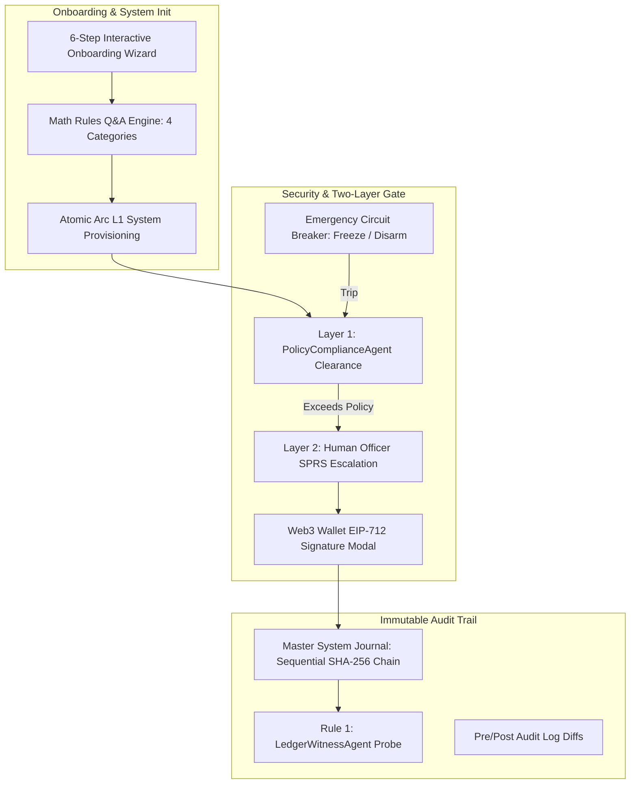
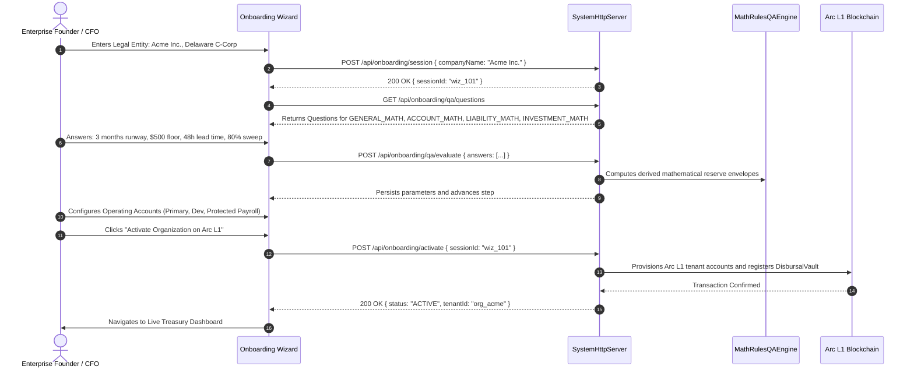
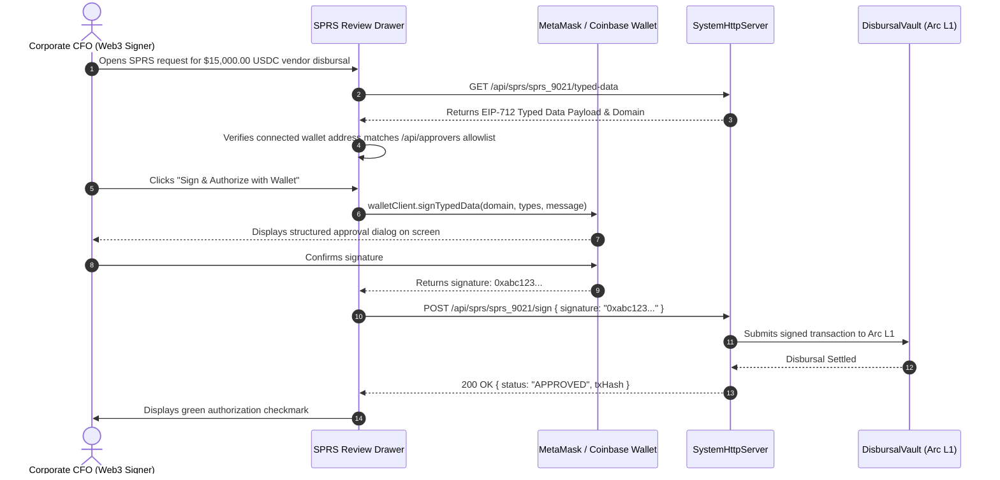
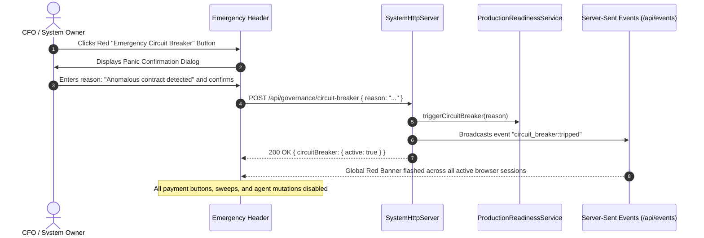

# BizArc Frontend Specification: Document 3
# Governance, Cryptographic Gateways & System Administration

## 1. Domain & Architectural Overview

The **Governance, Cryptographic Gateways & System Administration** console is BizArc's security and organizational headquarters. It bridges corporate enterprise policies with immutable blockchain cryptography on **Arc L1**, providing corporate executives, compliance officers, and external auditors with complete operational sovereignty, non-custodial cryptographic signing, and verifiable accounting integrity.

This console guarantees:
1. **The Two-Layer Authorization Gate**: Layer 1 automated policy compliance clearance $\rightarrow$ Layer 2 cryptographic Human Officer SPRS (Standardized Permission Requests) for threshold exceptions.
2. **Web3 Browser Wallet EIP-712 Signing**: Eliminates CLI or terminal dependency. Corporate officers authorize high-value transactions directly inside MetaMask, Coinbase Wallet, or Hardware Wallets (Ledger/Trezor).
3. **The 6-Step Enterprise Onboarding Wizard & Math Rules Q&A Engine**: Guided enterprise FTUX for company formation, mathematical policy definition, departmental account setup, and onchain system activation.
4. **Emergency System Circuit Breaker (Panic Button)**: Instant cryptographic freeze halting all autonomous swarm agent actions, sweeping, or payments during an anomaly.
5. **Rule 6 Document-Linked Double-Entry Ledger**: The Master System Journal maintains an unbroken SHA-256 hash-chain with a one-click **Chain Integrity Probe**.
6. **Multi-Tenant IAM & Enterprise RBAC**: Enforces strict boundaries between organizations, scoped API keys (`biz_live_...`), and authenticated sessions.

---

## 2. Target User Personas & Enterprise RBAC Matrix

The system enforces 5 distinct roles governed by `/api/team/roles`:

| Role | Scope & Permissions | Key Responsibilities in UI |
| :--- | :--- | :--- |
| **OWNER** | Full organizational sovereignty (`ALL`, `TENANT_ADMIN`, `SPENDING_POLICY_WRITE`, `USER_MANAGE`, `CIRCUIT_BREAKER_TRIP`). | Complete organization profile control, inviting members, revoking owners, approving critical SPRS, tripping/disarming circuit breaker. |
| **CFO** | Chief Financial Officer (`SPRS_SIGN`, `DISBURSAL_EXECUTE`, `SWEEP_EXECUTE`, `SPENDING_POLICY_WRITE`, `CIRCUIT_BREAKER_TRIP`). | Authorizing EIP-712 human approvals, modifying investment and spending rules, managing bank profiles, onboarding activation. |
| **TREASURY_OFFICER** | Daily financial operator (`ACCOUNTS_READ`, `ACCOUNTS_WRITE`, `DISBURSAL_EXECUTE`, `DISCOVERY_RUN`). | Creating liabilities, initiating transfers, generating wire instructions, running intake scans. Cannot alter global governance policies. |
| **AUDITOR_VIEWER** | Independent read-only compliance (`LEDGER_READ`, `AUDIT_LOG_READ`, `REPORTS_EXPORT`). | Verifying SHA-256 ledger integrity probe, exporting double-entry journals, auditing SPRS approvals and pre/post state diffs. |
| **API_SERVICE** | Machine-to-machine integration token with explicit granular scopes (e.g., `["accounts:read", "disbursals:create"]`). | Backend ERP sync (Odoo, ERPNext, Zapier). Handled via scoped API keys (`biz_live_...`). |

---

## 3. Screen Blueprint & Interface Components

### 3.1 The 6-Step Enterprise Onboarding Wizard (FTUX)
* **Pathway Entry Screen**:
  * Gives the executive the choice between:
    * **Pathway A**: Guided Interactive Setup (6 structured manual steps).
    * **Pathway B**: Connected Workspace / ERP Assisted (Connect Google Workspace MCP, Microsoft 365, or Odoo/ERPNext for AI auto-population).
* **Step 1: Company Profile & Legal Identity**:
  * Inputs: Legal Entity Name (e.g., `Acme Technologies Inc.`), Tax ID / EIN, Regulatory Domicile (`US-DE`, `UK`, `SG`), Reporting Currency (`USDC`), and Business Description (guiding autonomous agent context).
  * Calls `POST /api/onboarding/session` and `POST /api/onboarding/step` for step `COMPANY_PROFILE`.
* **Step 2: Mathematical Rules Defined via Q&A Engine**:
  * Administers structured questions from `GET /api/onboarding/qa/questions` across four distinct domains:
    1. **`GENERAL_MATH`**: Required liquidity runway months (e.g., 3 months), estimated monthly net cash burn ($150,000 USDC).
    2. **`ACCOUNT_MATH`**: Minimum liquid floor ($50.00 to $5,000.00 USDC), liability safety multiplier buffer (e.g., 1.20x Opex, 1.25x Payroll).
    3. **`LIABILITY_MATH`**: Pre-flight radar lead time (e.g., 48 hours), max price hike tolerance percentage (e.g., 10.0%).
    4. **`INVESTMENT_MATH`**: Idle surplus target allocation ratio (e.g., 80.0%), minimum sweep threshold ($500.00 USDC).
  * Interactive sliders and number inputs with live visual simulation of derived reserve bands.
  * Calls `POST /api/onboarding/qa/evaluate` to compute mathematical parameters.
* **Step 3: Swarm Agent Declared Policies**:
  * Configures single-transaction human gate cap (e.g., `$2,500.00 USDC`), daily spending limits, and vendor price creep threshold (5.0%).
* **Step 4: Departmental Operating Accounts & Payroll Shield Configuration**:
  * Configures initial operating wallets (`TREASURY_RESERVE`, `OPEX_DEV`, `OPEX_GROWTH`, `OPEX_LEGAL`, `TAX_ESCROW`).
  * Explicit **Protected Payroll Wall** toggle: establishes `acc_payroll` with `max_autonomous_sweep_limit = 0.00` and `excludeFromWaterfall = true`.
* **Step 5: Recurring Liabilities & Gateway Selection**:
  * Add initial vendor commitments (AWS, GitHub, Slack, Retainers) with account binding and default rail.
* **Step 6: Disbursal Account Clearinghouse & Onchain System Activation**:
  * Reviews summary of accounts, policies, and contracts.
  * Primary Action: **"Activate Organization on Arc L1"** (`POST /api/onboarding/activate`).
  * Provisions Arc L1 wallets, deploys DisbursalVault references, and transitions tenant to live active state.

### 3.2 Standardized Permission Requests (SPRS) Governance Inbox
* **Pending Approvals Queue (`GET /api/sprs/pending`)**:
  * Urgent alert card displaying pending human escalation requests triggered by PolicyComplianceAgent.
  * Details per request: Request ID (`SPRS_102...`), Action Type (`DISBURSAL`, `AUTONOMOUS_SWEEP`, `HIGH_VALUE_EXEMPTION`), Amount USDC, Risk Level Badge (`LOW`, `MEDIUM`, `HIGH`, `CRITICAL`), Declared Business Reason, Target Recipient, and Expiration Countdown.
* **Review & Verification Drawer**:
  * Side drawer expanding full transaction payload, affected account balance, and the Three-Way Match audit trail.
  * Primary Action: **"Review & Sign with Wallet"** (launches Web3 EIP-712 signing modal).
  * Secondary Action: **"Reject / Cancel"** (prompts officer for admin instruction memo).

### 3.3 Web3 Browser Wallet EIP-712 Signing Drawer
* **Direct Web3 Wallet Connector**:
  * Integrates standard Wagmi / Viem / WalletConnect providers (MetaMask, Coinbase Wallet, Brave Wallet, Rainbow, Ledger).
  * Automatically verifies connected wallet address against `/api/approvers` (`signerAllowlist`).
  * If connected address is not an authorized officer, displays amber alert: `Connected address is not an authorized officer for this organization`.
* **EIP-712 Structured Data Visualizer**:
  * Fetches typed data from `GET /api/sprs/:id/typed-data`.
  * Visualizes the exact domain parameters:
    * `Domain Name`: `BizArc Authorization Gate`
    * `Chain ID`: `5042002` (Arc Testnet) or `5042` (Arc Mainnet)
    * `Verifying Contract`: `DisbursalVault` address (`0x...`)
    * `Message Fields`: `permissionRequestId`, `actionType`, `accountId`, `amountUsdc`, `nonce`, `deadline`.
* **One-Click Sign Button**:
  * Calls `walletClient.signTypedData(...)`.
  * Forwards recovered signature `0x...` to `POST /api/sprs/:id/sign`.
  * Immediate transaction dispatch and live SSE event feedback.

### 3.4 Emergency System Circuit Breaker (Panic Button)
* **Global Header Trigger**:
  * Permanent red **"Emergency Circuit Breaker"** button located in the system top bar and Governance screen.
* **Trip Circuit Breaker Modal (`POST /api/governance/circuit-breaker`)**:
  * Confirmation modal requiring Owner or CFO confirmation.
  * Mandatory Input: Declarative Reason Memo (e.g., *"Suspected compromised vendor address; emergency freeze on all outbound payments"*).
  * State Change: Instantly trips the circuit breaker across the entire backend.
* **Global Tripped Banner**:
  * When active, an un-dismissible red flashing banner appears across every page of the application:
    `⚠️ SYSTEM CIRCUIT BREAKER ACTIVE: All autonomous agent actions, sweeps, and scheduled disbursals frozen by CFO (Timestamp: 2026-10-16 00:20:00). Reason: Suspected compromised vendor address.`
* **Disarm Circuit Breaker Modal (`POST /api/governance/circuit-breaker/disarm`)**:
  * Allows authorized Owner or CFO to restore autonomous operations after security audit.

### 3.5 Production Readiness Health Audit Dashboard
* **Compliance Checklist View (`GET /api/governance/readiness`)**:
  * Visual status monitor displaying the production health of the entire stack:
    * **Database Connection**: PostgreSQL pooling and latency status.
    * **Arc L1 RPC Node**: Arc testnet/mainnet node synchronization.
    * **Signer Allowlist**: Authorized Web3 signers configured and verified.
    * **Treasury Solvency**: Effective balance vs. 30-day liability commitments.
    * **Smart Contract Verification**: DisbursalVault and YieldVault deployment status on ArcScan.
    * **Master Journal Hash Verification**: Unbroken hash chain confirmation.

### 3.6 Cryptographic Master System Journal Explorer (Rule 6)
* **Immutable Double-Entry Ledger Table (`GET /api/ledger/entries` or `/api/journal`)**:
  * Displays sequential accounting blocks: Sequence ID, Timestamp, Account ID, Action Type, Debit Account, Credit Account, Exact Amount (6-decimal string), Document Reference, and Current SHA-256 Hash.
* **Real-Time Hash-Chain Verification Probe (`GET /api/journal/verify`)**:
  * Prominent status card:
    * **`CHAIN INTEGRITY VERIFIED (GREEN)`**: "All historical ledger blocks cryptographically verified with zero broken links."
    * **`TAMPER DETECTED (RED)`**: Alerts if any historical debit, credit, or memo was mutated out-of-band in PostgreSQL, specifying the exact sequence ID where the hash chain broke.
* **Audit Trail Explorer (`GET /api/audit-logs`)**:
  * Deep-dive audit log comparing JSON pre-state snapshots vs. post-state snapshots for every single action executed by humans or autonomous swarm agents.

### 3.7 Team Member Administration & RBAC Modal
* **Team Directory Table (`GET /api/team/members`)**:
  * Lists active members: Name, Email, Assigned Role (`OWNER`, `CFO`, `TREASURY_OFFICER`, `AUDITOR_VIEWER`), Associated Wallet Address (`0x...`), and Last Active Timestamp.
* **Invite Member Modal (`POST /api/team/invites` or `/api/team/invite`)**:
  * Inputs: Colleague Email, Role Selector Dropdown.
  * Generates invite link and sends email invitation.
* **Pending Invitations Table (`GET /api/team/invitations`)**:
  * View pending invites, copy invite token/link, or revoke invite.
* **Accept Invite Screen (`POST /api/auth/invites/accept`)**:
  * Accept invitation token, connect Web3 wallet or create password.

### 3.8 Multi-Company / Tenant Profile Switcher & Settings
* **Tenant Switcher Dropdown (Top Navigation Bar)**:
  * Lists all organizations the authenticated user belongs to (`GET /api/tenants`).
  * One-click tenant switch (`POST /api/auth/switch-company` with `{ companyId }`).
* **Company Profile Settings Screen (`GET /api/company`, `PUT /api/company`)**:
  * Edit Company Legal Name, Domicile, Tax ID, and Contact Info.

### 3.9 Sign-In with Ethereum (SIWE) & Authentication
* **Web3 Login Modal**:
  * Requests cryptographic nonce (`POST /api/auth/wallet/nonce`).
  * Prompts wallet to sign EIP-4361 personal message.
  * Submits signature to `POST /api/auth/wallet/verify` to receive JWT session token.
* **Email / Password Alternative**:
  * Supported via `POST /api/auth/signin` and `POST /api/auth/signup`.

### 3.10 Developer Platform & Scoped API Key Manager
* **API Key Table (`GET /api/api-keys`)**:
  * Lists active keys with prefix (e.g., `biz_live_8f92a...`), Name, Granular Scopes, Creation Date, and Last Used Timestamp.
* **Generate API Key Modal (`POST /api/api-keys`)**:
  * Name (e.g., `ERPNext Production Sync`), Scope Checkboxes (`accounts:read`, `disbursals:create`, `ledger:read`), Expiration Date.
  * One-time display of secret token with copy button.

### 3.11 Interactive Real-Time Notifications Drawer
* **Notification Bell Icon (Header)**:
  * Real-time unread badge counter listening to SSE `/api/events`.
* **Notifications Drawer (`GET /api/notifications`)**:
  * Filters: `ALL`, `URGENT_APPROVAL_NEEDED`, `RADAR_ALERTS`, `PRICE_CREEP`, `CIRCUIT_BREAKER`.
  * Actions: "Mark All as Read" (`POST /api/notifications/read`), click-to-navigate directly to the relevant SPRS request, pre-flight alert, or proposal.

---

## 4. User Interaction Flows & Mermaid Sequence Diagrams

### 4.1 First-Time Onboarding (Pathway A: Q&A Engine Flow)

### 4.2 Web3 Browser Wallet EIP-712 Signing Flow

### 4.3 Emergency Circuit Breaker Flow (Panic Button)

---

## 5. Backend REST & WebSocket API Wireup

| UI Component | HTTP | Endpoint | Request Payload / Params | Response Highlights |
| :--- | :--- | :--- | :--- | :--- |
| **Start Onboarding** | `POST` | `/api/onboarding/session` | `{ companyName, taxId, jurisdiction, reportingCurrency }` | `{ success: true, sessionId, status: "DRAFT" }` |
| **Get Onboarding State**| `GET` | `/api/onboarding/session/:id` | Path param `:id` | `{ success: true, session: { currentStep, completedSteps, data } }` |
| **Submit Wizard Step** | `POST` | `/api/onboarding/step` | `{ sessionId, step: "COMPANY_PROFILE"|"ACCOUNTS"|..., payload: { ... } }` | `{ success: true, nextStep }` |
| **Get Q&A Questions** | `GET` | `/api/onboarding/qa/questions`| `?category=GENERAL_MATH` | `{ success: true, count, questions: [{ id, question, category, derivedField }] }` |
| **Evaluate Answers** | `POST` | `/api/onboarding/qa/evaluate` | `{ answers: [{ questionId, value }], companyId }` | `{ success: true, results: { minOperatingFloorUsdc, safetyBufferRatio, ... } }` |
| **Activate Tenant** | `POST` | `/api/onboarding/activate` | `{ sessionId: string }` | `{ success: true, status: "ACTIVE", companyId, arcWalletAddress }` |
| **Circuit Breaker Trip**| `POST` | `/api/governance/circuit-breaker` | `{ reason: string }` | `{ success: true, circuitBreaker: { active: true, reason, triggeredAt } }` |
| **Circuit Breaker Disarm**|`POST`| `/api/governance/circuit-breaker/disarm` | *None* | `{ success: true, circuitBreaker: { active: false, disarmedAt } }` |
| **Production Readiness**| `GET` | `/api/governance/readiness` | *None* | `{ success: true, report: { database: "OK", rpcNode: "OK", signerAllowlist: "OK", ... } }` |
| **Pending SPRS Queue** | `GET` | `/api/sprs/pending` | *None* | `{ success: true, count, data: [{ permission_request_id, action_type, amount_usdc, risk_level, reason }] }` |
| **EIP-712 Typed Data** | `GET` | `/api/sprs/:id/typed-data` | Path param `:id` | `{ success: true, typedData: { types, domain, message }, signerAllowlist: ["0x..."] }` |
| **Sign SPRS** | `POST` | `/api/sprs/:id/sign` | `{ signature: "0x..." }` | `{ success: true, status: "APPROVED", signerAddress, txHash }` |
| **Decide SPRS** | `POST` | `/api/sprs/:id/decision` | `{ decision: "APPROVE"|"REJECT", reason?: string }` | `{ success: true, status: "APPROVED"|"REJECTED" }` |
| **Signer Allowlist** | `GET` | `/api/approvers` | *None* | `{ success: true, approvers: ["0x..."], count }` |
| **Double-Entry Journal**| `GET` | `/api/journal` | `?limit=50&accountId=...` | `{ success: true, count, entries: [{ sequence_id, debit_account, credit_account, amount_usdc, current_hash }] }` |
| **Verify Hash Chain** | `GET` | `/api/journal/verify` | *None* | `{ success: true, verified: true, totalBlocksChecked: 1428, brokenBlockId: null }` |
| **Audit Logs Diffs** | `GET` | `/api/audit-logs` | `?limit=50` | `{ success: true, logs: [{ log_id, action_type, pre_state_snapshot, post_state_snapshot }] }` |
| **Team Members** | `GET` | `/api/team/members` | *None* | `{ success: true, members: [{ user_id, email, role, wallet_address }] }` |
| **Invite Member** | `POST` | `/api/team/invite` | `{ email: string, role: string }` | `{ success: true, inviteId, inviteLink }` |
| **Pending Invites** | `GET` | `/api/team/invitations` | *None* | `{ success: true, invitations: [...] }` |
| **Accept Invite** | `POST` | `/api/auth/invites/accept` | `{ token: string, password?: string, walletAddress?: string }` | `{ success: true, session: { token, user } }` |
| **Tenant Switching** | `POST` | `/api/auth/switch-company` | `{ companyId: string }` | `{ success: true, companyId, token }` |
| **Company Profile** | `GET` / `PUT` | `/api/company` | `PUT`: `{ companyName, taxId, jurisdiction }` | `{ success: true, company: { ... } }` |
| **SIWE Nonce** | `POST` | `/api/auth/wallet/nonce` | `{ address: "0x..." }` | `{ success: true, nonce, message }` |
| **SIWE Verify** | `POST` | `/api/auth/wallet/verify` | `{ address: "0x...", signature: "0x..." }` | `{ success: true, token, user: { ... } }` |
| **API Keys** | `GET` / `POST` | `/api/api-keys` | `POST`: `{ name, scopes: [...] }` | `{ success: true, key: { id, name, prefix, secretKey } }` |
| **Notifications** | `GET` | `/api/notifications` | *None* | `{ success: true, notifications: [{ id, title, message, category, read }] }` |
| **Mark Notifs Read** | `POST` | `/api/notifications/read` | `{ notificationIds: [...] }` | `{ success: true, markedCount }` |

---

## 6. Real-Time Push Events & Client-Side Cache Invalidation

Persistent SSE connection listening to `/api/events`:
1. **`sprs:created`**: Urgent push sound and toast notifying CFO that a human authorization gate has been triggered. Refreshes SPRS inbox badge.
2. **`circuit_breaker:tripped` & `circuit_breaker:disarmed`**: Triggers immediate global state shift, displaying or hiding the full-screen emergency lockdown banner.
3. **`ledger:appended`**: Appends new SHA-256 block to the live journal table with hash chain visual animation.
4. **`member:invited` & `member:joined`**: Updates team directory view.

---

## 7. Crucial User Safety Guardrails & Validation

1. **Signer Allowlist Validation**: The frontend checks connected Web3 wallet against `/api/approvers` BEFORE allowing signature generation to prevent signature rejection.
2. **Mandatory Trip Reason**: The emergency circuit breaker cannot be triggered without a declarative reason text to ensure an immutable audit record.
3. **Double Confirmation on Company Deletion / Tenant Switching**: Prevents accidental session context switching during multi-tenant treasury operations.
