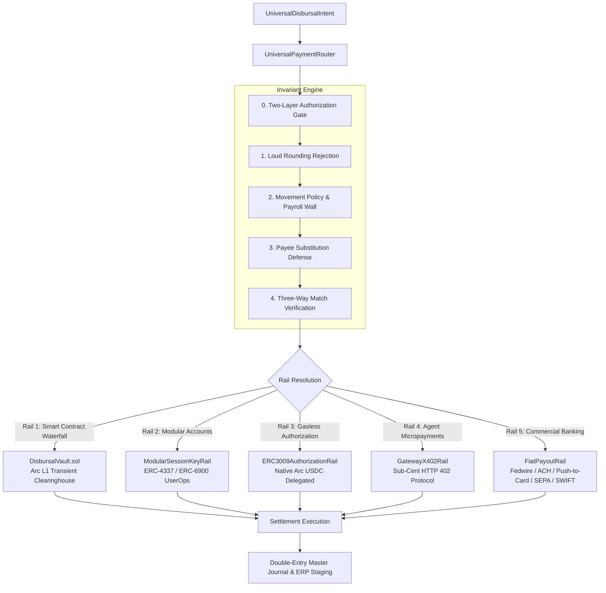

# BizArc Payment Rails & Universal Routing Guide

## 1. Architectural Overview

BizArc solves the fragmentation between enterprise crypto treasuries and commercial corporate banking through the **Universal Payment Router** ([UniversalPaymentRouter.ts](file://wsl.localhost/Ubuntu-24.04/home/gifted/BizArc/src/payments/universalPaymentRouter.ts)). 

The router provides a single programmatic interface for all outgoing corporate disbursements. When an invoice or payment request arrives, the router evaluates corporate policy, automatically recalls invested liquidity if needed, verifies counterparty identity, and routes the payment across the optimal rail:



---

## 2. Universal Disbursal Intent Interface

Every payment in BizArc is initiated using a strongly typed [UniversalDisbursalIntent](file://wsl.localhost/Ubuntu-24.04/home/gifted/BizArc/src/payments/rails/types.ts):

```typescript
export interface UniversalDisbursalIntent {
  intentId: string;                     // Deterministic identifier
  primaryAccountId: string;             // Initiating operating account
  vendorId: string;                     // Registered vendor identifier
  vendorName: string;                   // Human-readable vendor name
  amountUsdc: number;                   // Exact 6-decimal USDC amount (e.g. 500.000000)
  payoutAddress?: string;               // EVM address for Rails 1, 2, 3
  serviceUrl?: string;                  // HTTP 402 URL for Rail 4
  beneficiaryBank?: {                   // Banking credentials for Rail 5
    accountHolderName: string;
    ibanOrAccountNumber: string;
    routingOrSwift: string;
    bankCountry: string;
    bankName?: string;
    paymentSubMethod?: "FEDWIRE" | "ACH" | "PUSH_TO_CARD" | "SEPA" | "SWIFT";
    cardToken?: string;
    cardLast4?: string;
    cardNetwork?: string;
  };
  declaredReason: string;               // Verifiable commercial rationale
  invoiceId?: string;                   // Document reference
  poReference?: string;                 // Linked Purchase Order reference
  category?: string;                    // Cost-center category (e.g. "SAAS", "PAYROLL")
  documentHash?: string;                // SHA-256 hash of invoice artifact
  deliveryProofHash?: string;           // Milestone / goods delivery proof
  requireThreeWayMatch?: boolean;       // Whether 3-way match is strictly required
  sessionKeyId?: string;                // Session key identifier for Rail 2
  sprsRequestId?: string;               // EIP-712 human sign-off request ID
}
```

---

## 3. Seven Invariant Execution Gates

Prior to dispatching funds to any rail, [UniversalPaymentRouter](file://wsl.localhost/Ubuntu-24.04/home/gifted/BizArc/src/payments/universalPaymentRouter.ts) executes seven strict validation phases:

### Invariant 0: Two-Layer Authorization Gate
Verifies that the action has either:
- **Layer 1 Authorization**: A single-use `#CLEAR-...` clearance code issued by [PolicyComplianceLlmAgent](file://wsl.localhost/Ubuntu-24.04/home/gifted/BizArc/src/agents/policyComplianceLlmAgent.ts) for actions inside defined rules.
- **Layer 2 Authorization**: A valid EIP-712 cryptographic signature from an authorized corporate officer or an approved SPRS in [PermissionRequestRepo](file://wsl.localhost/Ubuntu-24.04/home/gifted/BizArc/src/database/repos/permissionRequestRepo.ts).

### Invariant 1: Loud Rounding Rejection (Golden Rule 5)
Refuses floating-point approximations. If `amountUsdc` contains more than 6 decimal places:
```typescript
const decimalParts = intent.amountUsdc.toString().split(".");
if (decimalParts.length === 2 && decimalParts[1].length > 6) {
  throw new LoudRoundingError("Amount exceeds 6-decimal USDC precision. Silent rounding is strictly forbidden.");
}
```

### Invariant 2: Movement Policy & Payroll Wall Isolation
- **Payroll Wall**: If `primaryAccountId` has role `PAYROLL` and `category !== 'PAYROLL'`, the payment is rejected immediately.
- **Automatic USYC Recall**: If liquid balance ($B_L$) is insufficient but available balance ($B_L + B_Y$) covers the invoice, the router automatically recalls the deficit from [CentralTreasuryYieldVault](file://wsl.localhost/Ubuntu-24.04/home/gifted/BizArc/contracts/CentralTreasuryYieldVault.sol).
- **Waterfall Allocation**: If the primary account lacks full funding, [MovementPolicyRepo](file://wsl.localhost/Ubuntu-24.04/home/gifted/BizArc/src/database/repos/movementPolicyRepo.ts) calculates a multi-account draw in priority order, excluding protected accounts.

### Invariant 3: Payee Substitution Defense (Golden Rule 3)
- Resolves counterparty credentials against [VendorMasterRepo](file://wsl.localhost/Ubuntu-24.04/home/gifted/BizArc/src/database/repos/vendorMasterRepo.ts) and [VendorPaymentPreferenceRepo](file://wsl.localhost/Ubuntu-24.04/home/gifted/BizArc/src/database/repos/vendorPaymentPreferenceRepo.ts).
- For crypto rails: `intent.payoutAddress` must match `vendor.verified_payout_address`.
- For fiat rails: `intent.beneficiaryBank` is matched against [VendorBankRepo](file://wsl.localhost/Ubuntu-24.04/home/gifted/BizArc/src/database/repos/vendorBankRepo.ts).
- Counterparty substitution triggers instant freeze and security escalation.

### Invariant 4: Three-Way Match Verification (Golden Rule 2)
For commercial vendor invoices, verifies the presence and integrity of:
1. `poReference`: Authorized Purchase Order.
2. `deliveryProofHash`: Goods Receipt Note (GRN) or milestone delivery receipt.
3. `documentHash`: Verifiable invoice artifact hash.

### Invariant 5: Chosen Rail Dispatch & Human Escalation
Executes the target payment rail. If an autonomous limit is breached, the transaction halts and generates an EIP-712 Standardized Permission Request.

### Invariant 6: Double-Entry Journaling & ERP Staging
Upon successful rail execution, appends a dual-entry voucher to [MasterJournalRepo](file://wsl.localhost/Ubuntu-24.04/home/gifted/BizArc/src/database/repos/masterJournalRepo.ts) with sequential SHA-256 hash chaining and stages the entry for Odoo / ERPNext synchronization.

---

## 4. Deep-Dive: The 5 Universal Payment Rails

### 4.1 Rail 1: DisbursalVault (Arc L1 Smart Contract Waterfall)
- **File**: [disbursalVaultRail.ts](file://wsl.localhost/Ubuntu-24.04/home/gifted/BizArc/src/payments/rails/disbursalVaultRail.ts)
- **Smart Contract**: [DisbursalVault.sol](file://wsl.localhost/Ubuntu-24.04/home/gifted/BizArc/contracts/DisbursalVault.sol)
- **Mechanism**:
  1. The vault holds **$0 balance at rest**.
  2. Operating accounts approve the vault for the exact disbursement sum.
  3. The contract pulls funds, verifies `approvedVendors[vendor] == true`, verifies `executedIdempotencyKeys[key] == false`, verifies daily and per-tx spending caps, and transfers USDC directly to the vendor in the same atomic block.
  4. If amount exceeds `eip712ApprovalThreshold`, requires an onchain-verified EIP-712 human CFO signature.

### 4.2 Rail 2: Modular Session Keys (ERC-4337 / ERC-6900)
- **File**: [modularSessionKeyRail.ts](file://wsl.localhost/Ubuntu-24.04/home/gifted/BizArc/src/payments/rails/modularSessionKeyRail.ts)
- **Mechanism**:
  1. Grants agents time-bound, scoped cryptographic signing authority managed in [SessionKeyRepo](file://wsl.localhost/Ubuntu-24.04/home/gifted/BizArc/src/database/repos/sessionKeyRepo.ts).
  2. Enforces maximum amount per cycle (`max_amount_per_cycle_usdc`), cycle duration (`cycle_duration_seconds`), and expiration timestamp.
  3. Executes real onchain UserOps on Arc L1 targeting `ARC_CONSTANTS.USDC_PREDEPLOY` via [ArcTransactionExecutor](file://wsl.localhost/Ubuntu-24.04/home/gifted/BizArc/src/contracts/arcTransactionExecutor.ts) using the 20 Gwei gas floor.

### 4.3 Rail 3: ERC-3009 Gasless Delegated Authorizations
- **File**: [erc3009AuthorizationRail.ts](file://wsl.localhost/Ubuntu-24.04/home/gifted/BizArc/src/payments/rails/erc3009AuthorizationRail.ts)
- **Mechanism**:
  1. Leverages Arc USDC's native EIP-3009 `receiveWithAuthorization` interface:
     ```solidity
     function receiveWithAuthorization(
         address from,
         address to,
         uint256 value,
         uint256 validAfter,
         uint256 validBefore,
         bytes32 nonce,
         uint8 v, bytes32 r, bytes32 s
     ) external;
     ```
  2. Nonces are stored in [erc3009_authorizations](file://wsl.localhost/Ubuntu-24.04/home/gifted/BizArc/src/database/repos/erc3009Repo.ts) to guarantee zero signature replay.

### 4.4 Rail 4: Circle Gateway x402 Micropayments
- **File**: [gatewayX402Rail.ts](file://wsl.localhost/Ubuntu-24.04/home/gifted/BizArc/src/payments/rails/gatewayX402Rail.ts)
- **Mechanism**:
  1. Initiates an HTTP request to the external AI agent service URL.
  2. Intercepts the HTTP `402 Payment Required` challenge containing price, payment address, and facilitator headers.
  3. Signs a cryptographic micropayment authorization using the agent wallet.
  4. Re-submits request with the payment authorization; receives external service payload and records micropayment in [AuditLogRepo](file://wsl.localhost/Ubuntu-24.04/home/gifted/BizArc/src/database/repos/auditLogRepo.ts).

### 4.5 Rail 5: Universal Fiat Payouts (Commercial Banking)
- **File**: [fiatPayoutRail.ts](file://wsl.localhost/Ubuntu-24.04/home/gifted/BizArc/src/payments/rails/fiatPayoutRail.ts)
- **Commercial Banking Integration**:
  1. Built for non-crypto corporate suppliers (landlords, utilities, legal counsel, enterprise SaaS).
  2. Supports 5 distinct fiat payment sub-methods:
     - **FEDWIRE**: High-value domestic bank wire via BNY Mellon / Circle Mint with instant tracking memo.
     - **ACH**: Standard / Same-Day ACH transfer for domestic commercial invoicing.
     - **PUSH_TO_CARD**: Real-time (<5 minute) direct card credit to 16-digit Visa/Mastercard debit cards.
     - **SEPA / SEPA INSTANT**: Eurozone commercial bank payouts in EUR/EURC.
     - **SWIFT**: International multi-currency commercial wire transfers.
  3. **Onchain Double-Entry Tie**: Executes an onchain tracking burn transaction on Arc L1 (`transfer(address(0), amount)`) to tie traditional bank wire releases to the tamper-evident cryptographic ledger.
  4. Records payout details in [fiat_payout_records](file://wsl.localhost/Ubuntu-24.04/home/gifted/BizArc/src/database/repos/fiatPayoutRepo.ts).
  5. Webhook reconciliation via `POST /api/webhooks/circle-mint` updates status from `PROCESSING` to `SETTLED`.

---

## 5. Token Swaps & Cross-Chain Liquidity Ingestion

To ensure BizArc can ingest revenue and capital from any blockchain ecosystem:

### 5.1 Circle Swap Kit & LiFi Multi-Chain Swaps
- **Implementation**: [TokenSwapService.ts](file://wsl.localhost/Ubuntu-24.04/home/gifted/BizArc/src/services/tokenSwapService.ts)
- Connects `@circle-fin/swap-kit` with `@circle-fin/adapter-viem-v2` (`createViemAdapterFromPrivateKey({ privateKey })`).
- Allows swapping incoming tokens (e.g., USDT, DAI, ETH) across Ethereum, Base, Arbitrum, and Solana directly into native Arc USDC.
- **Arc L1 Duality Rule**: Rejects swaps attempting to exchange USDC $\leftrightarrow$ NATIVE on Arc L1, enforcing the protocol invariant that USDC *is* the native token.

### 5.2 Cross-Chain CCTP Bridging
- Uses Circle's Cross-Chain Transfer Protocol (CCTP) to permissionlessly burn USDC on source chains (Base, Ethereum, Arbitrum) and mint native USDC directly on Arc L1 within sub-second finality.

---

## 6. Verification and Reference Files

- Router Implementation: [universalPaymentRouter.ts](file://wsl.localhost/Ubuntu-24.04/home/gifted/BizArc/src/payments/universalPaymentRouter.ts)
- Rail Interfaces: [rails/types.ts](file://wsl.localhost/Ubuntu-24.04/home/gifted/BizArc/src/payments/rails/types.ts)
- Fiat Payout Rail: [fiatPayoutRail.ts](file://wsl.localhost/Ubuntu-24.04/home/gifted/BizArc/src/payments/rails/fiatPayoutRail.ts)
- Token Swap Service: [tokenSwapService.ts](file://wsl.localhost/Ubuntu-24.04/home/gifted/BizArc/src/services/tokenSwapService.ts)
- Disbursal Vault Contract: [DisbursalVault.sol](file://wsl.localhost/Ubuntu-24.04/home/gifted/BizArc/contracts/DisbursalVault.sol)
