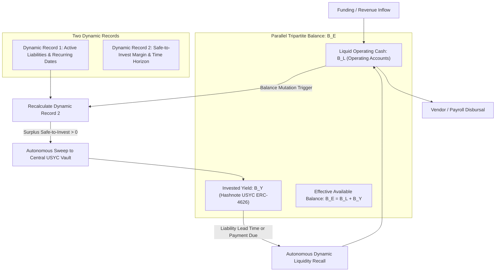
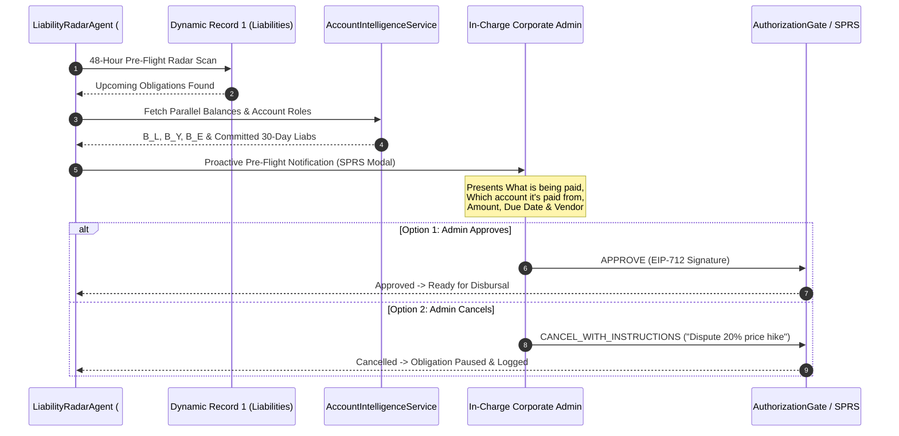
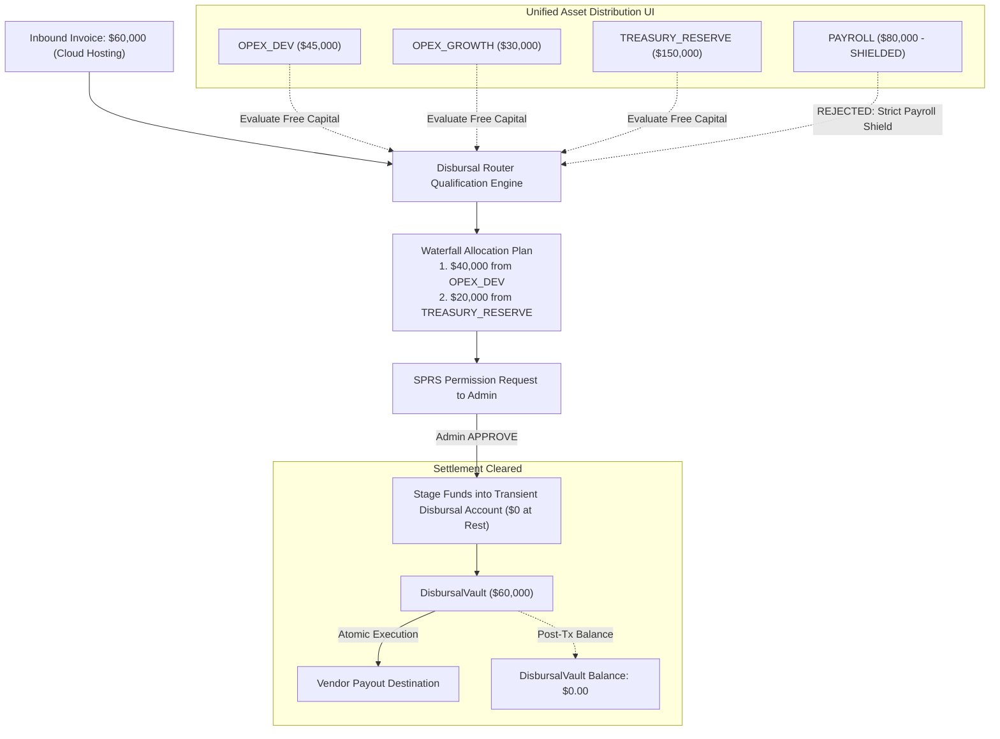
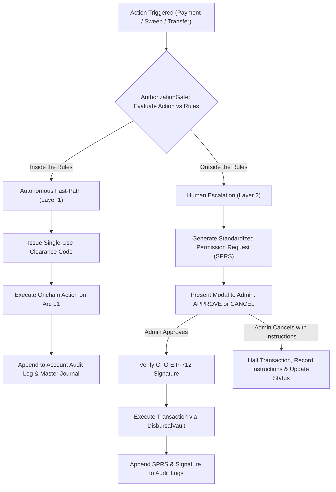
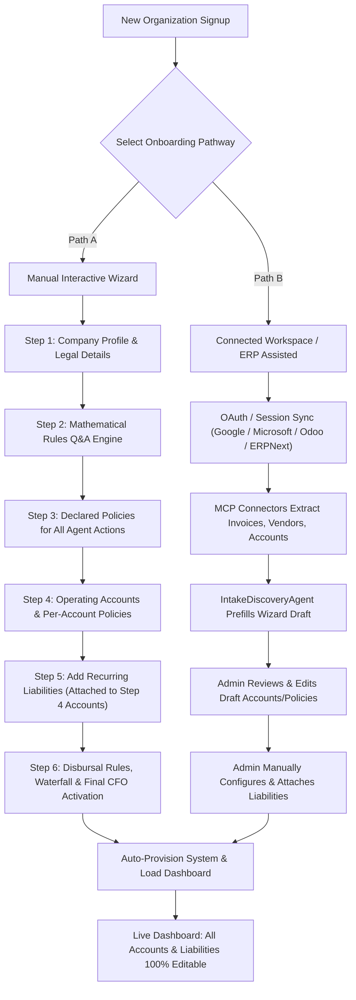

# BizArc: Problem, Solution & Governance Philosophy

## 1. Executive Summary & Core Motivation

Modern corporate treasury is plagued by structural inefficiencies:
- **Capital Inefficiency**: Operational cash sits idle in low-yield commercial checking accounts or cold storage wallets, forfeiting hundreds of thousands of dollars in risk-free yield annually.
- **Subscription & Liability Blind Spots**: Hyper-growth enterprises manage hundreds of recurring SaaS subscriptions, cloud infrastructure commitments, vendor retainers, and debt schedules across fragmented corporate cards and departmental wallets. Admins lose visibility, triggering unexpected payment failures, service outages, or unauthorized price increases.
- **Fragmented Liquidity & Routing Gridlock**: Treasury funds are dispersed across multiple cost centers (Engineering, Marketing, Legal, Operations, Payroll) and blockchain networks. When a vendor invoice or liability must be paid, finance teams face friction determining which account should pay, evaluating cross-account transfers, and staging funds without running operational accounts dry.

**BizArc** solves these foundational corporate treasury challenges through an autonomous multi-agent financial operations system engineered on **Arc L1** (Circle's Layer-1 blockchain where USDC is the native gas token) and global banking networks.

This document articulates the **Three Core Problems**, the **Algorithmic Solutions**, the **"Inside vs. Outside the Rules" Governance Philosophy**, the **Four Primary Agent Capabilities**, and the **End-to-End Onboarding Architecture**.

---

## 2. Problem 1: Idle Capital & Yield Mobility

> **PROBLEM STATEMENT**  
> **Money sits idle, earning zero yield. It needs to be invested continuously, yet remain liquid and immediately accessible whenever liabilities or payments come due.**

### 2.1 The Corporate Failure Mode
Traditional treasury teams face an irreconcilable tradeoff:
1. **Hold cash idle**: Maintain high liquid checking balances to ensure all upcoming vendor bills, payroll runs, and taxes settle without friction—sacrificing 4.5%–5.5% annualized institutional yield.
2. **Lock funds in traditional yield instruments**: Allocate idle capital into commercial certificates of deposit (CDs) or multi-day lockup treasuries—risking catastrophic cash shortfalls when urgent obligations arise due to T+2 settlement delays and rigid banking cut-off windows.

### 2.2 The BizArc Solution: Algorithmic USYC Mobility

BizArc maintains an institutional yield facility via the [CentralTreasuryYieldVault](file://wsl.localhost/Ubuntu-24.04/home/gifted/BizArc/src/contracts/centralTreasuryYieldVaultService.ts) deployed on Arc L1. The vault interfaces with **Hashnote USYC** (ERC-4626 tokenized short-term US Treasury bills), delivering daily yield compounding while enabling instantaneous, sub-second liquidity redemption.

To manage idle capital without ever risking operational insolvency, BizArc's agents maintain **Two Dynamic Records** and an unbroken **Parallel Tripartite Balance**:



#### A. Dynamic Record 1: Account Liabilities & Due Dates
Managed by the [DynamicRecordsService](file://wsl.localhost/Ubuntu-24.04/home/gifted/BizArc/src/records/dynamicRecordsService.ts) and backed by the `account_liabilities` table in PostgreSQL:
- Maintains an up-to-the-second registry of every active liability, debt obligation, and recurring SaaS subscription linked to each specific corporate account.
- Tracks exact payment dates, recurrence intervals (Cron schedules), counterparty identities, and pre-flight lead times.

#### B. Dynamic Record 2: Safe-to-Invest Calculation
Continuously computed by the [DynamicRecordsService.calculateSafeToInvest](file://wsl.localhost/Ubuntu-24.04/home/gifted/BizArc/src/records/dynamicRecordsService.ts#L104-L185):

$$\text{Safe-to-Invest} = \max\left(0,\, B_L - \left(\sum_{i \in \text{Horizon}} \text{Liability}_i \times \text{Buffer Ratio}\right) - \text{Floor}\right)$$

Where:
- $B_L$: Current liquid operating cash in the account.
- $\text{Horizon}$: Forward-looking evaluation window (default: 7 days / $604,800$ seconds).
- $\text{Buffer Ratio}$: Safety factor applied to due liabilities (default: $1.20$, or $1.25$ for payroll).
- $\text{Floor}$: Inviolable minimum operating reserve floor configured for the account.

#### C. Continuous Recalculation & Immediate Sweeps
- **Anytime the balance changes**—whether from external customer funding, invoice receipts, faucet drips, or an outgoing expenditure—the system instantly recomputes Dynamic Record 2.
- If $\text{Safe-to-Invest} > 0$ and exceeds the configured sweep threshold ($H_{\text{sweep}}$), the surplus funds are **immediately and autonomously transferred** to the Central USYC Investment Account.
- **Segregation of Duties**: While the [TreasurySentinelService](file://wsl.localhost/Ubuntu-24.04/home/gifted/BizArc/src/services/treasurySentinelService.ts) executes the onchain sweep, an independent agent—the [LedgerWitnessService](file://wsl.localhost/Ubuntu-24.04/home/gifted/BizArc/src/services/ledgerWitnessService.ts)—independently observes the Arc L1 blockchain, validates the receipt, and updates the double-entry ledger.

#### D. Parallel Record of Effective Available Balance
To prevent false insolvency rejections during transaction planning:
- When $80 of a $100 balance is swept into the USYC vault, the account's liquid balance drops to $20.
- However, the agent maintains a **Parallel Record** showing:
  $$B_E = B_L + B_Y = \$20 + \$80 = \$100$$
- The account UI and decision engines display **Available Balance = $100.000000 USDC**.
- When the business plans or authorizes transactions, the system bases decisions on this **Effective Available Balance ($B_E$)**, recognizing that invested funds are liquid on demand.

#### E. Dynamic Liquidity Recall
- Anytime money must be moved from an account for a payment, or when an upcoming liability due date enters the predefined lead-time window (e.g., 48 hours), the agent checks Dynamic Record 1 and Dynamic Record 2.
- If $B_L < \text{Required Payment}$, the agent **automatically redeems the exact required amount from the USYC account** back into the target operating account before the transaction executes.

---

## 3. Problem 2: Subscription Sprawl Across Accounts

> **PROBLEM STATEMENT**  
> **Subscriptions and recurring liabilities can proliferate to the point where administrators lose track of which account is paying what, leading to forgotten zombie subscriptions, overdrafts, and unexpected payment failures.**

### 3.1 The Corporate Failure Mode
Modern enterprises utilize hundreds of third-party software subscriptions (AWS, OpenAI, Snowflake, Datadog, Figma, GitHub, Google Workspace). When spread across multiple departments and credit cards:
- Department heads change, but recurring charges persist indefinitely.
- Corporate cards expire or hit unexpected credit limits, causing infrastructure cutoffs.
- No single executive has visibility into which account pays for which recurring liability.

### 3.2 The BizArc Solution: Proactive Radar & Standardized Governance

BizArc deploys a dedicated [LiabilityRadarService](file://wsl.localhost/Ubuntu-24.04/home/gifted/BizArc/src/services/liabilityRadarService.ts) that maintains global overview across all corporate accounts and liabilities:



#### A. Global Account & Liability Overview
- The agent continuously aggregates and manages every account's liability schedule, including recurring SaaS subscriptions, infrastructure bills, recurring supplier invoices, and debt amortizations.
- Every liability is explicitly mapped to:
  1. The assigned source account (e.g., `OPEX_DEV`, `OPEX_GROWTH`, `PAYROLL`).
  2. The verified vendor counterparty from [VendorMasterRepo](file://wsl.localhost/Ubuntu-24.04/home/gifted/BizArc/src/database/repos/vendorMasterRepo.ts).
  3. The exact Cron frequency and due date.
  4. The preferred settlement rail (DisbursalVault, Session Key, ERC-3009, x402, or Fiat Payout).

#### B. Proactive Pre-Flight Notifications
- When an obligation approaches its payment date within a predefined lead time (e.g., 48 hours), the agent proactively alerts the in-charge administrator.
- The alert provides complete context:
  - Exact service/item being paid for.
  - Due date and invoice amount.
  - Counterparty name and verified payout destination.
  - The exact corporate account scheduled to fund the transaction.
  - Current liquid, invested, and available balances for that account.

#### C. Binary Decision Framework: APPROVE or CANCEL WITH INSTRUCTIONS
Rather than ambiguous or complex workflows, the admin is presented with strictly **two binary options**:
1. **`APPROVE`**: Signs off on the pending transaction. If the transaction exceeds autonomous policy limits, the admin signs an EIP-712 cryptographic permit.
2. **`CANCEL_WITH_INSTRUCTIONS`**: Freezes the payment and provides natural language instructions (e.g., *"Subscription was decommissioned in sprint 24—terminate vendor relationship"*, or *"Negotiate 15% price increase with AWS account rep"*). The agent ingests these instructions, halts payment execution, and updates the liability status to `CANCELLED` or `DISPUTED`.

#### D. Standardized Permission Requests (SPRS) for Cross-Account Movement
If the target account lacks sufficient funds and requires pulling capital from another operational account, the agent cannot move funds silently. It must generate an EIP-712 **Standardized Permission Request (SPRS)** detailing:
- The source and destination accounts.
- The exact amount to be transferred.
- The operational rationale.
- The projected post-transfer balances for both accounts.

#### E. Standardized Agent Log Specification
Every notification, admin decision, cancellation memo, and financial movement is immutably logged according to the Standardized Agent Log Specification in `account_agent_audit_log` ([AuditLogRepo](file://wsl.localhost/Ubuntu-24.04/home/gifted/BizArc/src/database/repos/auditLogRepo.ts)).

---

## 4. Problem 3: Fragmented Accounts & Payment Routing

> **PROBLEM STATEMENT**  
> **Fragmented accounts make it cumbersome to decide which account to make payments from and what accounts to move money to and from to facilitate the payment.**

### 4.1 The Corporate Failure Mode
When companies maintain separate accounts for Product Engineering, Growth Marketing, Legal, Operations, and Payroll:
- Finance personnel spend hours reviewing balances across different bank portals and blockchain wallets before every billing cycle.
- Ad-hoc manual transfers between accounts result in reconciliation chaos and accounting errors.
- Crucially, unguided transfers risk accidentally pulling funds from protected reserves—such as draining the Payroll or Tax Escrow account to cover a cloud hosting bill.

### 4.2 The BizArc Solution: Unified UI, Transient Disbursal Account & Waterfall Rules



#### A. The Transient Disbursal Account ($0 at Rest)
BizArc introduces a specialized clearinghouse mechanism: the [DisbursalVault](file://wsl.localhost/Ubuntu-24.04/home/gifted/BizArc/src/contracts/disbursalVaultService.ts) on Arc L1.
- **Holds $0 balance at rest**: The disbursal account never retains idle funds.
- Funds are only moved into the Disbursal Vault **temporarily and atomically** at the moment of payment execution.
- Upon receipt of funds, the contract immediately disperses the payment to the vendor's verified payout address and returns its balance to zero.
- This eliminates custody risk on clearing accounts and provides a single, deterministic audit trail for all outgoing disbursements.

#### B. Unified Asset Distribution UI
The [UnifiedAssetAggregatorService](file://wsl.localhost/Ubuntu-24.04/home/gifted/BizArc/src/services/unifiedAssetAggregatorService.ts) presents corporate officers with a single, real-time dashboard displaying:
- Total enterprise treasury assets ($B_E = \sum B_{E,\text{accounts}}$).
- Distribution across liquid operating cash ($B_L$), invested USYC yield ($B_Y$), and currency denominations.
- Unencumbered free capital vs. committed 30-day liabilities per account.

#### C. Smart Account Qualification & Movement Rules
When a payment obligation is due, the [DisbursalRouterService](file://wsl.localhost/Ubuntu-24.04/home/gifted/BizArc/src/services/disbursalRouterService.ts#L170-L310) algorithmically evaluates candidate accounts:
1. **Category & Role Matching**: Maps the payment category (e.g., `INFRASTRUCTURE`, `MARKETING`, `LEGAL`) to authorized account roles.
2. **Inviolable Payroll Shield**: Accounts designated with the `PAYROLL` role are strictly prohibited from funding non-payroll expenses, regardless of available balance.
3. **Single-Account Qualification**: The agent identifies if any single compatible account has sufficient unencumbered free capital ($\text{Liquid} + \text{USYC} - \text{Committed Liabilities} \ge \text{Payment}$). If qualified, funds are staged from that single account.

#### D. Multi-Account Waterfall Allocation
If no single account can cover the entire payment without violating its own operating floor or committed liabilities:
- The agent computes a **Multi-Account Waterfall Allocation**, drawing funds sequentially across prioritized candidate accounts based on predefined movement rules.
- For each candidate account, the agent respects its operating reserve floor and upcoming liabilities.
- **Mandatory Human Sign-off**: Because cross-account aggregation modifies departmental capital, the agent constructs a detailed SPRS showing the exact allocation per account and requires admin approval before staging funds to the Disbursal Vault.

---

## 5. Audit & Control Philosophy: Inside vs. Outside the Rules

BizArc operates under a foundational constitutional principle:
**NO AGENT CAN PERFORM ANY FINANCIAL ACTION WITHOUT EXPLICIT AUTHORIZATION.**

The system enforces a dual-layer boundary dividing operations into **"Inside the Rules"** and **"Outside the Rules"**:

| Dimension | "Inside the Rules" (Autonomous Fast-Path) | "Outside the Rules" (Mandatory Human Escalation) |
| :--- | :--- | :--- |
| **Operational Definition** | Routine treasury optimization strictly within pre-authorized mathematical bounds and verified vendor schedules. | Any action exceeding spending limits, transferring across cost centers, converting crypto to fiat, or altering master records. |
| **Permitted Actions** | 1. Sweeping idle surplus cash to Central USYC Vault.<br/>2. Recalling USYC funds to cover pre-approved liabilities.<br/>3. Routine scheduled payments $\le$ auto-pay ceiling to verified Vendor Master counterparties. | 1. Inter-account fund transfers.<br/>2. Multi-account waterfall allocations.<br/>3. Crypto-to-fiat conversions.<br/>4. Payments exceeding single-transaction caps.<br/>5. Unregistered vendors or changed payout addresses. |
| **Authorization Layer** | **Layer 1: Enforcer Agent ([PolicyComplianceLlmAgent](file://wsl.localhost/Ubuntu-24.04/home/gifted/BizArc/src/agents/policyComplianceLlmAgent.ts))** issues a single-use, cryptographic clearance code. | **Layer 2: Human Officer (CFO / Admin)** signs an EIP-712 Standardized Permission Request (SPRS). |
| **Agent Autonomy** | Agent acts autonomously and records the action immediately. | Agent CANNOT execute; it pauses and awaits human sign-off. |
| **Audit Logging** | Instant append to Account Agent Log and Master Journal. | Full SPRS payload and human signature recorded in Audit Log. |



### 5.1 Standardized Permission Request (SPRS) Specification
When an action falls "Outside the Rules", the agent constructs a strictly formatted SPRS payload ([StandardizedPermissionRequest](file://wsl.localhost/Ubuntu-24.04/home/gifted/BizArc/src/types/sprs.ts)):
1. **Action & Reason**: Explicit action type (`DISBURSEMENT_PAYMENT`, `CROSS_ACCOUNT_REBALANCE`, etc.) and natural-language justification.
2. **Affected Accounts & Roles**: Detailed summary of all source and destination accounts, including addresses, roles, liquid balance, USYC balance, total effective balance, committed 30-day liabilities, and projected post-transaction balances.
3. **Counterparty Verification**: Vendor identity, claimed destination address, and verification status against the immutable Vendor Master Registry.
4. **Associated Document Records**: Linked Purchase Order ID/hash, Goods Delivery Receipt proof, Invoice hash, and Keccak-256 idempotency key.
5. **Binary Options**:
   - `APPROVE`: Sign EIP-712 message to execute.
   - `CANCEL_WITH_INSTRUCTIONS`: Abort with mandatory guidance memo.

### 5.2 Dual-Level Audit Logging
Auditability is enforced across two complementary layers:
1. **Per-Account Agent Log** (`account_agent_audit_log` via [AuditLogRepo](file://wsl.localhost/Ubuntu-24.04/home/gifted/BizArc/src/database/repos/auditLogRepo.ts)):
   - Maintains a chronological timeline for each individual corporate account.
   - Records every timed agent action, transaction hash, timestamp, pre-state snapshot, post-state snapshot, and associated SPRS ID.
2. **Central Master Sequential Journal** (`master_system_journal` via [MasterJournalRepo](file://wsl.localhost/Ubuntu-24.04/home/gifted/BizArc/src/database/repos/masterJournalRepo.ts)):
   - Global double-entry journal recording all debits and credits across all corporate accounts sequentially.
   - Secured by **cryptographic SHA-256 hash chaining**:
     $$H_n = \text{SHA-256}(H_{n-1} \parallel \text{AccountId} \parallel \text{Action} \parallel \text{Debit} \parallel \text{Credit} \parallel \text{Amount} \parallel \text{Timestamp})$$
   - Forms a tamper-evident financial ledger that guarantees zero undetected modifications.

---

## 6. The Four Core Agent Capabilities & Tools

BizArc equips its cognitive LLM agent swarm with four primary capabilities and over 30 deterministic tools ([ToolRegistry](file://wsl.localhost/Ubuntu-24.04/home/gifted/BizArc/src/tools/toolRegistry.ts)):

```
┌─────────────────────────────────────────────────────────────────────────────┐
│                       THE 4 CORE AGENT CAPABILITIES                         │
├─────────────────────────────────────────────────────────────────────────────┤
│                                                                             │
│  1. COMPREHENSIVE ACCOUNT KNOWLEDGE                                         │
│     - Real-time balances (Liquid B_L, Invested B_Y, Effective B_E)          │
│     - Multi-chain and banking location awareness                            │
│     - Dynamic Record 1: Scheduled recurring liabilities & due dates         │
│     - Dynamic Record 2: Safe-to-invest margins & operating floors           │
│     - Complete historical audit logs & counterparty interaction memory     │
│                                                                             │
│  2. MOVE MONEY FROM ACCOUNT TO ACCOUNT                                      │
│     - Autonomous surplus sweeps to Central USYC Vault                       │
│     - Autonomous liquidity recalls from USYC to operating wallets           │
│     - Inter-account rebalances and waterfall allocations via SPRS           │
│     - Atomic fund staging to transient DisbursalVault ($0 at rest)          │
│                                                                             │
│  3. AUTHORIZE TRANSACTIONS                                                  │
│     - Layer 1: Evaluates Reason-Bearing Intents; issues clearance codes     │
│     - Layer 2: Formulates EIP-712 SPRS; verifies human CFO signatures       │
│     - Enforces 3-Way Matching & Payee Substitution Defense                  │
│     - Enforces Loud Rounding Arithmetic (zero fractional cent tolerance)    │
│                                                                             │
│  4. CONVERT FROM CRYPTO TO FIAT                                             │
│     - 5 Universal Settlement Rails (DisbursalVault, Session Keys,           │
│       ERC-3009 Gasless, Gateway x402, and Circle Mint Fiat Payouts)         │
│     - 5 Traditional Fiat Sub-Methods: Fedwire, ACH, Push-to-Card,           │
│       SEPA, and SWIFT                                                       │
│     - Automated token swaps (USDT/USDC) with slippage bounds                │
│     - Onchain proof-of-burn tracking on Arc L1 for traditional bank wires   │
│                                                                             │
└─────────────────────────────────────────────────────────────────────────────┘
```

---

## 7. The End-to-End Onboarding Process

BizArc supports two distinct onboarding paths to ensure seamless enterprise adoption:



### 7.1 Path A: Manual Interactive Onboarding Wizard
Guided by [OnboardingWizardService](file://wsl.localhost/Ubuntu-24.04/home/gifted/BizArc/src/services/onboardingWizardService.ts):
1. **Step 1: Company Profile**: Legal entity name, jurisdiction, reporting currency, tax ID, and business description.
2. **Step 2: Mathematical Rules via Q&A Engine**:
   - Instead of writing complex formulas, administrators answer structured questions administered by the [MathRulesQAEngine](file://wsl.localhost/Ubuntu-24.04/home/gifted/BizArc/src/services/mathRulesQAEngine.ts).
   - Covers: target cash runway (months), estimated 30-day net operating burn, base operating floors, safety buffer ratios, and investment allocation percentages.
   - System automatically derives mathematical policy parameters.
3. **Step 3: Declared Policies for Agent Actions**:
   - Cost center rules, anomaly tolerances (e.g., maximum permitted price hike percentage, default 15%), review triggers, and investment policies.
4. **Step 4: Operating Accounts & Per-Account Policies**:
   - Provision specific corporate accounts (`TREASURY_RESERVE`, `PAYROLL`, `OPEX_DEV`, `OPEX_GROWTH`, `TAX_ESCROW`).
   - Define per-account rules: minimum operating floor, safety buffer ratio, per-transaction spending cap, daily/weekly/monthly spending limits, and authorized spending categories.
5. **Step 5: Recurring Liabilities Setup**:
   - User attaches each liability to one of the accounts configured in Step 4.
   - Defines obligation title, vendor identity, amount, due date, and Cron frequency.
   - Selects payment rail and gateway configuration out of the supported options (DisbursalVault, Session Key, ERC-3009, Gateway x402, or Fiat Payout).
   - Sets payment rules: auto-pay threshold, pre-flight notification lead time (e.g., 48 hours), and 3-way matching requirements.
6. **Step 6: Review, Disbursal Rules & Waterfall Conditions**:
   - Configure transient Disbursal Account settings, waterfall priorities, and strict payroll exclusion rules.
   - CFO confirms; system automatically provisions database records, initializes onchain accounts, and loads the active operational dashboard.

### 7.2 Path B: Connected Workspace & ERP Assisted Onboarding
For enterprises with existing accounting and productivity infrastructure:
1. **Connect Workspace / ERP**:
   - Google Workspace or Microsoft 365 via Model Context Protocol (MCP) clients ([GoogleWorkspaceMcpClient](file://wsl.localhost/Ubuntu-24.04/home/gifted/BizArc/src/connectors/googleWorkspaceMcpClient.ts), [Microsoft365McpClient](file://wsl.localhost/Ubuntu-24.04/home/gifted/BizArc/src/connectors/microsoft365McpClient.ts)).
   - Odoo or ERPNext via direct session authentication ([SessionErpSyncService](file://wsl.localhost/Ubuntu-24.04/home/gifted/BizArc/src/connectors/sessionErpSyncService.ts)).
2. **Autonomous Data Extraction**:
   - MCP clients and session connectors extract purchase orders, outstanding invoices, vendor master profiles, banking details, and departmental cost centers.
3. **AI Agent Draft Pre-fill**:
   - The [IntakeDiscoveryAgent](file://wsl.localhost/Ubuntu-24.04/home/gifted/BizArc/src/services/intakeDiscoveryAgent.ts) parses extracted documents and pre-populates the Onboarding Wizard form as a draft.
4. **Admin Review & Modification**:
   - The admin inspects the drafted cost centers, accounts, and policies, editing any values as desired.
5. **Mandatory Manual Liability Confirmation**:
   - The admin always reviews, configures, and attaches recurring liabilities to finalized accounts to ensure absolute operational fidelity.
6. **100% Post-Onboarding Editability**:
   - Every account, policy, limit, and liability remains fully editable post-onboarding via the settings management suite ([LiabilitySettingsService](file://wsl.localhost/Ubuntu-24.04/home/gifted/BizArc/src/services/liabilitySettingsService.ts), [AccountManagementService](file://wsl.localhost/Ubuntu-24.04/home/gifted/BizArc/src/services/accountManagementService.ts)).

---

## 8. Summary Comparison: Traditional Treasury vs. BizArc

| Feature | Traditional Corporate Treasury | BizArc Autonomous System |
| :--- | :--- | :--- |
| **Idle Cash Management** | Sits idle in 0% bank accounts or locked in multi-day CDs. | Continuous autonomous sweeps to Hashnote USYC (~5% APY) on Arc L1 with sub-second recall. |
| **Balance Representation** | Fragmented across 5–10 banking portals; manual spreadsheets. | Parallel Tripartite Balance: $B_E = B_L + B_Y$ unified across all accounts in real time. |
| **Subscription Tracking** | Passive credit card statements; frequent zombie charges and overdrafts. | Proactive 48-Hour Radar alerts with binary admin options: `APPROVE` or `CANCEL_WITH_INSTRUCTIONS`. |
| **Cross-Account Staging** | Manual bank transfers; high risk of overdrafting payroll reserves. | Transient DisbursalVault ($0 at rest); algorithmically enforced waterfall rules & inviolable Payroll Shield. |
| **Agent Governance** | None, or unconstrained black-box LLM prompts with catastrophic spending risks. | Strict "Inside vs Outside the Rules" boundary; Layer 1 Enforcer clearance codes vs Layer 2 Human EIP-712 SPRS. |
| **Audit Trails** | Periodic monthly PDF bank reconciliations. | Real-time per-account agent logs + unbroken SHA-256 hash-chained Master Journal. |
| **Payment Rails** | Siloed crypto wallets or siloed banking portals. | Universal 5-Rail Gateway covering onchain Arc contracts, session keys, gasless x402, and Fedwire/ACH/Push-to-Card/SEPA/SWIFT. |
