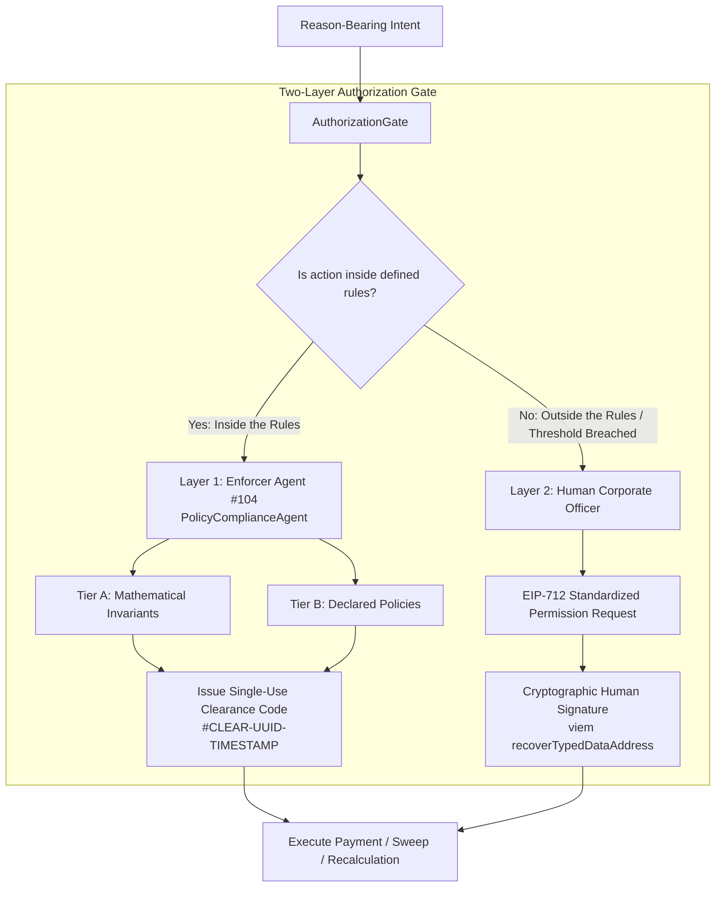
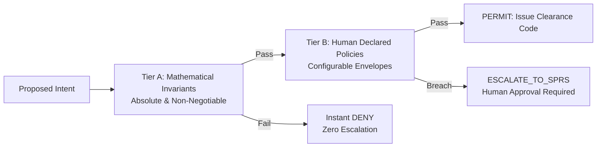
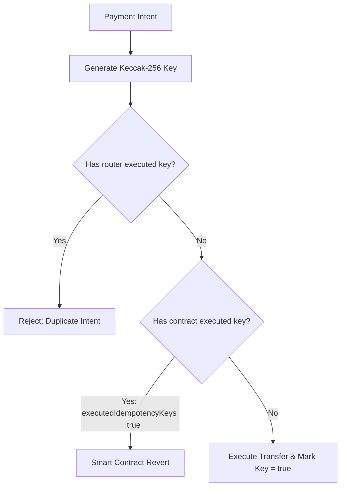

# BizArc Security, Governance & Compliance Architecture

## 1. Executive Summary

Autonomous AI agents executing financial transactions introduce novel enterprise attack vectors: hallucinated rounding, unauthorized address substitution, recursive loop depletion, and unconstrained spending.

BizArc neutralizes these risks by enforcing the **Canteen Agents & Ledgers (2026)** governance model through the [AuthorizationGate](file://wsl.localhost/Ubuntu-24.04/home/gifted/BizArc/src/security/authorizationGate.ts), deterministic mathematical rules, cryptographic EIP-712 human sign-offs, and immutable onchain smart contract clearinghouses.



---

## 2. Two-Layer Authorization Architecture

BizArc divides financial authority into two strict cryptographic layers:

### 2.1 Layer 1: The Enforcer Agent (PolicyComplianceAgent #104)
- **Role**: Autonomous gatekeeper for operations that remain strictly **"Inside the Rules"**.
- **Clearance Code Generation**: When an intent passes all checks, the Enforcer Agent issues a single-use, time-bound clearance code stored in [compliance_clearance_codes](file://wsl.localhost/Ubuntu-24.04/home/gifted/BizArc/src/database/repos/clearanceCodeRepo.ts):
  ```typescript
  export interface ClearanceCodeRecord {
    code: string;              // Format: #CLEAR-<timestamp>-<hash>
    account_id: string;        // Bound to source account
    action_type: string;       // Bound to specific action
    amount_usdc: number;       // Bound to exact amount
    issued_at: Date;
    expires_at: Date;          // Strict TTL (default: 5 minutes)
    is_consumed: boolean;      // Burned upon execution
  }
  ```
- **One-Time Consumption**: Once used by [UniversalPaymentRouter](file://wsl.localhost/Ubuntu-24.04/home/gifted/BizArc/src/payments/universalPaymentRouter.ts), the clearance code is marked `is_consumed: true`. Replay attempts fail immediately.

### 2.2 Layer 2: Human Corporate Officers (EIP-712 SPRS)
- **Role**: Cryptographic sign-off for actions that are **"Outside the Rules"**:
  - Exceeding autonomous single-transaction, daily, or weekly spending caps.
  - Modifying recurring liabilities or payment frequencies.
  - Creating or altering Vendor Master allowlists.
  - Cross-account liquidity transfers between cost centers.
- **Protocol**: Standardized Permission Requests (SPRS) compliant with EIP-712 Typed Data:
  ```solidity
  struct DisbursalApproval {
      bytes32 permissionRequestId;
      address vendor;
      uint256 amount;
      bytes32 idempotencyKey;
      uint256 nonce;
      uint256 deadline;
  }
  ```
- **Cryptographic Recovery**: The [AuthorizationGate](file://wsl.localhost/Ubuntu-24.04/home/gifted/BizArc/src/security/authorizationGate.ts) recovers the signer using Viem `recoverTypedDataAddress` and cross-references the recovered public key against the corporate approver registry (`getAuthorizedAdminAddresses()`). Unauthorized signatures are rejected.

---

## 3. Two-Tier Invariant Hierarchy

The Enforcer Agent evaluates intents against two distinct tiers of constraints:



### 3.1 Tier A: Mathematical Invariants (Hard Invariants)
Tier A rules represent absolute boundaries. If violated, the action is **DENIED immediately** without possibility of escalation:
1. **Loud Rounding Rejection (Rule 5)**: Amounts must have $\le 6$ decimal places. Negative or zero values are rejected.
2. **Payroll Wall Protection**: Accounts tagged with role `PAYROLL` can never be drawn for non-payroll vendor disbursements or cross-account loans.
3. **Solvency Reserve Floors**: Operating accounts must preserve their minimum cash floor ($B_L \ge \text{Min Operating Floor}$). Sweeps that would deplete the floor are blocked.
4. **Verified Counterparty Lock (Rule 3)**: Counterparty address or bank ID must exist in the Verified Master Registry.
5. **Unbroken Ledger Hash Integrity (Rule 6)**: The sequential SHA-256 hash chain in [master_system_journal](file://wsl.localhost/Ubuntu-24.04/home/gifted/BizArc/src/database/repos/masterJournalRepo.ts) must be 100% valid.

### 3.2 Tier B: Human Declared Policies (Configurable Constraints)
Tier B rules reflect commercial policies defined in tenant profiles:
1. **Spending Cap Headrooms**: Single-transaction limits (e.g., $\$500.00$), daily cumulative caps, and weekly caps.
2. **Cost-Center Segregation**: Marketing operating accounts cannot disburse infrastructure or engineering SaaS invoices.
3. **Price Creep Tolerance**: Recurring subscription renewals with price increases $\le 15\%$ are permitted; increases $>15\%$ trigger SPRS escalation.
4. **Multi-Account Waterfall Borrowing Ratio**: Restricts secondary account draws to a maximum percentage of target balance (default: $50\%$).

---

## 4. Payee Substitution Defense (Golden Rule 3)

### The Vulnerability
In autonomous agent systems, a compromised or hallucinated agent could parse an invoice PDF, extract an attacker's cryptocurrency address printed on the invoice header, and disburse funds to the attacker.

### BizArc Defense Mechanism
1. **Immutable Master Allowlist**: Counterparties must be pre-registered in [vendor_master_registry](file://wsl.localhost/Ubuntu-24.04/home/gifted/BizArc/src/database/repos/vendorMasterRepo.ts) with `change_lock: true`.
2. **Zero Trust in Invoice Headers**: The [LiabilityRadarLlmAgent](file://wsl.localhost/Ubuntu-24.04/home/gifted/BizArc/src/agents/liabilityRadarLlmAgent.ts) extracts claimed invoice details, but the settlement address is resolved exclusively from the verified master record:
   ```typescript
   if (vendorRecord.verified_payout_address.toLowerCase() !== input.claimedPayoutAddress.toLowerCase()) {
     initialStatus = "FROZEN";
     securityAlert = `PAYEE_SUBSTITUTION_ALERT: Claimed payout address does NOT match verified address.`;
   }
   ```
3. **Dual Fiat Verification**: Fiat vendor bank accounts (IBANs, routing numbers, card tokens) must match pre-verified records in [VendorBankRepo](file://wsl.localhost/Ubuntu-24.04/home/gifted/BizArc/src/database/repos/vendorBankRepo.ts).
4. **Onchain Contract Whitelist**: In [DisbursalVault.sol](file://wsl.localhost/Ubuntu-24.04/home/gifted/BizArc/contracts/DisbursalVault.sol), disbursements check `require(approvedVendors[vendor], "Vendor not approved")`. Even if off-chain code were manipulated, unapproved addresses cannot receive funds onchain.

---

## 5. Loud Rounding Rejection (Golden Rule 5)

Traditional accounting engines often apply silent floating-point rounding (e.g., `Math.round(val * 100) / 100`). In autonomous multi-agent systems, silent rounding causes fractional cent drift that accumulates into major balance discrepancies.

BizArc enforces **Loud Arithmetic**:
- All financial balances are modeled using exact 6-decimal integer strings (`BigInt` raw units onchain).
- Fractions exceeding 6 decimal places throw a [LoudRoundingError](file://wsl.localhost/Ubuntu-24.04/home/gifted/BizArc/src/foundation/index.ts).
- Silent rounding is strictly prohibited across all services.

---

## 6. Cryptographic Idempotency Engine (Golden Rule 4)

To prevent double-spending caused by agent retry loops, network timeouts, or temporal scheduler overlap:

$$\text{Idempotency Key} = \text{keccak256}(\text{vendorAddress} \parallel \text{invoiceDocumentHash} \parallel \text{amountRaw})$$



- **Router Gate**: [UniversalPaymentRouter](file://wsl.localhost/Ubuntu-24.04/home/gifted/BizArc/src/payments/universalPaymentRouter.ts) rejects duplicate executions before broadcasting to the network.
- **Smart Contract Gate**: [DisbursalVault.sol](file://wsl.localhost/Ubuntu-24.04/home/gifted/BizArc/contracts/DisbursalVault.sol) maintains `mapping(bytes32 => bool) public executedIdempotencyKeys`. Any re-execution of an existing key reverts onchain.

---

## 7. Emergency Circuit Breakers & The 8 Production Pillars

The [ProductionReadinessService](file://wsl.localhost/Ubuntu-24.04/home/gifted/BizArc/src/services/productionReadinessService.ts) audits the health of the platform across **8 Core Pillars**:

| Pillar | Verification Mandate | Threshold |
| :--- | :--- | :--- |
| **1. DisbursalVault Whitelist** | All registered vendors are whitelisted onchain in [DisbursalVault.sol](file://wsl.localhost/Ubuntu-24.04/home/gifted/BizArc/contracts/DisbursalVault.sol). | 100% whitelisted |
| **2. Active Company Profile** | Organization profile is verified with active cost centers and tenant policies. | `ACTIVE` status |
| **3. Latency Tiers** | Arc L1 RPC nodes and database queries respond within acceptable bounds. | $<2,000$ ms |
| **4. Spending Caps** | Operating accounts have defined per-tx, daily, and weekly spending caps. | All caps defined |
| **5. Address Checksums** | All configured wallet addresses conform to EIP-55 checksum standards. | 100% valid checksums |
| **6. Vendor Master Immutability** | All suppliers in [VendorMasterRepo](file://wsl.localhost/Ubuntu-24.04/home/gifted/BizArc/src/database/repos/vendorMasterRepo.ts) have `change_lock: true`. | 100% change locked |
| **7. Solvency Invariant** | Effective balance matches sum of liquid cash and invested yield ($B_E = B_L + B_Y$). | Zero variance |
| **8. Circuit Breakers** | Emergency stop mechanisms are armed and responsive. | Armed & active |

### Emergency Circuit Breaker Trigger
The tool `trigger_emergency_circuit_breaker` allows any cognitive agent or human administrator to immediately freeze all automated sweeping, scheduled disbursals, and session keys if an invariant violation or unusual anomaly is detected.

---

## 8. Verification and Reference Files

- Authorization Gate: [authorizationGate.ts](file://wsl.localhost/Ubuntu-24.04/home/gifted/BizArc/src/security/authorizationGate.ts)
- Enforcer Compliance Agent: [policyComplianceLlmAgent.ts](file://wsl.localhost/Ubuntu-24.04/home/gifted/BizArc/src/agents/policyComplianceLlmAgent.ts)
- Clearance Codes Repository: [clearanceCodeRepo.ts](file://wsl.localhost/Ubuntu-24.04/home/gifted/BizArc/src/database/repos/clearanceCodeRepo.ts)
- Permission Requests Repository: [permissionRequestRepo.ts](file://wsl.localhost/Ubuntu-24.04/home/gifted/BizArc/src/database/repos/permissionRequestRepo.ts)
- Production Readiness Service: [productionReadinessService.ts](file://wsl.localhost/Ubuntu-24.04/home/gifted/BizArc/src/services/productionReadinessService.ts)
- Disbursal Vault Contract: [DisbursalVault.sol](file://wsl.localhost/Ubuntu-24.04/home/gifted/BizArc/contracts/DisbursalVault.sol)
