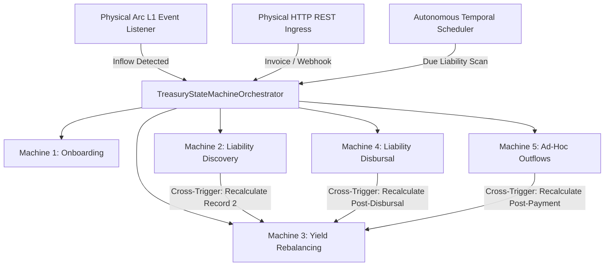
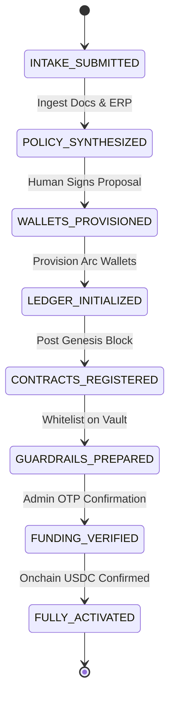
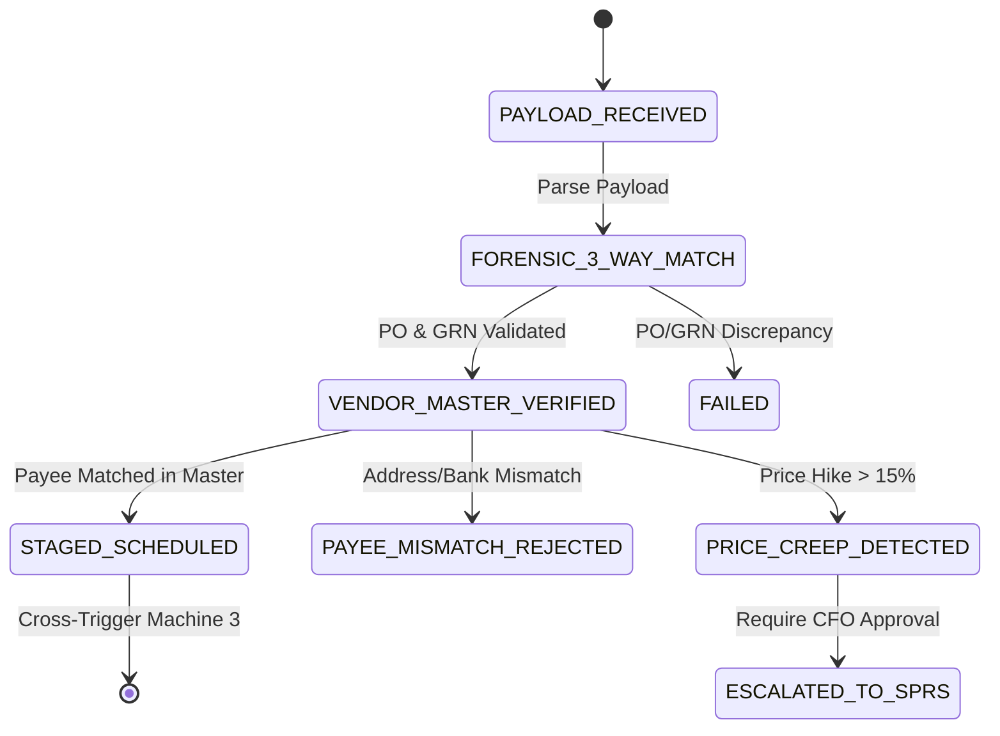
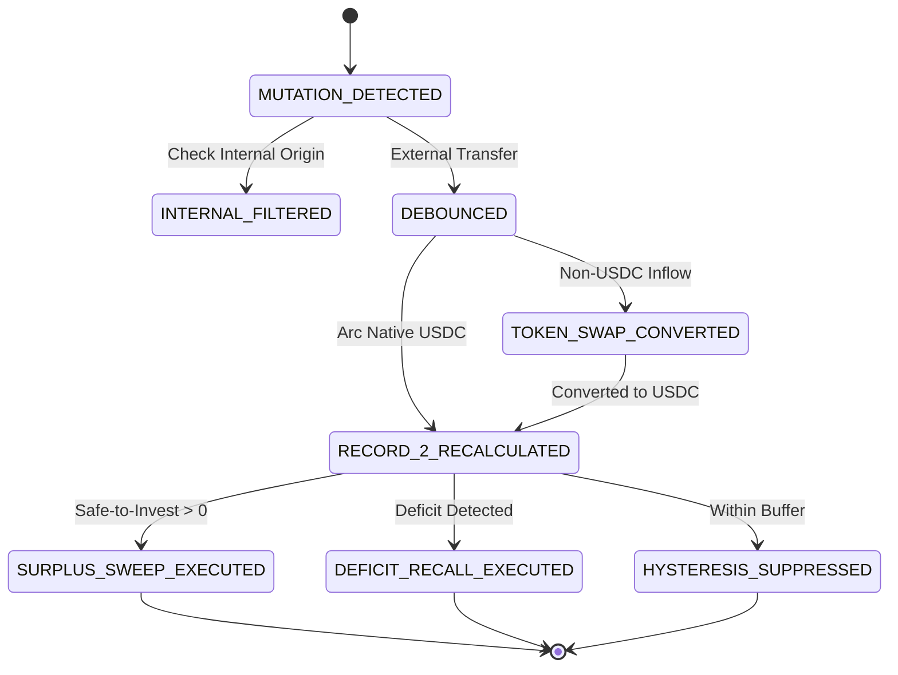
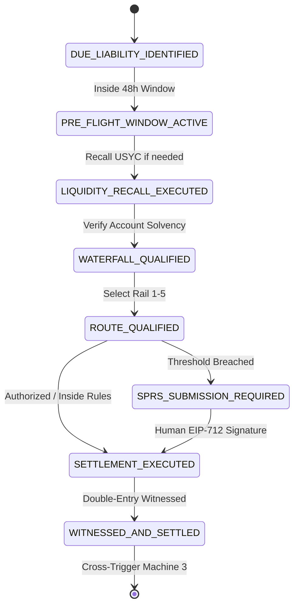
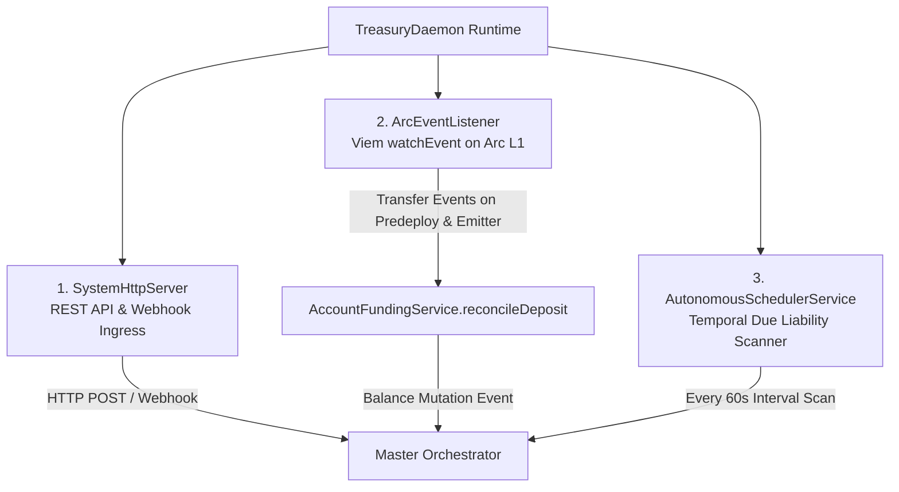

# BizArc Reactive State Machines & Orchestration Architecture

## 1. Executive Summary

At the core of BizArc is an unbroken operational fabric comprising **5 Reactive State Machines** coordinated by the [TreasuryStateMachineOrchestrator](file://wsl.localhost/Ubuntu-24.04/home/gifted/BizArc/src/orchestration/treasuryStateMachineOrchestrator.ts) and executed by the [TreasuryDaemon](file://wsl.localhost/Ubuntu-24.04/home/gifted/BizArc/src/daemon/treasuryDaemon.ts).

Unlike traditional systems where scheduled scripts run in isolated silos, BizArc connects all financial actions into a reactive chain:
- Staging a new liability in Machine 2 automatically triggers Machine 3 to recalculate Safe-to-Invest.
- Settling a scheduled disbursement in Machine 4 automatically prompts Machine 3 to evaluate remaining liquidity and sweep excess funds.
- An incoming onchain Arc L1 USDC transfer event instantly reconciles ledger vouchers and prompts dynamic yield sweeps.



---

## 2. Directory of the 5 Reactive State Machines

| Machine | Class Name | Primary Inbound Trigger | Actor Agent | Focus Area |
| :--- | :--- | :--- | :--- | :--- |
| **Machine 1** | [OnboardingStateMachine](file://wsl.localhost/Ubuntu-24.04/home/gifted/BizArc/src/orchestration/stateMachines/OnboardingStateMachine.ts) | Enterprise Intake Payload | OnboardingAgent (#100) | 7-Phase Enterprise Bootstrap, ERP Discovery, Ground-Truth Genesis |
| **Machine 2** | [LiabilityDiscoveryStateMachine](file://wsl.localhost/Ubuntu-24.04/home/gifted/BizArc/src/orchestration/stateMachines/LiabilityDiscoveryStateMachine.ts) | Inbound Invoices, Connected Apps | LiabilityRadarAgent (#102) | 3-Way Matching, Payee Substitution Defense, Dynamic Record 1 |
| **Machine 3** | [YieldRebalancingStateMachine](file://wsl.localhost/Ubuntu-24.04/home/gifted/BizArc/src/orchestration/stateMachines/YieldRebalancingStateMachine.ts) | Arc L1 Events, Internal Mutations | TreasurySentinelAgent (#101) | Tripartite Balance Invariant, Safe-to-Invest, USYC Sweeps & Recalls |
| **Machine 4** | [LiabilityDisbursalStateMachine](file://wsl.localhost/Ubuntu-24.04/home/gifted/BizArc/src/orchestration/stateMachines/LiabilityDisbursalStateMachine.ts) | Temporal Scheduler (48h Pre-Flight) | DisbursalRouterAgent (#103) | Multi-Account Waterfall, DisbursalVault, Fiat Settlement |
| **Machine 5** | [AdHocPaymentStateMachine](file://wsl.localhost/Ubuntu-24.04/home/gifted/BizArc/src/orchestration/stateMachines/AdHocPaymentStateMachine.ts) | Operator / Discretionary Requests | PolicyComplianceAgent (#104) | Non-Liability Outflows, Two-Layer Authorization, SPRS Escapes |

---

## 3. Deep-Dive: State Machine Specifications

### 3.1 Machine 1: Enterprise Onboarding State Machine
- **Implementation**: [OnboardingStateMachine.ts](file://wsl.localhost/Ubuntu-24.04/home/gifted/BizArc/src/orchestration/stateMachines/OnboardingStateMachine.ts)
- **Lifecycle States**:
  1. `INTAKE_SUBMITTED`: Entity metadata, Bylaws, MSAs, and ERP credentials ingested.
  2. `POLICY_SYNTHESIZED`: Cognitive proposal synthesized based on corporate obligations.
  3. `WALLETS_PROVISIONED`: Arc L1 operating accounts initialized in [treasury_accounts](file://wsl.localhost/Ubuntu-24.04/home/gifted/BizArc/src/database/repos/treasuryAccountsRepo.ts).
  4. `LEDGER_INITIALIZED`: Genesis block created in [master_system_journal](file://wsl.localhost/Ubuntu-24.04/home/gifted/BizArc/src/database/repos/masterJournalRepo.ts).
  5. `CONTRACTS_REGISTERED`: Operating accounts registered in [CentralTreasuryYieldVault](file://wsl.localhost/Ubuntu-24.04/home/gifted/BizArc/contracts/CentralTreasuryYieldVault.sol).
  6. `GUARDRAILS_PREPARED`: Monotonic Circle CLI spending cap commands generated for terminal OTP handoff.
  7. `FUNDING_VERIFIED`: Initial USDC deposit verified on Arc L1.
  8. `FULLY_ACTIVATED`: Company profile set to `ACTIVE`.



---

### 3.2 Machine 2: Liability Discovery State Machine
- **Implementation**: [LiabilityDiscoveryStateMachine.ts](file://wsl.localhost/Ubuntu-24.04/home/gifted/BizArc/src/orchestration/stateMachines/LiabilityDiscoveryStateMachine.ts)
- **Lifecycle States**:
  1. `PAYLOAD_RECEIVED`: Raw invoice payload parsed from webhook or document scanner.
  2. `FORENSIC_3_WAY_MATCH`: Evaluates PO terms, Goods Receipt Notes, and invoice amounts. Discrepancies fail immediately.
  3. `VENDOR_MASTER_VERIFIED`: Payee check:
     - For fiat invoices: cross-references bank details against [VendorBankRepo](file://wsl.localhost/Ubuntu-24.04/home/gifted/BizArc/src/database/repos/vendorBankRepo.ts).
     - For crypto invoices: verifies `payoutAddress` against [VendorMasterRepo](file://wsl.localhost/Ubuntu-24.04/home/gifted/BizArc/src/database/repos/vendorMasterRepo.ts).
  4. `PRICE_CREEP_DETECTED`: Stealth price hikes (>15% above 3-month trailing average) escalated to human review.
  5. `PAYEE_MISMATCH_REJECTED`: Unverified counterparty transitions to `FROZEN`.
  6. `STAGED_SCHEDULED`: Obligation committed to Dynamic Record 1 ([account_liabilities](file://wsl.localhost/Ubuntu-24.04/home/gifted/BizArc/src/database/repos/liabilityRepo.ts)).
  7. **Cross-Trigger to Machine 3**: Dispatches notification to recalculate Dynamic Record 2.



---

### 3.3 Machine 3: Automated Yield Rebalancing State Machine
- **Implementation**: [YieldRebalancingStateMachine.ts](file://wsl.localhost/Ubuntu-24.04/home/gifted/BizArc/src/orchestration/stateMachines/YieldRebalancingStateMachine.ts)
- **Lifecycle States**:
  1. `MUTATION_DETECTED`: Triggered by Arc L1 transfer log or internal ledger mutation.
  2. `INTERNAL_FILTERED`: Filtered if transfer is an internal settlement between internal accounts, preventing rebalancing feedback loops.
  3. `DEBOUNCED`: 5-second sliding window via [DebounceEngine](file://wsl.localhost/Ubuntu-24.04/home/gifted/BizArc/src/foundation/events/debounceEngine.ts) to batch high-frequency micro-inflows.
  4. `TOKEN_SWAP_CONVERTED`: Non-USDC tokens auto-swapped to native Arc USDC via [TokenSwapService](file://wsl.localhost/Ubuntu-24.04/home/gifted/BizArc/src/services/tokenSwapService.ts).
  5. `RECORD_2_RECALCULATED`: Safe-to-Invest recalculated for the cost center.
  6. `SURPLUS_SWEEP_EXECUTED`: If $\text{Safe-to-Invest} > 0$, excess liquid funds swept to USYC on Arc L1.
  7. `DEFICIT_RECALL_EXECUTED`: If upcoming liabilities require cash, invested shares recalled to operating wallet.
  8. `HYSTERESIS_SUPPRESSED`: Surplus within hysteresis band left in operating pool to avoid unnecessary gas spend.



---

### 3.4 Machine 4: Liability Disbursal State Machine
- **Implementation**: [LiabilityDisbursalStateMachine.ts](file://wsl.localhost/Ubuntu-24.04/home/gifted/BizArc/src/orchestration/stateMachines/LiabilityDisbursalStateMachine.ts)
- **Lifecycle States**:
  1. `DUE_LIABILITY_IDENTIFIED`: Scanned by [AutonomousSchedulerService](file://wsl.localhost/Ubuntu-24.04/home/gifted/BizArc/src/services/autonomousSchedulerService.ts).
  2. `PRE_FLIGHT_WINDOW_ACTIVE`: Entered 48 hours prior to `due_date`.
  3. `LIQUIDITY_RECALL_EXECUTED`: If cash is invested in USYC, pulls liquid funds back into operating account.
  4. `WATERFALL_QUALIFIED`: Multi-account funding computed; strictly excludes `PAYROLL` role.
  5. `ROUTE_QUALIFIED`: Selects optimal rail (Rails 1–5).
  6. `SPRS_SUBMISSION_REQUIRED`: If payment exceeds spending limits, generates EIP-712 human sign-off request.
  7. `SETTLEMENT_EXECUTED`: Disbursal executed through chosen rail.
  8. `WITNESSED_AND_SETTLED`: Document-linked general ledger entry posted to [MasterJournalRepo](file://wsl.localhost/Ubuntu-24.04/home/gifted/BizArc/src/database/repos/masterJournalRepo.ts).
  9. **Cross-Trigger to Machine 3**: Prompts post-settlement yield rebalancing.



---

### 3.5 Machine 5: Ad-Hoc Discretionary Payment State Machine
- **Implementation**: [AdHocPaymentStateMachine.ts](file://wsl.localhost/Ubuntu-24.04/home/gifted/BizArc/src/orchestration/stateMachines/AdHocPaymentStateMachine.ts)
- **Lifecycle States**:
  1. `REQUEST_RECEIVED`: Non-liability payment request received from API or operator.
  2. `ACCOUNT_QUALIFIED`: Verifies source account has sufficient available balance.
  3. `PREDICTIVE_RECALL_EXECUTED`: Pulls required cash from USYC if invested.
  4. `CLEARANCE_GRANTED` or `SPRS_APPROVAL_REQUIRED`: Evaluated by [PolicyComplianceLlmAgent](file://wsl.localhost/Ubuntu-24.04/home/gifted/BizArc/src/agents/policyComplianceLlmAgent.ts).
  5. `FIAT_OR_CRYPTO_EXECUTED`: Broadcasts payment to target rail.
  6. `WITNESSED_AND_COMPLETED`: Appends voucher to Master System Journal.
  7. **Cross-Trigger to Machine 3**: Prompts post-payment yield rebalancing.

---

## 4. Master Orchestrator & Cross-Machine Wiring

The [TreasuryStateMachineOrchestrator](file://wsl.localhost/Ubuntu-24.04/home/gifted/BizArc/src/orchestration/treasuryStateMachineOrchestrator.ts) unifies the 5 state machines into an unbroken closed loop:

```typescript
export class TreasuryStateMachineOrchestrator {
  public readonly onboardingMachine: OnboardingStateMachine;
  public readonly discoveryMachine: LiabilityDiscoveryStateMachine;
  public readonly yieldMachine: YieldRebalancingStateMachine;
  public readonly disbursalMachine: LiabilityDisbursalStateMachine;
  public readonly adHocMachine: AdHocPaymentStateMachine;

  constructor() {
    this.yieldMachine = new YieldRebalancingStateMachine(undefined, this.dynamicRecords);

    // Cross-wire Machine 2 -> Machine 3: Recalculate Safe-to-Invest when new liability staged
    this.discoveryMachine = new LiabilityDiscoveryStateMachine(undefined, async (accountId: string) => {
      await this.yieldMachine.recalculateForAccount(accountId);
    });

    // Cross-wire Machine 4 -> Machine 3: Recalculate Safe-to-Invest after payment disbursal
    this.disbursalMachine = new LiabilityDisbursalStateMachine({
      dynamicRecords: this.dynamicRecords,
      onDisbursalSettled: async (accountId: string) => {
        await this.yieldMachine.recalculateForAccount(accountId);
      },
    });

    // Cross-wire Machine 5 -> Machine 3: Recalculate Safe-to-Invest after ad-hoc payment
    this.adHocMachine = new AdHocPaymentStateMachine({
      dynamicRecords: this.dynamicRecords,
      onPaymentSettled: async (accountId: string) => {
        await this.yieldMachine.recalculateForAccount(accountId);
      },
    });
  }
}
```

---

## 5. Autonomous Daemon Runtime & Physical Triggers

Managed by [TreasuryDaemon](file://wsl.localhost/Ubuntu-24.04/home/gifted/BizArc/src/daemon/treasuryDaemon.ts), the system runs three continuous background processes:



1. **SystemHttpServer**: Listens for external events, webhooks (Circle Mint, ERP), and manual requests.
2. **ArcEventListener**: Listens for onchain USDC transfers. Inbound transfers automatically trigger `AccountFundingService.reconcileDeposit()`, writing journal entries and updating dynamic records before passing balance mutation events to the orchestrator.
3. **AutonomousSchedulerService**: Runs an autonomous tick (default: every 60 seconds) querying [LiabilityRepo](file://wsl.localhost/Ubuntu-24.04/home/gifted/BizArc/src/database/repos/liabilityRepo.ts) for scheduled liabilities approaching their execution threshold, initiating predictive recalls and disbursals.

---

## 6. Verification and Reference Files

- Master Orchestrator: [treasuryStateMachineOrchestrator.ts](file://wsl.localhost/Ubuntu-24.04/home/gifted/BizArc/src/orchestration/treasuryStateMachineOrchestrator.ts)
- Runtime Daemon: [treasuryDaemon.ts](file://wsl.localhost/Ubuntu-24.04/home/gifted/BizArc/src/daemon/treasuryDaemon.ts)
- State Machine Directory: [src/orchestration/stateMachines/](file://wsl.localhost/Ubuntu-24.04/home/gifted/BizArc/src/orchestration/stateMachines)
- Scheduler Service: [autonomousSchedulerService.ts](file://wsl.localhost/Ubuntu-24.04/home/gifted/BizArc/src/services/autonomousSchedulerService.ts)
- Event Listener: [arcEventListener.ts](file://wsl.localhost/Ubuntu-24.04/home/gifted/BizArc/src/foundation/events/arcEventListener.ts)
